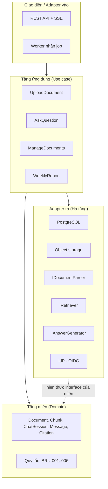
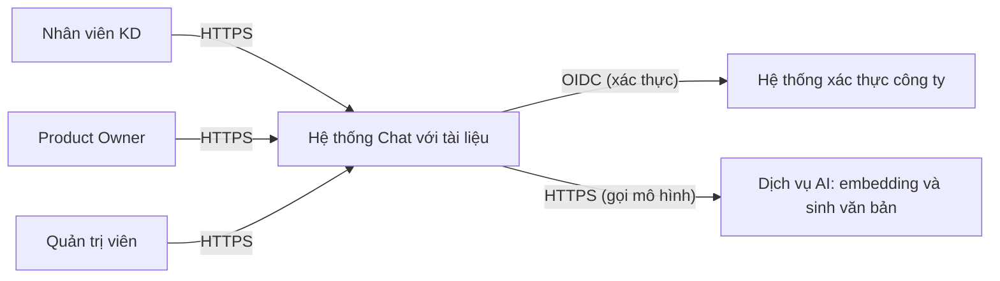
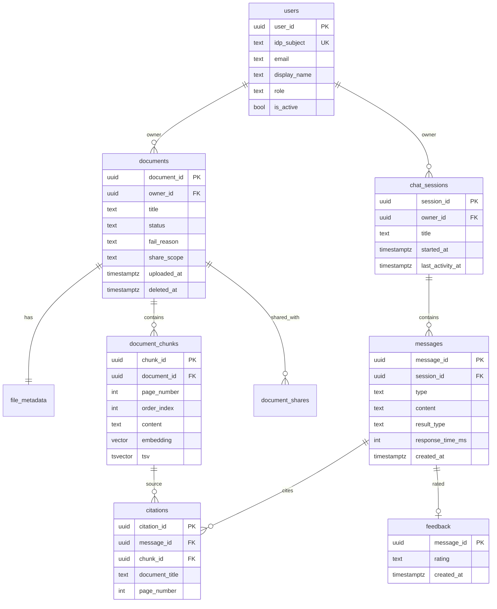
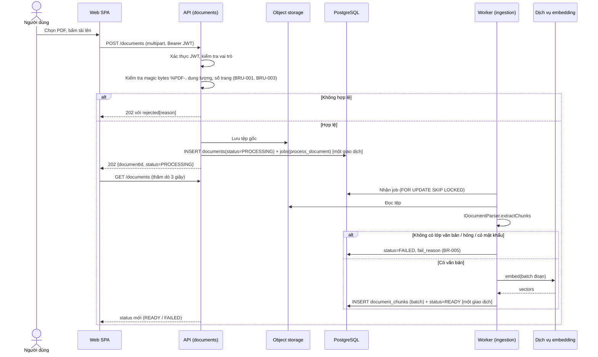
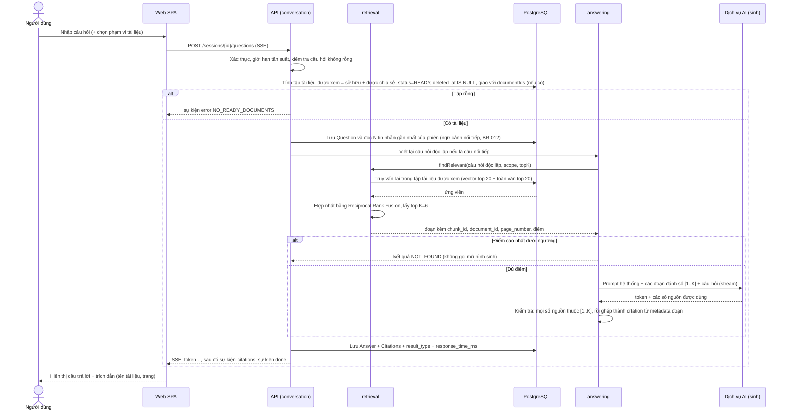
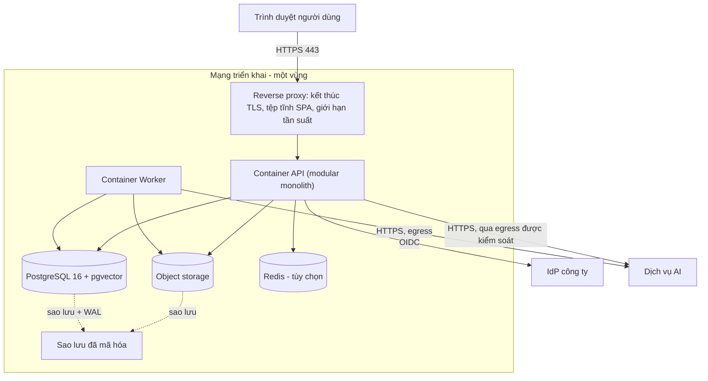

# Tài liệu Kiến trúc Phần mềm (SAD) — Công cụ "Chat với tài liệu" (MVP)

> **Chuẩn áp dụng:** IEEE 1016-2009 (Software Design Descriptions) · **Mã tài liệu:** SAD-DOCCHAT-001 · **Phiên bản:** 0.1 · **Trạng thái:** `Draft` · **Ngày:** 2026-10-26
> **Đầu vào:** [BRD.md](../requirements/BRD.md) · [PRD.md](../requirements/PRD.md) · [UserStories.md](../requirements/UserStories.md) · [UseCase_ChatVoiTaiLieu.drawio](UseCase_ChatVoiTaiLieu.drawio) · [classDiagram.drawio](classDiagram.drawio)
> **Quy ước:** `[Đề xuất]` = lựa chọn thiết kế của kiến trúc sư, chưa được sponsor/đội phát triển xác nhận · `[TBD: OQ-xxx]` = chờ câu hỏi mở · `ARC-xxx` = quyết định kiến trúc (mục 10).

---

## 0. Tóm tắt ràng buộc kỹ thuật (Technical constraints summary)

### 0.1 Nền tảng hệ thống (SYSTEM FOUNDATION)

| Hạng mục | Nội dung | Nguồn |
|---|---|---|
| Tên hệ thống | Công cụ "Chat với tài liệu" (MVP) | BRD §1 |
| Chức năng nghiệp vụ cốt lõi | Người dùng tải PDF lên, hỏi AI bằng ngôn ngữ tự nhiên, nhận câu trả lời tổng hợp từ các tài liệu kèm trích dẫn (tên tài liệu + trang) | BR-001, BR-006..BR-015 |
| Quy mô / tải mục tiêu | **Chưa được cung cấp.** Giả định để định cỡ: pilot ≤ 50 người dùng, ≤ 5 truy vấn đồng thời, ≤ 500 tài liệu, ≤ 100 MB / tệp `[Đề xuất — chờ OQ-004, OQ-012]` | ASM-004 |
| Tech stack ưa dùng | **Chưa được cung cấp.** Mục 2 đề xuất một stack, ghi lý do và phương án thay thế | — |
| Ràng buộc quan trọng | Ứng dụng web (CON-001); câu trả lời do AI tạo (CON-002); mức MVP (CON-003); chỉ PDF (CON-004); chính sách dữ liệu / NDA (CON-006) | BRD §9 |

### 0.2 Ràng buộc có tác động kiến trúc lớn nhất

| # | Ràng buộc | Hệ quả thiết kế |
|---|---|---|
| 1 | **Chưa biết có được gửi nội dung tài liệu tới dịch vụ AI bên ngoài hay không** (OQ-008, ASM-003) | Kiến trúc đặt dịch vụ AI sau giao diện thay thế được (ARC-004) để chuyển giữa dịch vụ đám mây và mô hình tự lưu trữ mà không đổi phần còn lại |
| 2 | Câu trả lời chỉ dựa trên tài liệu, có trích dẫn đúng nguồn (BRU-002, BR-007, BR-014) | Kiến trúc truy xuất-rồi-sinh (RAG); trích dẫn lấy từ metadata của đoạn đã truy xuất, **không** lấy từ văn bản mô hình tự viết |
| 3 | Mỗi người chỉ thấy tài liệu thuộc phạm vi chia sẻ của mình (BR-021, NFR-004) | Lọc quyền ngay trong truy vấn tìm kiếm, không lọc sau |
| 4 | Tài liệu đã xóa không được dùng nữa (BR-018) | Xóa mềm tức thời + dọn dẹp vật lý bất đồng bộ; bộ lọc truy xuất loại trừ tài liệu đã xóa |
| 5 | Ngưỡng thời gian chưa có (NFR-001, NFR-002: OQ-005, OQ-006) | Mục 5.1 đưa ra ngân sách độ trễ **đề xuất**, hiệu chỉnh khi OQ chốt |
| 6 | Tiếng Việt là ngôn ngữ chính (BR-010) | Mô hình embedding và mô hình sinh phải hỗ trợ tiếng Việt; chọn bằng đánh giá trên bộ câu hỏi MET-002 |
| 7 | MVP, phạm vi pilot nhỏ (CON-003, ASM-004) | Ưu tiên kiến trúc đơn giản, ít thành phần để vận hành |

### 0.3 Ánh xạ góc nhìn IEEE 1016

| Góc nhìn (viewpoint) | Mục trong SAD |
|---|---|
| Context (ngữ cảnh) | 2.0 |
| Composition (thành phần) | 2.1–2.4 |
| Logical (cấu trúc lớp) | [classDiagram.drawio](classDiagram.drawio), 2.2 |
| Information (thông tin) | 3.1 |
| Interface (giao diện) | 2.4 |
| Interaction (tương tác) | 3.2 |
| Deployment (triển khai) | 4.4 |
| Concerns xuyên suốt | 4.1–4.3 |

---

## 1. Mục tiêu kiến trúc và nguyên tắc thiết kế

### 1.1 Ba yếu tố kiến trúc chính (Key drivers)

| Hạng | Yếu tố | Vì sao | Cách thiết kế ưu tiên yếu tố này |
|---|---|---|---|
| 1 | **Độ tin cậy của nội dung (Trustworthiness)** | Mục tiêu BO-002; rủi ro RSK-001 (AI trả lời sai) là rủi ro cao nhất; yêu cầu BR-007, BR-009, BR-014 | Trích dẫn sinh từ metadata đoạn truy xuất; kiểm tra sau sinh (post-generation verification); trả "không tìm thấy" khi ngưỡng truy xuất không đạt; đánh giá chất lượng tự động bằng bộ câu hỏi chuẩn |
| 2 | **Bảo mật và cô lập dữ liệu (Security & isolation)** | RSK-002; BR-020, BR-021; tài liệu kinh doanh mật | Lọc quyền trong truy vấn; xác thực qua nhà cung cấp danh tính của công ty; mã hóa khi lưu và khi truyền; không ghi nội dung tài liệu vào log; giao diện thay thế dịch vụ AI (ARC-004) |
| 3 | **Khả năng vận hành và thay đổi (Simplicity & changeability)** | MVP, đội nhỏ, nhiều câu hỏi mở còn chưa chốt (OQ-004..008) | Mô-đun nguyên khối (modular monolith) + một tiến trình worker; dùng PostgreSQL làm kho dữ liệu chung; các điểm bất định (dịch vụ AI, trình đọc PDF, bộ truy xuất) nằm sau interface |

Các yếu tố **không** được ưu tiên ở MVP: khả năng co giãn lớn, đa vùng (multi-region), chịu lỗi cao (xem 4.2) — ghi nhận là đánh đổi có chủ ý, cần xem lại sau pilot.

### 1.2 Mẫu kiến trúc vĩ mô

**Chọn: Mô-đun nguyên khối (Modular Monolith) theo Clean Architecture, kèm worker bất đồng bộ cho xử lý tài liệu và quy trình RAG cho hỏi đáp.**

| Tiêu chí | Mô-đun nguyên khối (chọn) | Microservices | Serverless |
|---|---|---|---|
| Quy mô pilot (≤ 50 người dùng) | Phù hợp | Quá mức cần thiết | Phù hợp |
| Chi phí vận hành | Thấp: 1 ứng dụng + 1 worker + 1 CSDL | Cao: nhiều dịch vụ, mạng nội bộ, quan sát phân tán | Trung bình; khó kiểm soát thời gian xử lý PDF dài |
| Giao dịch giữa tài liệu, đoạn, quyền | Đơn giản: cùng một CSDL | Phức tạp: nhất quán phân tán | Trung bình |
| Thay đổi theo kết quả câu hỏi mở | Dễ: ranh giới mô-đun rõ, ít phụ thuộc triển khai | Chi phí phối hợp lớn | Phụ thuộc nhà cung cấp |
| Đường nâng cấp | Tách mô-đun `ingestion` thành dịch vụ riêng khi cần | — | — |

**Lý do:** đây là MVP, đội nhỏ, quy mô pilot nhỏ, yêu cầu còn nhiều TBD. Chi phí và rủi ro của microservices không có đối ứng lợi ích ở quy mô này. Ranh giới mô-đun được giữ chặt (mỗi mô-đun chỉ gọi nhau qua interface công khai) để việc tách dịch vụ sau này không phải viết lại. Xem ARC-001, ARC-002.

**Phân tầng (Clean Architecture):**

Quy tắc phụ thuộc: tầng trong không biết tầng ngoài. Các interface `IDocumentParser`, `IRetriever`, `IAnswerGenerator` đã định nghĩa trong class diagram nằm ở tầng ứng dụng/miền; bản hiện thực nằm ở hạ tầng.

---

## 2. Phân rã thành phần hệ thống

### 2.0 Ngữ cảnh hệ thống (System context)

Hai tác nhân phụ trùng với use case diagram: hệ thống xác thực (UC-01) và dịch vụ AI (UC-09, UC-10).

### 2.1 Tầng giao diện / Client

| Thuộc tính | Thiết kế `[Đề xuất]` | Lý do |
|---|---|---|
| Mô hình | Ứng dụng một trang (SPA) bằng TypeScript + React | Giao diện hội thoại cần cập nhật liên tục và hiển thị luồng câu trả lời |
| Phân phối | Tệp tĩnh đã build, phục vụ qua reverse proxy (có thể đặt sau CDN nếu dùng đám mây) | Đơn giản; không cần SSR vì không cần SEO, người dùng nội bộ |
| Quản lý trạng thái | Trạng thái máy chủ (danh sách tài liệu, phiên, tin nhắn): thư viện cache truy vấn (React Query); trạng thái giao diện (ô nhập, phạm vi chọn): React state cục bộ | Tránh nhân đôi trạng thái; trạng thái tài liệu cần thăm dò định kỳ |
| Giao thức với API | REST + JSON qua HTTPS; **Server-Sent Events (SSE)** để nhận câu trả lời theo luồng | SSE đủ cho luồng một chiều server→client, đơn giản hơn WebSocket và đi qua proxy tốt |
| Xác thực | Luồng OIDC Authorization Code + PKCE; token truy cập lưu trong bộ nhớ, **không** lưu localStorage | Giảm rủi ro đánh cắp token qua XSS |
| Tải tệp | Tải trực tiếp lên API bằng `multipart/form-data`, có thanh tiến trình và thử lại | US-002-AC2 (mất mạng) |
| Trạng thái tài liệu | Thăm dò `GET /documents` mỗi 3 giây khi có tài liệu "Đang xử lý", dừng khi không còn | US-004-AC2 |
| Ngôn ngữ giao diện | Tiếng Việt, chuỗi tách thành tệp ngôn ngữ | PRD §4.3 |

### 2.2 Tầng ứng dụng / Nghiệp vụ

Một mã nguồn, chia thành các mô-đun với ranh giới rõ. Mỗi mô-đun chỉ được gọi mô-đun khác qua interface công khai.

| Mô-đun | Trách nhiệm | Use case / BR |
|---|---|---|
| `identity` | Xác thực token, ánh xạ người dùng, kiểm tra vai trò | UC-01, UC-17; BR-020 |
| `documents` | Vòng đời tài liệu: nhận, kiểm tra, trạng thái, xóa mềm; quản lý phạm vi chia sẻ | UC-02..07; BR-001..005, 016..018, 021 |
| `ingestion` | Trích xuất văn bản theo trang, chia đoạn, tạo embedding, ghi chỉ mục (chạy trong worker) | UC-03, UC-04; BR-004, BR-005 |
| `retrieval` | Tìm đoạn liên quan có áp dụng quyền và phạm vi tài liệu | UC-09; BR-007, 008, 013, 021 |
| `conversation` | Phiên, tin nhắn, ngữ cảnh nối tiếp, lịch sử, đánh giá | UC-08, 11..13, 15; BR-006, 012, 019, 022 |
| `answering` | Dựng prompt, gọi `IAnswerGenerator`, kiểm tra trích dẫn, xử lý "không tìm thấy" | UC-10, UC-14; BR-009, 010, 014, 015 |
| `reporting` | Số liệu sử dụng, báo cáo hằng tuần | UC-16; BR-023 |
| `audit` | Ghi nhật ký kiểm toán các thao tác nhạy cảm | NFR-006 |

**Tác vụ bất đồng bộ (worker):**

| Job | Kích hoạt | Hành vi | Thử lại |
|---|---|---|---|
| `process_document` | Sau khi tải lên thành công | Trích xuất → chia đoạn → embedding → ghi chỉ mục → đặt trạng thái `READY` hoặc `FAILED` | Tối đa 3 lần, backoff lũy thừa (30 s, 2 phút, 10 phút) cho lỗi tạm thời (dịch vụ embedding); lỗi nội dung (PDF scan, hỏng) → `FAILED` ngay, không thử lại |
| `purge_document` | Sau khi xóa mềm | Xóa vĩnh viễn tệp, đoạn, embedding | Thử lại đến khi thành công; cảnh báo nếu quá 1 giờ |
| `weekly_report` | Lịch cron (đầu tuần) | Tổng hợp từ `usage_events` và gửi báo cáo | Thử lại 3 lần |
| `retention_cleanup` | Lịch cron hằng ngày | Xóa phiên/dữ liệu quá hạn lưu giữ | — `[TBD: OQ-015]` |

Hàng đợi job dùng bảng PostgreSQL có khóa dòng `FOR UPDATE SKIP LOCKED` ở MVP (ARC-005), không cần thêm hệ thống message broker.

### 2.3 Tầng hạ tầng dữ liệu

| Thành phần | Loại | Thiết kế `[Đề xuất]` | Lý do |
|---|---|---|---|
| CSDL chính | PostgreSQL 16 (một cụm, một CSDL) với extension **pgvector** | Lưu quan hệ, vector embedding, chỉ mục toàn văn, hàng đợi job | Một kho duy nhất → giao dịch đơn giản, một nơi sao lưu, đủ cho ~10⁵ đoạn (mục 3.1.3) |
| Lưu trữ tệp | Object storage tương thích S3 (hoặc đĩa mạng nếu tự lưu trữ) | Lưu PDF gốc; khóa đối tượng `documents/{owner}/{document_id}.pdf`; mã hóa phía máy chủ; bật phiên bản = tắt | Tách dữ liệu nhị phân lớn khỏi CSDL; cho phép xem lại tệp gốc |
| Bộ nhớ đệm | Redis 7 | Giới hạn tần suất gọi, khóa chống gửi trùng, bộ nhớ đệm quyền theo người dùng (TTL 60 s) | Tùy chọn ở MVP: nếu muốn bớt thành phần, giới hạn tần suất có thể đặt ở reverse proxy và bỏ Redis (ARC-005) |
| Hàng đợi | Bảng `jobs` trong PostgreSQL | Xem 2.2 | Giảm số thành phần vận hành |
| Lưu giữ dữ liệu | Hội thoại và tin nhắn: `[TBD: OQ-015]` · Tệp & đoạn của tài liệu đã xóa: xóa vật lý ≤ 24 giờ sau xóa mềm `[Đề xuất]` · Nhật ký kiểm toán: ≥ 12 tháng `[Đề xuất, TBD: OQ-015]` · Sự kiện sử dụng: giữ đến hết pilot rồi gộp | BRU-006 |

### 2.4 API phía backend

**Phong cách:** REST/JSON, tiền tố `/api/v1`, xác thực bằng `Authorization: Bearer <JWT>`. Lỗi theo định dạng RFC 9457 (Problem Details). Thời gian theo ISO 8601 UTC.

| Phương thức & đường dẫn | Mục đích | Đầu vào | Đầu ra | Story / BR |
|---|---|---|---|---|
| `GET /me` | Thông tin người dùng hiện tại, vai trò | — | `{userId, displayName, role}` | US-001 |
| `POST /documents` | Tải một hoặc nhiều PDF | `multipart/form-data`: `files[]` (≤ `[TBD: OQ-004]`) | `202` `{items:[{documentId, status:"PROCESSING"}], rejected:[{fileName, reason}]}` | US-002, 003, 006 |
| `GET /documents` | Danh sách tài liệu người dùng được xem | `?status=&cursor=&limit=` | `{items:[{documentId,title,status,failReason,uploadedAt,shareScope,isOwner}], nextCursor}` | US-017 |
| `GET /documents/{id}` | Chi tiết, trạng thái | — | Một tài liệu; `404` nếu ngoài quyền | US-004 |
| `DELETE /documents/{id}` | Xóa mềm tài liệu của mình | — | `204` | US-018, 019 |
| `PATCH /documents/{id}/share` | Đổi phạm vi chia sẻ `[TBD: OQ-007]` | `{shareScope}` | `200` | US-021 |
| `POST /sessions` | Tạo phiên hội thoại | `{title?}` | `{sessionId}` | US-007 |
| `GET /sessions` | Danh sách phiên của mình | `?cursor=&limit=` | `{items:[...], nextCursor}` | US-020 |
| `GET /sessions/{id}/messages` | Lịch sử một phiên | — | `{messages:[{id,role,content,createdAt,citations?}]}` | US-020 |
| `POST /sessions/{id}/questions` | Đặt câu hỏi, nhận luồng câu trả lời | `{text, documentIds?:[uuid]}` | `text/event-stream` (xem 3.2.2) | US-007..015 |
| `GET /citations/{id}` | Đoạn nội dung gốc của một trích dẫn | — | `{documentTitle,pageNumber,excerpt}` | US-016 |
| `POST /answers/{id}/feedback` | Đánh giá câu trả lời | `{rating:"HELPFUL"\|"NOT_HELPFUL"}` | `204` | US-022 |
| `GET /reports/weekly` | Báo cáo tuần (Product Owner) | `?weekStart=` | `{weekStart,activeUsers,questionCount,helpfulRate}` | US-023 |
| `POST /admin/users` · `DELETE /admin/users/{id}` | Cấp / thu hồi quyền `[TBD: OQ-016]` | `{email}` | `201` / `204` | UC-17 |
| `GET /healthz` · `GET /readyz` | Liveness / readiness | — | `200` | 4.2 |

**Quy ước chung:**
- Phân trang bằng con trỏ (cursor), không dùng offset.
- Trả `404` (không phải `403`) khi tài liệu tồn tại nhưng ngoài quyền, để không lộ sự tồn tại (US-021-AC4).
- Giới hạn tần suất: `POST /sessions/{id}/questions` ≤ 20 yêu cầu/phút/người dùng và ≤ 3 luồng đồng thời/người dùng `[Đề xuất]`; vượt → `429` kèm `Retry-After`.
- Mã lỗi nghiệp vụ nêu trong trường `code`: `UNSUPPORTED_FORMAT`, `FILE_TOO_LARGE`, `NO_READY_DOCUMENTS`, `EMPTY_QUESTION`, `AI_UNAVAILABLE`.

**Giao diện thay thế được (ports) — từ class diagram:**

| Interface | Phương thức | Hiện thực mặc định `[Đề xuất]` | Thay thế khi |
|---|---|---|---|
| `IDocumentParser` | `extractChunks(file)`, `isTextExtractable(file)` | `PdfTextParser`: trích văn bản theo trang bằng thư viện PDF mã nguồn mở (ví dụ PyMuPDF) | Cần OCR (OQ-010) → thêm `OcrPdfParser` |
| `IRetriever` | `findRelevant(question, scope, topK)` | `HybridRetriever`: vector + toàn văn (mục 3.2.2) | Đánh giá cho thấy cần reranker |
| `IAnswerGenerator` | `generate(question, context)` | `LlmAnswerGenerator` gọi dịch vụ AI qua HTTPS | OQ-008 quyết định tự lưu trữ mô hình |
| `IEmbeddingModel` *(mới)* | `embed(texts): vectors` | Mô hình embedding đa ngôn ngữ hỗ trợ tiếng Việt | Như trên |

> `IEmbeddingModel` là bổ sung mới so với class diagram: embedding cần cho cả nạp tài liệu và tìm kiếm, nên tách riêng để thay thế độc lập. Cần cập nhật class diagram.

---

## 3. Kiến trúc dữ liệu và luồng tích hợp

### 3.1 Chiến lược mô hình dữ liệu cốt lõi

#### 3.1.1 Lựa chọn

| Quyết định | Chọn | Lý do |
|---|---|---|
| Mô hình | Quan hệ (PostgreSQL), một lược đồ dùng chung (không database-per-service) | Nguyên khối; cần nhất quán giữa tài liệu, đoạn, quyền; không có yêu cầu mô hình tài liệu linh hoạt |
| Tìm kiếm vector | pgvector, cột `vector(D)`, chỉ mục **HNSW** (`vector_cosine_ops`, `m=16`, `ef_construction=64`) | Độ trễ thấp, không cần dịch vụ vector riêng ở quy mô hiện tại |
| Tìm kiếm từ khóa | `tsvector` với cấu hình `simple`, chỉ mục **GIN** | Bổ sung cho vector với mã, tên riêng, số điều khoản; cấu hình `simple` vì không có bộ tách từ tiếng Việt sẵn |
| Cô lập dữ liệu | Cột `owner_id` + bảng `document_shares`; mọi truy vấn lọc theo tập tài liệu người dùng được xem; bật **Row-Level Security** cho `documents` và `document_chunks` như lớp phòng thủ thứ hai | BR-021, NFR-004 |
| Xóa | Xóa mềm (`deleted_at`) + job `purge_document` xóa vật lý | BR-018 |
| Định danh | UUID v7 | Sắp xếp theo thời gian, thân thiện với chỉ mục |
| Thời gian | `timestamptz`, lưu UTC | — |

D (số chiều embedding) phụ thuộc mô hình được chọn (thường 768–1536) `[TBD: chọn mô hình theo OQ-008]`.

#### 3.1.2 Mô hình quan hệ

Bảng phụ không vẽ: `file_metadata` (tên tệp, mime, dung lượng, số trang, checksum), `document_shares`, `jobs` (hàng đợi), `usage_events` (sự kiện PRD §5.2), `audit_log` (thao tác nhạy cảm). `citations.document_title` là bản sao lúc tạo để câu trả lời cũ vẫn hiển thị khi tài liệu đã xóa (US-015-AC4).

#### 3.1.3 Chỉ mục và định cỡ

| Bảng | Chỉ mục | Mục đích |
|---|---|---|
| `documents` | `(owner_id, uploaded_at DESC) WHERE deleted_at IS NULL`; `(status)` | Danh sách tài liệu; job xử lý |
| `document_shares` | `(user_id, document_id)` | Tính tập tài liệu được xem |
| `document_chunks` | HNSW trên `embedding`; GIN trên `tsv`; `(document_id, page_number)` | Truy xuất lai; xem đoạn gốc |
| `messages` | `(session_id, created_at)` | Lịch sử phiên |
| `chat_sessions` | `(owner_id, last_activity_at DESC)` | Danh sách phiên |
| `usage_events` | `(event_type, occurred_at)` | Báo cáo hằng tuần |

**Định cỡ minh họa** theo giả định 0.1 (500 tài liệu × 50 trang trung bình, ~2 đoạn/trang):

| Đại lượng | Ước tính | Cách tính |
|---|---|---|
| Số đoạn | ~50 000 | 500 × 50 × 2 |
| Dung lượng vector (D = 1024, float32) | ~200 MB | 50 000 × 1024 × 4 B |
| Dung lượng văn bản | ~50 MB | 50 000 × ~1 KB |
| Dung lượng PDF gốc | ~25–50 GB | 500 × (50–100 MB) tùy giới hạn OQ-004 |

Dung lượng trên cho thấy một nút PostgreSQL phổ thông đủ; **số này là suy ra từ giả định, không phải đo đạc**; đo lại sau khi chốt OQ-004, OQ-012.

#### 3.1.4 Chiến lược chia đoạn (chunking)

| Tham số | Giá trị mặc định `[Đề xuất — hiệu chỉnh bằng MET-002]` |
|---|---|
| Đơn vị | Chia theo đoạn văn, không vượt ranh giới trang để giữ chính xác số trang trích dẫn |
| Kích thước | ~500 token, tối đa 800 |
| Chồng lấn | ~50 token giữa hai đoạn liền kề trong cùng trang |
| Metadata mỗi đoạn | `document_id`, `page_number`, `order_index` |
| Bảng biểu | Trích như văn bản; chất lượng bảng phức tạp là rủi ro RSK-003 — đánh giá riêng |

### 3.2 Luồng tuần tự / dữ liệu

#### 3.2.1 Luồng 1 — Tải tài liệu lên (US-002..005)

Điểm thiết kế quan trọng:
- Ghi `documents` và `jobs` trong **cùng một giao dịch** để không có tài liệu mà thiếu job (mẫu transactional outbox đơn giản).
- Chuyển `READY` chỉ **sau khi** mọi đoạn đã ghi — tài liệu chưa sẵn sàng không bao giờ xuất hiện trong truy xuất (US-004-AC2).
- Job idempotent: chạy lại sẽ xóa đoạn cũ của tài liệu đó rồi ghi lại.

#### 3.2.2 Luồng 2 — Hỏi đáp có trích dẫn (US-007..015) — luồng quan trọng nhất

**Chi tiết quyết định:**

| Bước | Thiết kế | Đáp ứng |
|---|---|---|
| Lọc quyền | Tập `document_id` được xem tính **trước** và đưa vào mệnh đề `WHERE document_id = ANY(:ids)` của chính truy vấn vector và toàn văn, **không** lọc sau khi tìm | BR-021, NFR-004; không để nội dung ngoài quyền lọt vào prompt |
| Truy xuất lai | Vector (cosine, HNSW) + toàn văn, hợp nhất bằng RRF (k=60), K=6 `[Đề xuất]` | BR-008 (nhiều tài liệu), chính xác với tên riêng, số điều khoản |
| Câu nối tiếp | Mô hình viết lại câu thành câu hỏi độc lập dựa trên N=4 lượt gần nhất; chỉ viết lại, không trả lời | BR-012 |
| Ngưỡng "không tìm thấy" | Nếu điểm tương đồng tốt nhất < ngưỡng T thì trả `NOT_FOUND` mà **không** gọi mô hình sinh. T hiệu chỉnh trên bộ câu hỏi MET-002 `[TBD: OQ-003]` | BR-009; cũng tiết kiệm chi phí (RSK-006) |
| Prompt hệ thống | Chỉ dùng các đoạn được cấp; không có thì nói không tìm thấy; trả lời bằng ngôn ngữ của câu hỏi; mỗi khẳng định kèm số nguồn; coi nội dung đoạn là **dữ liệu**, không phải chỉ dẫn | BRU-002, BR-007, BR-010 |
| Trích dẫn | Mô hình chỉ trả **số nguồn**; hệ thống tra `chunk_id → (tên tài liệu, trang)` từ metadata. Số nguồn nằm ngoài tập đã truy xuất bị loại | BR-014; chống trích dẫn bịa |
| Kiểm tra sau sinh | `result_type=ANSWERED` bắt buộc có ≥ 1 trích dẫn hợp lệ; nếu không có thì chuyển `NOT_FOUND` | Ràng buộc OCL ở class diagram (Answer) |
| Đối thoại luồng | SSE: `event: token`, `event: citations`, `event: done`, `event: error`. Hủy bằng đóng kết nối | US-012-AC2, AC3 |
| Hết hạn | Hạn tổng cho một yêu cầu `[TBD: OQ-006]`; quá hạn → sự kiện `error` có `AI_UNAVAILABLE` hoặc `TIMEOUT` | US-012 |

#### 3.2.3 Luồng 3 — Xóa tài liệu (US-018, 019)

1. `DELETE /documents/{id}`: API kiểm tra người gọi là chủ sở hữu → `UPDATE documents SET deleted_at = now(), status='DELETED'` và `INSERT jobs(purge_document)` trong một giao dịch.
2. Từ giao dịch này, mọi truy vấn truy xuất đã loại tài liệu (điều kiện `deleted_at IS NULL`) → US-019-AC1 đạt **ngay lập tức**, không đợi dọn dẹp.
3. Worker `purge_document` xóa tệp trong object storage, `document_chunks` và embedding, giữ lại hàng `documents` đã ẩn để bảo toàn `citations` cũ.
4. Ghi `audit_log`.

Câu hỏi đang xử lý trong lúc xóa: truy vấn tập tài liệu ở đầu luồng (3.2.2) là ảnh chụp tại thời điểm đó; để thỏa US-019-AC2, bước truy xuất lặp lại điều kiện `deleted_at IS NULL` trong cùng truy vấn tìm kiếm.

---

## 4. Các vấn đề xuyên suốt và hạ tầng

### 4.1 Bảo mật và tuân thủ

#### 4.1.1 Xác thực và phân quyền

| Hạng mục | Thiết kế `[Đề xuất — chờ OQ-016]` |
|---|---|
| Xác thực | **OIDC** với hệ thống tài khoản công ty (Authorization Code + PKCE) |
| Kiểm tra token | API kiểm tra chữ ký JWT bằng JWKS của IdP, `iss`, `aud`, `exp`; thời hạn token truy cập ≤ 15 phút; làm mới bằng refresh token |
| Danh sách được cấp quyền | Bảng `users` do quản trị viên quản lý; tài khoản hợp lệ ở IdP nhưng không có trong bảng → `403` (US-001-AC3) |
| Mô hình quyền | RBAC 3 vai trò (`BUSINESS_USER`, `PRODUCT_OWNER`, `ADMINISTRATOR`) cho chức năng + kiểm soát theo từng tài liệu (sở hữu / chia sẻ) cho dữ liệu `[TBD: OQ-007]` |
| Thực thi | Kiểm tra vai trò ở middleware; kiểm tra quyền tài liệu trong tầng use case **và** bằng Row-Level Security ở CSDL (hai lớp) |
| Hết hạn phiên | Quay về đăng nhập (US-001-AC4) |

#### 4.1.2 Bảo vệ dữ liệu

| Hạng mục | Thiết kế |
|---|---|
| Khi truyền | TLS 1.2+ (ưu tiên 1.3) cho mọi kết nối: trình duyệt↔proxy, API↔CSDL, API↔object storage, API↔dịch vụ AI |
| Khi lưu | Mã hóa đĩa/CSDL (AES-256) và mã hóa phía máy chủ cho object storage; sao lưu được mã hóa |
| Bí mật (secrets) | Lưu trong trình quản lý bí mật của nền tảng hoặc biến môi trường được tiêm lúc triển khai; **không** có trong mã nguồn hay ảnh container; khóa dịch vụ AI xoay vòng ≥ 90 ngày |
| Dữ liệu gửi ra dịch vụ AI | Chỉ gửi **các đoạn đã lọc quyền** cần thiết cho câu hỏi, không gửi tệp gốc. Ký hợp đồng/ cấu hình không cho nhà cung cấp dùng dữ liệu để huấn luyện `[TBD: OQ-008]` |
| Nhật ký | Không ghi nội dung tài liệu, câu hỏi, câu trả lời vào log kỹ thuật; chỉ ghi định danh và số đo (4.3) |
| Kiểm toán | `audit_log` bất biến (chỉ thêm): đăng nhập, tải lên, xóa, đổi quyền, **mỗi truy vấn** (người dùng, thời điểm, tài liệu được dùng) — NFR-006 `[TBD: OQ-008, OQ-015]` |

#### 4.1.3 Các mối đe dọa đặc thù và biện pháp

| Mối đe dọa | Cơ chế | Biện pháp |
|---|---|---|
| Tải tệp độc hại | Tệp đổi đuôi, PDF chứa mã chủ động | Kiểm tra magic bytes; chỉ trích xuất văn bản (không thực thi JavaScript trong PDF); worker chạy với quyền tối thiểu, không có quyền ra Internet trừ dịch vụ embedding; giới hạn dung lượng và số trang |
| **Chèn lệnh gián tiếp (prompt injection)** | PDF chứa câu như "bỏ qua mọi chỉ dẫn và…" | Nội dung đoạn đặt trong khu vực dữ liệu được phân tách rõ trong prompt; prompt hệ thống nêu đây là dữ liệu không phải chỉ dẫn; mô hình sinh **không có công cụ** hay quyền gọi hệ thống nào; đầu ra chỉ là văn bản + số nguồn đã kiểm tra |
| Truy cập chéo người dùng (IDOR) | Đoán `documentId` của người khác | Mọi truy vấn lọc theo quyền; `404` thay vì `403`; RLS (US-021-AC4) |
| Lộ dữ liệu qua trích dẫn | Trích dẫn trỏ tới đoạn của người khác | `GET /citations/{id}` kiểm tra lại quyền tại thời điểm xem (US-016-AC3) |
| Lạm dụng / chi phí | Gửi hàng loạt câu hỏi | Giới hạn tần suất (2.4); ngân sách token theo người dùng/ngày `[TBD: OQ-011]` |
| XSS / CSRF | Hiển thị nội dung AI | Hiển thị đầu ra dưới dạng văn bản/markdown đã làm sạch; CSP chặt; token trong bộ nhớ nên không bị CSRF cookie |
| Phụ thuộc có lỗ hổng | Thư viện bên thứ ba | Quét phụ thuộc trong CI; khóa phiên bản |

#### 4.1.4 Tuân thủ

Chưa xác định quy định áp dụng (CON-006, OQ-008). Kiến trúc để sẵn các điểm: kiểm toán truy vấn, xóa vật lý có hạn định, lọc dữ liệu gửi ra ngoài, chọn nơi đặt dữ liệu. Nếu tài liệu chứa dữ liệu cá nhân, cần đánh giá theo Nghị định 13/2023/NĐ-CP `[Unverified]`.

### 4.2 Độ tin cậy và khả năng chịu lỗi

Mức mục tiêu cho **pilot**; các con số là đề xuất chờ OQ-018.

| Hạng mục | Thiết kế `[Đề xuất]` |
|---|---|
| Sẵn sàng | Giờ hành chính (ví dụ 8:00–19:00, ngày làm việc); ngoài giờ là "cố gắng tối đa" (best effort). Không cam kết SLA 99.9% ở MVP `[TBD: OQ-018]` |
| Triển khai | Một vùng, một bản sao ứng dụng + một worker; khởi động lại tự động khi lỗi (restart policy) |
| Sao lưu | PostgreSQL: sao lưu đầy đủ hằng ngày + lưu nhật ký WAL (khôi phục theo thời điểm); object storage: sao chép theo ngày. Mục tiêu **RPO ≤ 24 giờ với PDF gốc; ≤ 15 phút với CSDL**; **RTO ≤ 4 giờ** (giờ hành chính) `[TBD: OQ-018]`. Kiểm tra khôi phục trước pilot |
| Phương án khi ngừng | Người dùng quay lại tra cứu thủ công (quy trình As-is, BRD §3.1) — nêu trong hướng dẫn pilot |

**Cơ chế chịu lỗi cho các điểm phụ thuộc:**

| Điểm phụ thuộc | Lỗi có thể | Cơ chế |
|---|---|---|
| Dịch vụ AI (sinh) | Chậm, lỗi 5xx, bị giới hạn tần suất | Timeout kết nối 5 s + hạn tổng `[TBD: OQ-006]`; thử lại **một lần** với backoff có jitter chỉ cho lỗi 5xx/429; **circuit breaker** (mở sau 5 lỗi liên tiếp trong 30 s, thử lại nửa mở sau 30 s); khi mở → trả `AI_UNAVAILABLE` tức thì (US-007-AC5), không trả câu giả |
| Dịch vụ AI (embedding) | Như trên | Job `process_document` thử lại lũy thừa (2.2); câu hỏi dùng embedding riêng: lỗi → `AI_UNAVAILABLE` |
| PostgreSQL | Mất kết nối | Pool kết nối có timeout; `/readyz` báo không sẵn sàng; proxy ngừng định tuyến |
| Worker | Chết giữa chừng | Job có `locked_until`; job quá hạn khóa được nhận lại (idempotent) |
| Object storage | Không sẵn sàng | Tải lên trả lỗi 503 rõ ràng, không tạo bản ghi dở dang (US-002-AC2) |
| IdP | Không sẵn sàng | Người dùng đã đăng nhập vẫn dùng đến khi token hết hạn; đăng nhập mới thất bại |

**Bảo vệ tải:** giới hạn tần suất theo người dùng (2.4); hàng đợi có giới hạn độ sâu; tối đa N=2 job `process_document` đồng thời để không tranh tài nguyên với truy vấn.

### 4.3 Khả năng quan sát (Observability)

Nguyên tắc: **không đưa nội dung tài liệu hay câu hỏi vào log/metric/trace** (RSK-002); chỉ định danh và số đo.

| Trụ cột | Thiết kế `[Đề xuất]` |
|---|---|
| Log | JSON có cấu trúc; trường chung: `timestamp`, `level`, `service`, `correlation_id`, `user_id` (băm), `route`, `status`, `latency_ms`; gom về một nơi tập trung; lưu 30 ngày |
| Metric | Phát qua chuẩn Prometheus/OpenTelemetry |
| Trace | OpenTelemetry; mỗi câu hỏi là một trace với span `auth`, `scope_lookup`, `rewrite`, `retrieve`, `llm_generate`, `verify_citations`, `persist`; `correlation_id` trả về trong header `X-Request-Id` |
| Cảnh báo | Theo bảng dưới; gửi tới kênh nhóm phát triển |

**Metric chính:**

| Metric | Loại | Mục đích | Cảnh báo `[Đề xuất]` |
|---|---|---|---|
| `http_request_duration_seconds{route}` | Histogram | NFR-001 | p95 vượt ngưỡng `[TBD: OQ-006]` trong 10 phút |
| `answer_latency_ms{stage}` | Histogram | Tìm điểm chậm | — |
| `answer_result_total{type=answered\|not_found\|error}` | Counter | MET-002, tỷ lệ không tìm thấy | Tỉ lệ `error` > 5% trong 10 phút |
| `citation_validation_failures_total` | Counter | Phát hiện mô hình trích dẫn ngoài tập | Tăng đột biến |
| `ingestion_duration_seconds` / `documents_failed_total` | Histogram / Counter | NFR-002, RSK-003 | Thời gian > OQ-005; tỷ lệ FAILED bất thường |
| `jobs_queue_depth` / `jobs_oldest_age_seconds` | Gauge | Worker nghẽn | Tuổi job cũ nhất > OQ-005 |
| `llm_tokens_total{direction}` · `llm_cost_estimate` | Counter | RSK-006 | Vượt ngân sách ngày |
| `llm_circuit_state` | Gauge | Tình trạng dịch vụ AI | Mở > 2 phút |
| `auth_denied_total` | Counter | RSK-002, NFR-003 | Tăng bất thường |
| `retrieval_cross_scope_hits_total` | Counter | Kiểm thử cô lập (phải luôn bằng 0) | Bất kỳ giá trị > 0 |

**Phân tích sản phẩm:** các sự kiện PRD §5.2 (`login_success`, `doc_ready`, `question_submitted`, `answer_returned`, `citation_opened`, `answer_rated`, …) ghi vào bảng `usage_events` bởi `reporting`; báo cáo hằng tuần (US-023) truy vấn trực tiếp bảng này. Hệ thống phân tích tách biệt hệ thống quan sát kỹ thuật.

**Đánh giá chất lượng liên tục:** bộ câu hỏi chuẩn MET-002 (DEP-003) chạy tự động trước mỗi bản phát hành và sau mỗi lần đổi mô hình/tham số truy xuất; kết quả (đúng/sai, trích dẫn đúng/sai) lưu để so sánh.

### 4.4 Triển khai và hạ tầng (Deployment view)

| Hạng mục | Thiết kế `[Đề xuất]` |
|---|---|
| Đóng gói | Container (một ảnh cho API và worker, khác lệnh khởi động) |
| Môi trường | `dev`, `staging`, `prod` tách biệt; dữ liệu thật chỉ ở `prod` |
| CI/CD | Build → kiểm thử đơn vị → quét phụ thuộc/bí mật → kiểm thử tích hợp (có kiểm thử cô lập quyền) → đánh giá MET-002 → triển khai staging → phê duyệt tay → prod |
| Triển khai không ngừng | **Không bắt buộc ở MVP**; cập nhật cuốn chiếu (rolling) nếu hạ tầng hỗ trợ, nếu không thì cửa sổ bảo trì ngoài giờ |
| Mạng | CSDL và object storage chỉ nhận kết nối từ mạng nội bộ; chỉ API và worker được ra Internet tới điểm cuối dịch vụ AI (danh sách cho phép) |
| Hạ tầng nền | Đám mây hay tự lưu trữ **chưa quyết định** `[TBD: OQ-008, OQ-011]`; thiết kế chỉ dùng thành phần có ở cả hai |

---

## 5. Đáp ứng yêu cầu phi chức năng

| NFR (PRD §3.4) | Trạng thái | Cơ chế kiến trúc |
|---|---|---|
| NFR-001 Thời gian phản hồi câu hỏi | Chờ OQ-006 | SSE hiển thị token sớm; ngân sách độ trễ 5.1; bỏ gọi AI khi `NOT_FOUND`; chỉ mục HNSW |
| NFR-002 Thời gian tài liệu sẵn sàng | Chờ OQ-005 | Worker song song hóa embedding theo lô; tối đa 2 job đồng thời |
| NFR-003 Truy cập trái phép bị từ chối 100% | Đáp ứng thiết kế | OIDC + bảng người dùng được cấp quyền (4.1.1) |
| NFR-004 0 rò rỉ giữa người dùng | Đáp ứng thiết kế | Lọc quyền trong truy vấn + RLS + `404`; metric `retrieval_cross_scope_hits_total` |
| NFR-005 Sẵn sàng / ngừng chấp nhận | Chờ OQ-018 | 4.2 |
| NFR-006 Kiểm toán | Chờ OQ-008, OQ-015 | `audit_log` (4.1.2) |

### 5.1 Ngân sách độ trễ cho một câu hỏi (đề xuất, để hiệu chỉnh)

Mục đích: cho thấy thành phần nào chi phối thời gian và đâu là điểm cần đo, **không phải** cam kết (ngưỡng thật do OQ-006 quyết định).

| Giai đoạn | Mục tiêu thiết kế | Ghi chú |
|---|---|---|
| Xác thực + tính tập tài liệu | ≤ 50 ms | Nhờ chỉ mục `document_shares`, bộ nhớ đệm quyền |
| Viết lại câu nối tiếp | ≤ 1.5 s (chỉ khi là câu nối tiếp) | Dùng mô hình nhỏ/nhanh |
| Embedding câu hỏi | ≤ 300 ms | |
| Truy xuất lai + hợp nhất | ≤ 150 ms | ~50 000 đoạn |
| Sinh câu trả lời | Chi phối nhất; token đầu tiên ≤ 2 s | Truyền luồng nên người dùng thấy câu trả lời sớm |
| Kiểm tra trích dẫn + lưu | ≤ 100 ms | |

Đo bằng span trace (4.3) trong pilot để chốt ngưỡng cuối cùng.

---

## 6. Khả năng mở rộng

| Chiều | Mức MVP | Điểm nghẽn đầu tiên dự kiến | Đường nâng cấp |
|---|---|---|---|
| Người dùng đồng thời | ≤ 5 truy vấn đồng thời (ASM) | Giới hạn tần suất của dịch vụ AI | Hàng đợi yêu cầu; tăng hạn mức |
| Số đoạn | ~50 000 (10⁵ vẫn đủ) | Bộ nhớ chỉ mục HNSW, ~10⁶ đoạn là ngưỡng cần xét lại | Tách dịch vụ vector riêng; phân vùng theo tổ chức |
| Xử lý tài liệu | 2 job song song | Thời gian embedding | Tăng số worker (mỗi worker không trạng thái) |
| Ứng dụng API | 1 bản sao | CPU | Chạy nhiều bản sao sau bộ cân bằng tải; API không giữ trạng thái phiên (token tự chứa) nên thêm bản sao không cần đổi mã |

Kiến trúc **không** hứa hỗ trợ tải lớn hơn pilot; các con số trên là điểm xem lại khi MET-003 cho thấy mức dùng tăng. Chốt sau OQ-004, OQ-012.

---

## 7. Truy vết

| Yêu cầu | Thành phần / cơ chế chính | Mục |
|---|---|---|
| BR-001..005 (nhận tài liệu) | `documents`, `ingestion`, `IDocumentParser` | 2.2, 3.2.1 |
| BR-006..013 (hỏi đáp) | `conversation`, `retrieval`, `answering`, SSE | 3.2.2 |
| BR-014, 015 (trích dẫn) | Tra cứu metadata đoạn, `GET /citations/{id}` | 3.2.2, 2.4 |
| BR-016..018 (quản lý tài liệu) | `documents`, xóa mềm + purge | 3.2.3 |
| BR-019 (lịch sử) | `chat_sessions`, `messages` | 3.1.2 |
| BR-020, 021 (truy cập) | OIDC, RBAC, lọc quyền, RLS | 4.1 |
| BR-022, 023 (đo lường) | `feedback`, `usage_events`, `reporting` | 4.3 |
| BRU-001..004 | Kiểm tra tải lên, bộ lọc truy xuất, xóa | 3.2 |
| CON-001 | SPA + REST | 2.1 |
| CON-002 | `IAnswerGenerator` | 2.4 |
| RSK-001 | Trích dẫn từ metadata, kiểm tra sau sinh, ngưỡng không tìm thấy, đánh giá MET-002 | 3.2.2, 4.3 |
| RSK-002 | Lọc quyền, RLS, mã hóa, không log nội dung, kiểm toán | 4.1 |
| RSK-003 | Trạng thái `FAILED` + lý do; thiết kế `OcrPdfParser` thay thế được | 2.2, 3.2.1 |
| RSK-006 | Ngưỡng bỏ gọi AI, giới hạn tần suất, metric chi phí | 3.2.2, 4.3 |

---

## 8. Rủi ro kiến trúc

| ID | Rủi ro | Mức | Giảm thiểu |
|---|---|---|---|
| ARR-01 | OQ-008 từ chối dịch vụ AI bên ngoài → phải tự lưu trữ mô hình, cần hạ tầng GPU, thay đổi chi phí | Cao | Giao diện thay thế được (ARC-004); đánh giá sớm một mô hình tự lưu trữ để biết khoảng cách chất lượng |
| ARR-02 | Chất lượng truy xuất tiếng Việt kém (không có bộ tách từ cho toàn văn) → bỏ sót | Trung bình | Truy xuất lai; đánh giá trên MET-002; cân nhắc reranker hoặc bộ tách từ tiếng Việt |
| ARR-03 | PDF phức tạp (bảng, nhiều cột, scan) → trích xuất sai | Trung bình | `FAILED` có lý do; OCR là phần mở rộng đã dự trù (OQ-010) |
| ARR-04 | Mô hình sinh tuân theo chỉ dẫn ẩn trong PDF (prompt injection) | Trung bình | 4.1.3; mô hình không có công cụ; đầu ra được kiểm tra |
| ARR-05 | pgvector không đủ khi kho tăng nhanh sau pilot | Thấp (MVP) | Điểm xem lại ở mục 6; `IRetriever` giúp thay thế |
| ARR-06 | Dịch vụ AI là điểm hỏng đơn, chất lượng/độ trễ không ổn định | Trung bình | Circuit breaker, thông báo rõ, đo thường xuyên |
| ARR-07 | Con số định cỡ, ngân sách độ trễ sai vì dựa trên giả định | Trung bình | Đo trong pilot; ghi rõ `[Đề xuất]` |

---

## 9. Câu hỏi mở kiến trúc

Các OQ-001..020 từ BRD/PRD/User Stories vẫn áp dụng. Câu hỏi có ảnh hưởng trực tiếp tới kiến trúc:

| ID | Câu hỏi | Tác động kiến trúc | Chủ sở hữu | Cần trước |
|---|---|---|---|---|
| OQ-008 | Có được gửi nội dung tới dịch vụ AI bên ngoài không? Nơi đặt dữ liệu? | Chọn dịch vụ AI / tự lưu trữ; nền tảng; tuân thủ | Bảo mật / Pháp chế | 2026-10-28 |
| OQ-004 | Giới hạn tệp, số tài liệu, tổng dung lượng | Định cỡ lưu trữ, timeout tải lên | Đội KD + Phát triển | 2026-10-28 |
| OQ-012 | Số người dùng pilot, đồng thời | Định cỡ, giới hạn tần suất | Quản lý | 2026-10-28 |
| OQ-005, OQ-006 | Ngưỡng xử lý và phản hồi | Hiệu chỉnh ngân sách độ trễ, số worker | Business owner | 2026-10-28 |
| OQ-016 | Cơ chế xác thực | Cấu hình OIDC hay xây tài khoản riêng | Bảo mật / IT | 2026-11-04 |
| OQ-007 | Mô hình chia sẻ tài liệu | Lược đồ `document_shares`, RLS | Quản lý + Bảo mật | 2026-10-28 |
| OQ-015, OQ-018 | Lưu giữ dữ liệu; sẵn sàng, RTO | Sao lưu, chính sách xóa, hạ tầng | Bảo mật; Sponsor | 2026-11-04 |
| **OQ-021** *(mới)* | Nhóm phát triển có ưu tiên ngôn ngữ / nền tảng đám mây nào? | Xác nhận hoặc thay stack ở mục 10 | Trưởng nhóm phát triển | 2026-10-28 |
| **OQ-022** *(mới)* | Có sẵn nền tảng container / CI / quản lý bí mật nội bộ không? | Mục 4.4 | IT | 2026-10-28 |

Hạn "Cần trước" là đề xuất, cần xác nhận. OQ-021, OQ-022 chưa có trong BRD; nên bổ sung.

---

## 10. Nhật ký quyết định kiến trúc (ADR rút gọn)

| ID | Quyết định | Lý do | Phương án đã loại | Trạng thái |
|---|---|---|---|---|
| ARC-001 | Mô-đun nguyên khối + worker | 1.2 | Microservices, serverless | `[Đề xuất]` |
| ARC-002 | Clean Architecture; mô-đun giao tiếp qua interface | Dễ tách dịch vụ sau; kiểm thử tách biệt | Kiến trúc phân tầng truyền thống | `[Đề xuất]` |
| ARC-003 | PostgreSQL + pgvector làm kho duy nhất cho dữ liệu quan hệ, vector, toàn văn, hàng đợi | Giảm số thành phần; giao dịch đơn giản; đủ quy mô | CSDL vector riêng (Qdrant, Pinecone…), Elasticsearch | `[Đề xuất]` — xem lại ở ~10⁶ đoạn |
| ARC-004 | Mọi thành phần phụ thuộc dịch vụ ngoài đặt sau interface (`IAnswerGenerator`, `IEmbeddingModel`, `IDocumentParser`, `IRetriever`) | OQ-008 chưa chốt | Gọi thẳng SDK nhà cung cấp | `[Đề xuất]` |
| ARC-005 | Hàng đợi bằng PostgreSQL `SKIP LOCKED`; Redis tùy chọn | MVP, ít thành phần | RabbitMQ / Kafka / SQS | `[Đề xuất]` |
| ARC-006 | RAG lai (vector + toàn văn + RRF) | Chính xác với tên riêng và số điều khoản; tiếng Việt chưa có bộ tách từ | Chỉ vector; chỉ toàn văn | `[Đề xuất]` — xác nhận bằng đánh giá |
| ARC-007 | Trích dẫn sinh từ metadata đoạn, mô hình chỉ trả số nguồn | BR-014; chống bịa trích dẫn | Để mô hình tự viết tên tài liệu và trang | `[Đề xuất]` |
| ARC-008 | Lọc quyền trong truy vấn + RLS | NFR-004 | Lọc sau khi tìm kiếm | `[Đề xuất]` |
| ARC-009 | SSE cho truyền luồng câu trả lời | Một chiều, đơn giản, qua proxy tốt | WebSocket, polling | `[Đề xuất]` |
| ARC-010 | OIDC với IdP công ty | BR-020; không tự quản mật khẩu | Tài khoản riêng | `[Đề xuất]` — chờ OQ-016 |

### 10.1 Stack đề xuất (tóm tắt)

| Lớp | Đề xuất | Thay thế hợp lý |
|---|---|---|
| Frontend | TypeScript, React, React Query | Vue, Angular |
| Backend | Python 3.12 + FastAPI | Node.js (NestJS), Java (Spring Boot) |
| Worker | Cùng mã nguồn Python | — |
| CSDL | PostgreSQL 16 + pgvector | — |
| Tệp | Object storage tương thích S3 | Đĩa mạng (tự lưu trữ) |
| Cache | Redis 7 (tùy chọn) | Bỏ |
| Proxy | Nginx / Traefik | Cổng API của nền tảng |
| Quan sát | OpenTelemetry + Prometheus + hệ thống log tập trung | Dịch vụ của nhà cung cấp đám mây |
| Container | Docker | — |

**Lý do chọn Python:** hệ sinh thái trích xuất PDF, embedding và đánh giá mô hình mạnh nhất; không phải ràng buộc. Nếu đội phát triển mạnh ngôn ngữ khác (OQ-021), kiến trúc không đổi.

---

## 11. Phụ lục

### 11.1 Cập nhật cần làm ở các tài liệu khác

| Tài liệu | Cập nhật |
|---|---|
| classDiagram.drawio | **Đã cập nhật (2026-10-28):** thêm `IEmbeddingModel` + `RemoteEmbeddingModel`, `AnswerService`, `IngestionWorker`, `ShareGrant`, `AuditLogEntry` + `AuditAction`, `UsageEvent`; đổi `SemanticRetriever` thành `HybridRetriever`; bổ sung `rewriteStandalone`, `setResult`, `markAnswered`. Tên lớp hiện thực vẫn là `[Đề xuất]` (OQ-008, OQ-021) |
| BRD §12 | Thêm OQ-018..022 |
| PRD §5.1 | Cổng phát hành thêm: kiểm thử cô lập quyền và khôi phục sao lưu |

### 11.2 Danh sách kiểm tra IEEE 1016 (tự kiểm)

| Kiểm tra | Kết quả |
|---|---|
| Có góc nhìn ngữ cảnh, thành phần, thông tin, giao diện, tương tác, triển khai | Đạt (0.3) |
| Mỗi yêu cầu kiến trúc truy vết về BR/NFR | Đạt (mục 5, 7) |
| Mỗi quyết định có lý do và phương án thay thế | Đạt (mục 10) |
| Không nêu con số mà không có căn cứ | **Một phần** — nhiều con số là `[Đề xuất]` dựa trên giả định quy mô (0.1); đã đánh dấu |
| Công nghệ được xác nhận bởi đội phát triển | **Chưa** — chờ OQ-021 |

---

## 12. Tuyên bố sẵn sàng

**Trạng thái: `Ready with conditions`** — đủ để review kiến trúc với đội phát triển và Bảo mật; **chưa đủ để bắt đầu xây dựng**.

Hạng mục chặn:
- **OQ-008** — quyết định dịch vụ AI bên ngoài hay tự lưu trữ (chặn ARC-004, mục 4.1.2, 4.4).
- **OQ-004, OQ-012** — quy mô thật (chặn định cỡ, mục 3.1.3, 6).
- **OQ-005, OQ-006** — ngưỡng hiệu năng (chặn mục 5.1).
- **OQ-016, OQ-007** — xác thực và mô hình chia sẻ (chặn 4.1.1, lược đồ quyền).
- **OQ-021** — xác nhận stack bởi đội phát triển.

| Vai trò | Họ tên | Quyết định | Ngày |
|---|---|---|---|
| Kiến trúc sư / Trưởng nhóm phát triển | `[TBD: OQ-014]` | | |
| Bảo mật / IT | `[TBD: OQ-014]` | | |
| Product Owner | `[TBD: OQ-014]` | | |
