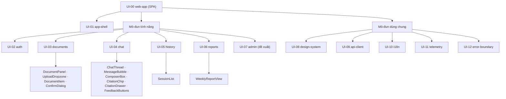
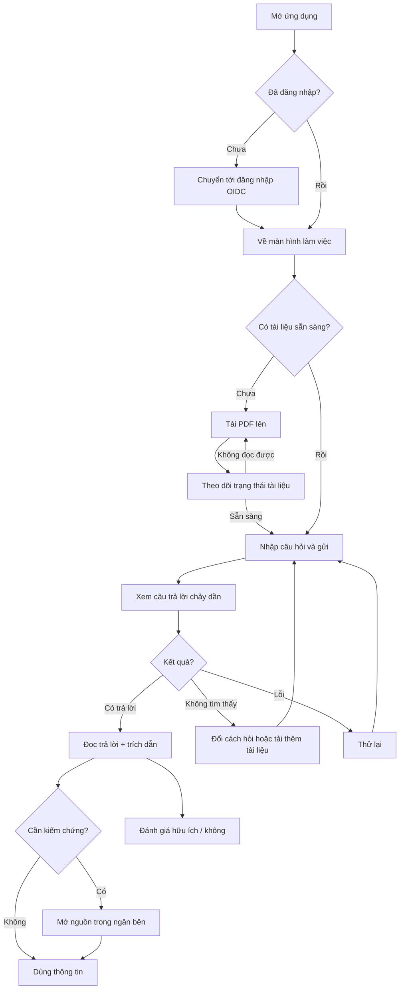
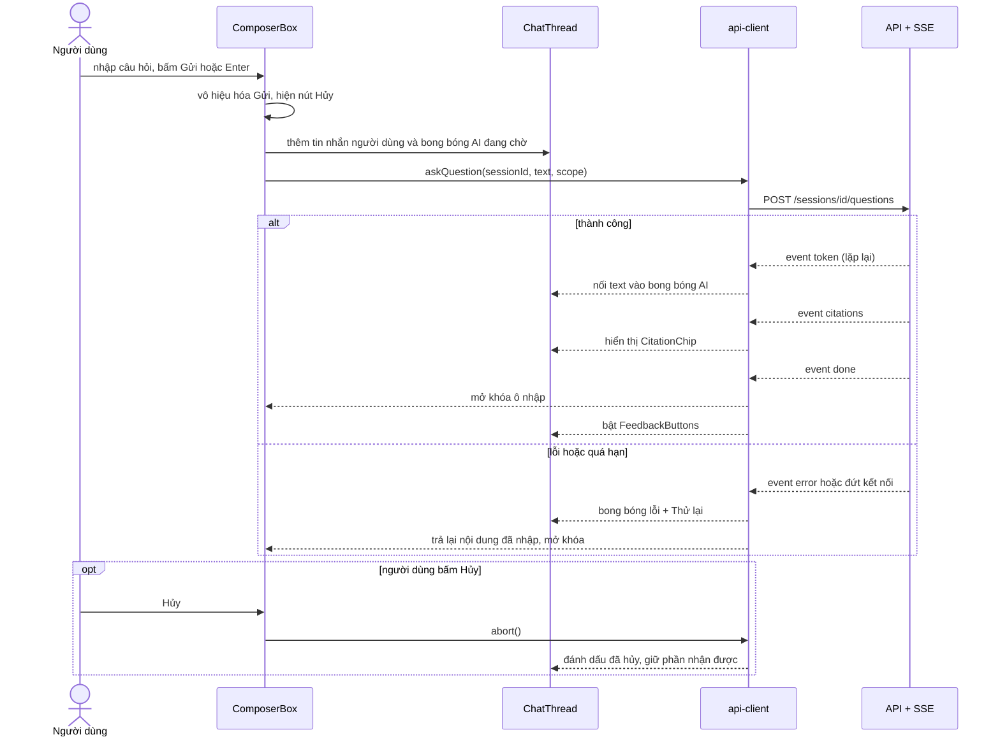
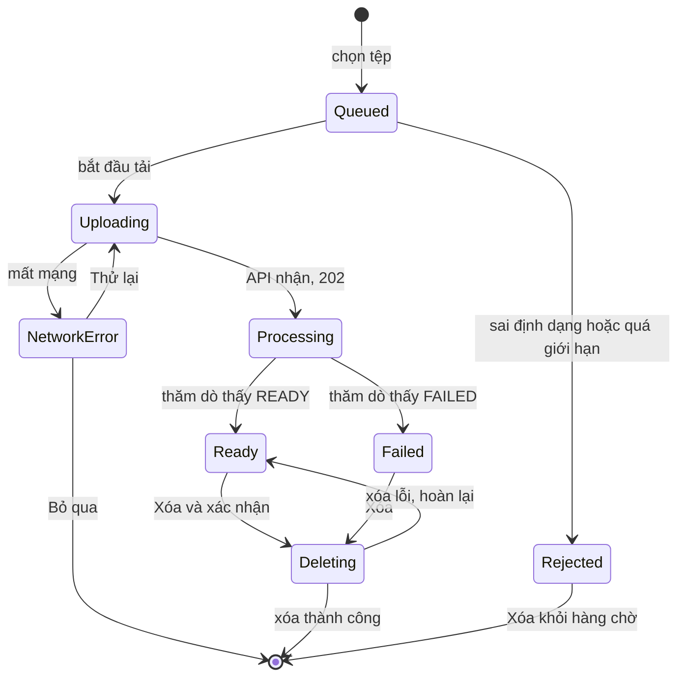
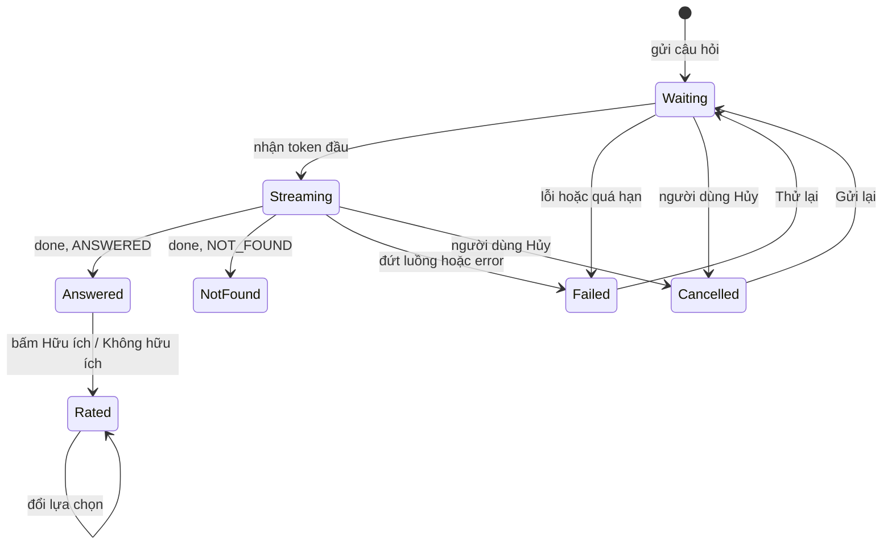
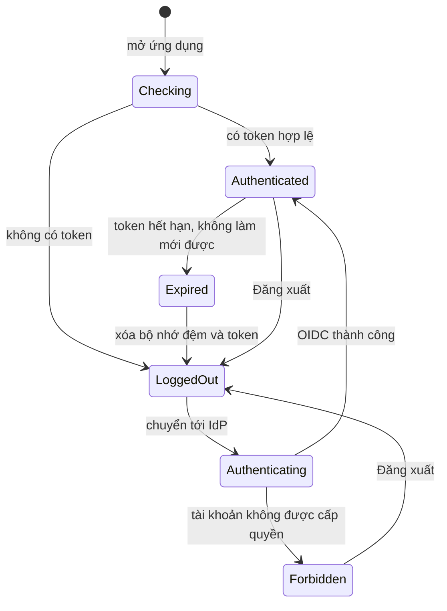

# Blueprint Thiết kế UI/UX — Công cụ "Chat với tài liệu" (MVP)

> **Chuẩn áp dụng:** IEEE 1016-2009 (Software Design Descriptions) · **Mã tài liệu:** UIUX-DOCCHAT-001 · **Phiên bản:** 0.1 · **Trạng thái:** `Draft`
> **Đầu vào:** [PRD.md](../requirements/PRD.md) §4 · [UserStories.md](../requirements/UserStories.md) · [BRD.md](../requirements/BRD.md) · [SAD.md](SAD.md) §2.1, §2.4 · [classDiagram.drawio](classDiagram.drawio) · [UseCase_ChatVoiTaiLieu.drawio](UseCase_ChatVoiTaiLieu.drawio)
> **Quy ước:** `[Đề xuất]` = lựa chọn thiết kế của tác giả, chưa được sponsor/đội thiết kế xác nhận · `[TBD: OQ-xxx]` = chờ câu hỏi mở · `[Unverified]` = chưa có bằng chứng.

---

## 0. Phạm vi và cách đọc tài liệu

**Phạm vi.** Blueprint này mô tả thiết kế **lớp giao diện người dùng** (frontend web) của MVP và truy vết từ mối quan tâm của các bên liên quan tới từng phần tử thiết kế. Thiết kế tầng backend nằm ở [SAD.md](SAD.md); blueprint này chỉ dùng lại phần hợp đồng giao diện (API, SSE) mà giao diện cần.

**Lưu ý về file prompt.** File [bluePrint_design_prompt.md](../bluePrint_design_prompt.md) nêu "tám góc nhìn thiết kế" nhưng chỉ định nghĩa mục 3.1 (Composition View); các mục sau bị cắt ở dòng 153. Do đó tác giả **tự chọn 7 góc nhìn còn lại** từ danh mục viewpoint của IEEE 1016-2009, những góc nhìn có giá trị với UI/UX:

| # | Góc nhìn IEEE 1016 | Dùng cho UI/UX |
|---|---|---|
| 3.1 | Composition | Phân rã giao diện thành mô-đun, màn hình, thành phần |
| 3.2 | Logical | Mô hình dữ liệu hiển thị (view model), design system, danh mục thành phần |
| 3.3 | Dependency | Phụ thuộc giữa mô-đun giao diện và với bên ngoài |
| 3.4 | Information | Dữ liệu hiển thị, phân loại trạng thái, quyền riêng tư dữ liệu |
| 3.5 | Interface | Màn hình, wireframe, hợp đồng API/SSE, thông báo cho người dùng |
| 3.6 | Interaction | Luồng người dùng, trình tự tương tác, bàn phím |
| 3.7 | State dynamics | Máy trạng thái của tài liệu, tin nhắn, phiên đăng nhập |
| 3.8 | Resource | Ngân sách hiệu năng, điểm ngắt bố cục, tài nguyên, trình duyệt |

Nếu đội muốn bộ góc nhìn khác (ví dụ thêm Patterns use hoặc Algorithm), mục 3 có thể mở rộng mà không đổi các mục 1, 2, 4.

**Tóm tắt ràng buộc có tác động lớn nhất tới UI/UX**

| # | Ràng buộc | Nguồn | Hệ quả thiết kế |
|---|---|---|---|
| 1 | Ứng dụng web, ưu tiên trình duyệt máy tính; hỗ trợ di động chưa chốt | CON-001, PRD §4.0, OQ-019 | Bố cục hai ngăn cho desktop; di động ở mức không vỡ bố cục |
| 2 | Câu trả lời phải kiểm chứng được | BR-014, BR-015 | Trích dẫn là phần tử hạng nhất trong mỗi câu trả lời, mở nguồn ≤ 2 thao tác |
| 3 | AI có thể sai, có thể chậm hoặc lỗi | RSK-001, NFR-001 | Có trạng thái "không tìm thấy", tiến trình, hủy, thử lại; không bao giờ hiển thị câu trả lời giả |
| 4 | Tài liệu mật, phạm vi chia sẻ chưa chốt | BR-021, OQ-007 | Giao diện không lộ sự tồn tại của tài liệu ngoài quyền; không lưu nội dung ở máy khách lâu dài |
| 5 | Ngưỡng hiệu năng chưa có | OQ-005, OQ-006 | Ngân sách hiệu năng ở mục 3.8 là `[Đề xuất]` |
| 6 | Giao diện bằng tiếng Việt | PRD §4.3, BR-010 | Phông chữ hỗ trợ dấu tiếng Việt; chuỗi giao diện tách tệp ngôn ngữ |

---

## 1. Bối cảnh và đối tượng thiết kế

### 1.1 Định danh hệ thống

| Thuộc tính | Giá trị |
|---|---|
| **System Name** | Công cụ "Chat với tài liệu" (MVP) — lớp giao diện người dùng |
| **SDD Version** | v0.1 |
| **Document Date** | 2026-10-28 |
| **Document Owner** | do98 — BA (soạn thảo với hỗ trợ AI) · Chủ sở hữu thiết kế UI/UX `[TBD: OQ-014]` |
| **Revision History** | Xem bảng dưới |

| Phiên bản | Ngày | Tác giả | Thay đổi |
|---|---|---|---|
| 0.1 | 2026-10-28 | do98 | Bản nháp đầu tiên từ PRD §4, User Stories, SAD §2.1 và §2.4 |

### 1.2 Phạm vi hệ thống và ranh giới bên ngoài

| Loại ranh giới | Mô tả |
|---|---|
| **System Purpose** | Cho nhân viên phát triển kinh doanh tải PDF lên và hỏi AI bằng ngôn ngữ tự nhiên, nhận câu trả lời tổng hợp kèm trích dẫn để kiểm chứng; thay cho việc mở và tổng hợp thủ công nhiều tệp PDF (BO-001, BO-002). |
| **Trong phạm vi thiết kế này** | Ứng dụng một trang (SPA) chạy trong trình duyệt: màn hình, thành phần, trạng thái, bố cục, văn bản giao diện, hành vi bàn phím, telemetry phía máy khách. |
| **Ngoài phạm vi thiết kế này** | API và dịch vụ backend (SAD), thiết kế thương hiệu/biểu trưng, ứng dụng di động gốc (CON-001), chế độ tối, đa ngôn ngữ ngoài tiếng Việt `[Đề xuất: sau MVP]`. |
| **External Systems** | API ứng dụng (REST + SSE, SAD §2.4); hệ thống xác thực công ty qua OIDC (OQ-016); trình duyệt người dùng. Dịch vụ AI **không** được giao diện gọi trực tiếp (đi qua API). |
| **User Types** | Nhân viên phát triển kinh doanh (người dùng chính) · Product Owner / Quản lý · Quản trị viên (đề xuất, OQ-007, OQ-016). |
| **External Interfaces** | REST/JSON qua HTTPS; Server-Sent Events cho câu trả lời theo luồng; chuyển hướng OIDC Authorization Code + PKCE. |
| **Trust Boundaries** | Trình duyệt người dùng (không tin cậy: nhận mọi dữ liệu qua API đã kiểm quyền, không giữ bí mật lâu dài) → reverse proxy/API (vùng tin cậy của hệ thống) → dịch vụ AI và IdP (miền bên thứ ba/bên ngoài). Giao diện coi mọi nội dung AI và tên tệp là **không tin cậy** (làm sạch trước khi hiển thị). |
| **Deployment Environment** | SPA là tệp tĩnh phục vụ qua reverse proxy; nền tảng đám mây hay tự lưu trữ `[TBD: OQ-008, OQ-011, OQ-022]` (SAD §4.4). |

### 1.3 Giả định và ràng buộc

| Loại | Mô tả |
|---|---|
| **Technical Constraints** | Ứng dụng web chạy trên trình duyệt (CON-001). SPA bằng TypeScript + React, trạng thái máy chủ bằng React Query, SSE cho luồng câu trả lời, token không lưu `localStorage` (SAD §2.1) `[Đề xuất]`. Trình duyệt tối thiểu `[TBD: OQ-024]`. |
| **Business Constraints** | MVP, ngân sách và thời hạn chưa xác định (CON-003, CON-005, OQ-011). Ưu tiên P0 trước, P1/P2 có thể bị cắt. |
| **Environmental Assumptions** | Người dùng pilot dùng máy tính văn phòng với trình duyệt hiện đại và mạng nội bộ ổn định `[Unverified]` (ASM-004, OQ-012). Băng thông tới dịch vụ AI do backend lo, không ảnh hưởng tải trang. |
| **Data Assumptions** | Tên tệp tiếng Việt có dấu, có thể dài đến vài chục ký tự; mỗi người dùng có tối đa vài trăm tài liệu và vài trăm tin nhắn mỗi phiên `[Đề xuất — dùng để định ngân sách ở 3.8, chờ OQ-004, OQ-012]`. Thời hạn lưu giữ hội thoại `[TBD: OQ-015]`. |
| **Assumption — thiết kế** | Chưa có bộ nhận diện thương hiệu hay design system của công ty, nên thiết kế dùng bộ token trung tính ở 3.2 `[TBD: OQ-023]`. |

---

## 2. Bên liên quan và mối quan tâm

### 2.1 Nhận diện bên liên quan

| ID | Bên liên quan | Vai trò | Mối quan tâm chính | Nguồn |
|---|---|---|---|---|
| STK-002 | Nhân viên phát triển kinh doanh | Người dùng cuối chính | Dễ dùng, nhanh, câu trả lời đáng tin, biết nguồn | BRD STK-002 |
| STK-001 | Quản lý / Product Owner | Sponsor, theo dõi pilot | Số liệu sử dụng rõ ràng, giá trị MVP | BRD STK-001 |
| STK-007 | Quản trị viên | Cấp quyền, quản lý người dùng | Thao tác quản trị đơn giản, ít sai sót | `[Đề xuất]` (OQ-007) |
| STK-005 | Bảo mật / Pháp chế | Kiểm soát dữ liệu | Không lộ tài liệu, không ghi nội dung vào log phía máy khách, phiên hết hạn đúng | BRD STK-005 |
| STK-004 | Đội phát triển | Xây dựng và bảo trì giao diện | Dễ hiểu, dễ sửa, ít lặp mã, kiểm thử được | BRD STK-004 |
| STK-008 | QA / Kiểm thử | Xác nhận chất lượng | AC kiểm thử được, trạng thái giao diện xác định rõ | `[Đề xuất]` |
| STK-003 | Đội BA | Duy trì yêu cầu | Truy vết từ yêu cầu tới giao diện | BRD STK-003 |
| STK-009 | Thiết kế UX/UI | Duy trì design system | Nhất quán, dễ mở rộng | `[Unverified]` (OQ-023) |

### 2.2 Mối quan tâm của bên liên quan (IEEE 1016-2009)

| ID | Bên liên quan | Mối quan tâm | Ưu tiên | Tiêu chí chấp nhận (đo được) | Kịch bản |
|---|---|---|---|---|---|
| UXC-01 | STK-002 | Dùng được lần đầu, không cần hướng dẫn | High | ≥ `[TBD: OQ-002]`% người dùng pilot hoàn thành luồng "tải PDF → hỏi → đọc trả lời" không trợ giúp | UXS-01 |
| UXC-02 | STK-002 | Tin cậy và kiểm chứng được câu trả lời | High | 100% câu trả lời có nội dung từ tài liệu hiển thị trích dẫn; mở nguồn ≤ 2 thao tác (AC-014, AC-015) | UXS-08, QAS-01 |
| UXC-03 | STK-002 | Biết rõ trạng thái tài liệu và lý do lỗi | High | Mọi tài liệu luôn hiển thị đúng một trạng thái; lỗi tải nêu lý do và cách khắc phục (AC-002, AC-004, AC-005) | UXS-06, UXS-07 |
| UXC-04 | STK-002 | Biết hệ thống đang làm gì khi chờ AI | High | Chỉ báo tiến trình hiển thị ≤ 300 ms; có hủy và thử lại (US-012) | UXS-07, QAS-01, QAS-03 |
| UXC-05 | STK-005 | Không lộ dữ liệu qua giao diện | High | 100% thử truy cập trái phép bị từ chối; không có nội dung tài liệu trong log/telemetry (AC-020, AC-021) | QAS-02, QAS-06 |
| UXC-06 | Mọi bên | Khả năng tiếp cận | Med | 0 lỗi WCAG 2.1 AA nghiêm trọng trên các luồng chính `[Đề xuất, TBD: OQ-025]` | UXS-02 |
| UXC-07 | STK-002 | Phản hồi nhanh của giao diện | Med | FCP ≤ 1.5 s, LCP ≤ 2.5 s, INP ≤ 200 ms `[Đề xuất]`; ngưỡng trả lời theo NFR-001 `[TBD: OQ-006]` | UXS-03, QAS-01 |
| UXC-08 | STK-004, STK-009 | Nhất quán thị giác và dễ bảo trì | Med | 100% giá trị màu/cỡ chữ/khoảng cách lấy từ token; đổi token chỉ sửa 1 nơi | UXS-05, QAS-04 |
| UXC-09 | STK-001, STK-005 | Đo hành vi mà không lộ nội dung | High | 100% sự kiện PRD §5.2 được phát; 0 trường chứa nội dung | QAS-06 |
| UXC-10 | STK-008 | Giao diện kiểm thử được | Med | 100% AC của story P0 có ≥ 1 kiểm thử tự động ở mức E2E hoặc thành phần | QAS-05 |
| UXC-11 | STK-001 | Báo cáo dễ đọc để quyết định | Med | Product Owner đọc được số người dùng hoạt động và số câu hỏi trong ≤ 1 màn hình (AC-023) | UXS-08 |
| UXC-12 | STK-007 | Quản trị phân quyền đơn giản | Med | Cấp/thu hồi quyền ≤ 3 thao tác `[Đề xuất, TBD: OQ-007, OQ-016]` | UXS-08 |
| UXC-13 | STK-002, IT | Hỗ trợ trình duyệt và thiết bị | Med | Không có lỗi chức năng trên danh sách trình duyệt hỗ trợ `[TBD: OQ-024, OQ-019]` | UXS-04, UXS-10 |

### 2.3 Kịch bản thuộc tính chất lượng (cấp hệ thống, lớp giao diện)

Định dạng sáu phần: Nguồn (Source), Kích thích (Stimulus), Đối tượng (Artifact), Môi trường (Environment), Phản ứng (Response), Thước đo (Response Measure).

| ID | Thuộc tính | Source | Stimulus | Artifact | Environment | Response | Response Measure |
|---|---|---|---|---|---|---|---|
| QAS-01 | **Performance** | Nhân viên KD | Gửi một câu hỏi | `ChatThread` + luồng SSE | Pilot ≤ 5 truy vấn đồng thời `[Đề xuất, OQ-012]`, hệ thống bình thường | Token đầu tiên hiển thị, câu trả lời chảy dần | Token đầu ≤ 2 s `[Đề xuất, SAD §5.1]`; tổng thời gian theo NFR-001 `[TBD: OQ-006]` |
| QAS-02 | **Security** | Người dùng không có quyền | Mở trực tiếp đường dẫn hoặc mã tài liệu/phiên của người khác | Route guard + API | Mạng nội bộ | Giao diện hiển thị trang "Không tìm thấy", không tiết lộ sự tồn tại; token không có trong `localStorage` | 100% thử trái phép bị từ chối (AC-020, AC-021); 0 token trong bộ nhớ lâu dài |
| QAS-03 | **Availability** | Dịch vụ AI lỗi hoặc quá hạn | Người dùng gửi câu hỏi | `ComposerBox`, `ChatThread` | Circuit breaker mở (SAD §4.2) | Hiển thị lỗi tạm thời + nút "Thử lại", giữ nguyên câu hỏi; danh sách tài liệu vẫn dùng được | Thông báo ≤ 1 s sau khi API trả lỗi; 0 câu trả lời giả (US-007-AC5) |
| QAS-04 | **Maintainability** | Lập trình viên | Đổi màu chủ đạo hoặc thêm một trạng thái tài liệu | Token, `DocumentStatusChip` | Giai đoạn bảo trì | Thay đổi tập trung ở một nơi | Đổi token sửa 1 tệp; thêm trạng thái chạm ≤ 3 mô-đun |
| QAS-05 | **Testability** | QA | Chạy bộ kiểm thử trước mỗi bản phát hành | Toàn bộ giao diện | CI | Chạy kiểm thử thành phần, E2E luồng P0, kiểm tra truy cập tự động | 100% AC story P0 có kiểm thử E2E; độ phủ logic mô-đun ≥ 80%; E2E ≤ 10 phút `[Đề xuất]` |
| QAS-06 | **Observability** | Product Owner / Bảo mật | Theo dõi sử dụng pilot | Lớp telemetry phía máy khách | Pilot | Phát sự kiện PRD §5.2 chỉ chứa định danh và số đo | 100% sự kiện đúng định dạng; 0 trường chứa nội dung câu hỏi, câu trả lời, tên tệp |
| — | Scalability | — | — | — | — | **N/A cho giao diện MVP:** ứng dụng tĩnh, không chịu tải theo người dùng; co giãn thuộc SAD §6 | — |
| — | Deployability | — | — | — | — | Phát hành tệp tĩnh theo CI/CD của SAD §4.4; không yêu cầu canary ở MVP | — |

### 2.4 Kịch bản chất lượng UX/UI

| ID | Thuộc tính | Source | Stimulus | Artifact | Environment | Response | Response Measure |
|---|---|---|---|---|---|---|---|
| UXS-01 | **Usability** | Nhân viên KD dùng lần đầu, chưa được tập huấn | Muốn có câu trả lời đầu tiên từ một PDF | SCR-02, SCR-03 | Đã đăng nhập, kho trống | Hoàn thành tải PDF, chờ sẵn sàng, hỏi, đọc câu trả lời có trích dẫn mà không cần trợ giúp | ≥ `[TBD: OQ-002]`% hoàn thành không trợ giúp; thao tác của người dùng (không tính thời gian xử lý) ≤ 90 s, ≤ 1 lỗi thao tác `[Đề xuất]` |
| UXS-02 | **Accessibility** | Người dùng chỉ dùng bàn phím hoặc trình đọc màn hình | Thực hiện: đăng nhập, tải tệp, hỏi, mở trích dẫn, đánh giá | SCR-01..SCR-06 | Chrome/Edge trên Windows + trình đọc màn hình `[TBD: OQ-024]` | Mọi thao tác dùng được bằng bàn phím; câu trả lời mới được đọc ra qua vùng `aria-live`; tiêu điểm được quản lý khi mở/đóng ngăn nguồn | 0 lỗi WCAG 2.1 AA nghiêm trọng (kiểm tra tự động + thủ công) trên 5 luồng chính `[Đề xuất, TBD: OQ-025]` |
| UXS-03 | **Performance** | Người dùng | Mở ứng dụng; tương tác trong lúc AI trả lời | SPA | Mạng văn phòng | Khung ứng dụng hiện nhanh, giao diện không bị khựng khi nhận luồng | FCP ≤ 1.5 s, LCP ≤ 2.5 s, INP ≤ 200 ms `[Đề xuất]` |
| UXS-04 | **Responsiveness** | Người dùng | Đổi kích thước cửa sổ từ 320 đến 2560 px | Bố cục SCR-02 | Trình duyệt hỗ trợ | Bố cục thích nghi theo điểm ngắt 3.8 | Không có cuộn ngang ở mọi độ rộng 320–2560 px; khung chat luôn dùng được |
| UXS-05 | **Visual Consistency** | Lập trình viên / QA | Rà soát giao diện | Mọi màn hình | CI + rà soát thiết kế | Giao diện dùng token và thành phần chung | 100% màu, cỡ chữ, khoảng cách lấy từ token (kiểm bằng lint); ≥ 95% thành phần từ thư viện chung |
| UXS-06 | **Error Recovery** | Người dùng | Tải tệp sai, mất mạng khi hỏi, dịch vụ AI lỗi | `UploadQueueItem`, `ComposerBox` | Có lỗi | Thông báo nội tuyến bằng tiếng Việt nêu nguyên nhân và bước tiếp theo, giữ lại nội dung đã nhập | 100% lỗi ở bảng 3.5.5 khắc phục được không cần tải lại trang; 0 thông báo lộ mã lỗi kỹ thuật |
| UXS-07 | **Feedback & Affordance** | Người dùng | Bất kỳ thao tác bất đồng bộ (tải, hỏi, xóa) | Mọi thành phần tương tác | Mạng chậm giả lập | Hiển thị trạng thái đang xử lý; phần tử bấm được có hover, focus, active, disabled | 100% thao tác bất đồng bộ có chỉ báo ≤ 300 ms (kiểm bằng kiểm thử với độ trễ giả) |
| UXS-08 | **Information Architecture** | Người dùng | Tìm một chức năng | Điều hướng + SCR-02 | Đã đăng nhập | Chức năng chính đạt trong ≤ 2 thao tác từ màn hình làm việc | Tải tài liệu, hỏi, xem nguồn, xem phiên cũ, xóa tài liệu: mỗi việc ≤ 2 thao tác; báo cáo ≤ 2 thao tác từ menu |
| UXS-09 | **Internationalization** | Người dùng | Nhập và đọc tiếng Việt có dấu; tên tệp dài hoặc có ký tự Unicode | Toàn bộ giao diện | Mọi trình duyệt hỗ trợ | Hiển thị dấu đúng; tên tệp dài được cắt có chú giải; chuỗi giao diện ở tệp ngôn ngữ | 100% chuỗi giao diện ở tệp ngôn ngữ; bố cục chịu mở rộng văn bản +30%; RTL: N/A ở MVP |
| UXS-10 | **Mobile Experience** | Người dùng trên điện thoại `[TBD: OQ-019]` | Mở ứng dụng và hỏi | SCR-02 một cột | Màn hình ≤ 767 px | Bố cục một cột, thao tác chạm; chưa tối ưu cử chỉ | Vùng chạm ≥ 44×44 px; không vỡ bố cục. **MVP: mức "dùng được", không cam kết tối ưu di động** `[Đề xuất]` |

### 2.5 Ma trận ràng buộc UX/UI

| Ràng buộc | Yêu cầu | Chuẩn/Công cụ | Cách kiểm chứng |
|---|---|---|---|
| **Color Contrast** | Chữ thường ≥ 4.5:1; chữ lớn và thành phần giao diện ≥ 3:1 | WCAG 2.1 AA `[TBD: OQ-025]` | Bảng token ở 3.2 (đã tính tỉ lệ) + kiểm tra tự động + thủ công |
| **Typography** | Chữ nội dung ≥ 16 px; chữ phụ ≥ 14 px; không nhỏ hơn 12 px; phông có đủ dấu tiếng Việt; co giãn được tới 200% | Design system | Rà soát thiết kế, kiểm thử phóng to |
| **Touch / Click Targets** | Chạm ≥ 44×44 px (nếu hỗ trợ di động); desktop ≥ 32×32 px `[Đề xuất]` | Apple HIG / Material | Kiểm thử giao diện |
| **Focus & Keyboard** | Mọi thao tác dùng được bằng bàn phím; viền focus 2 px, tương phản ≥ 3:1; thứ tự tab theo thứ tự đọc | WCAG 2.1 (2.1.1, 2.4.7) | Kiểm thử thủ công, axe |
| **Motion** | Hoạt ảnh ≤ 200 ms; tôn trọng `prefers-reduced-motion` | WCAG 2.1 (2.3.3) | Kiểm thử thủ công |
| **Loading States** | Skeleton hoặc spinner trong ≤ 300 ms | Thực hành UX | Giám sát hiệu năng, kiểm thử trễ giả |
| **Error Messaging** | Rõ ràng, nêu hành động tiếp theo, không dùng thuật ngữ kỹ thuật | Hướng dẫn UX writing | Rà soát nội dung (bảng 3.5.5) |
| **Empty States** | Mọi trạng thái trống nêu việc tiếp theo | Thực hành UX | Kiểm kê giao diện (bảng 3.5.2) |
| **Notifications** | Thông báo không chặn thao tác; lỗi cần hành động ở lại tới khi xử lý; thông báo thành công tự ẩn sau 5 s | Thực hành UX | Kiểm thử người dùng |
| **Help & Onboarding** | Gợi ý ngữ cảnh ngay trong trạng thái trống; không bắt buộc hướng dẫn riêng | Thực hành UX | Tỉ lệ hoàn thành tác vụ (UXS-01) |

---

## 3. Các góc nhìn thiết kế (IEEE 1016-2009)

### 3.1 Composition View — phân rã giao diện

**Mục đích:** mô tả giao diện được ghép từ các đơn vị nhỏ hơn. **Mối quan tâm:** UXC-08, UXC-10, tính dễ hiểu, tính mô-đun.

| ID | Phần tử | Loại | Cha | Trách nhiệm | Phụ thuộc |
|---|---|---|---|---|---|
| UI-00 | `web-app` | Hệ thống | — | Ứng dụng SPA | — |
| UI-01 | `app-shell` | Mô-đun | UI-00 | Khung trang, tiêu đề, menu người dùng, điều hướng, vùng thông báo | `design-system`, `auth` |
| UI-02 | `auth` | Mô-đun | UI-00 | Đăng nhập OIDC, bảo vệ route, hết hạn phiên | `api-client` |
| UI-03 | `documents` | Mô-đun tính năng | UI-00 | Danh sách tài liệu, tải lên, trạng thái, xóa, chia sẻ | `design-system`, `api-client`, `i18n`, `telemetry` |
| UI-04 | `chat` | Mô-đun tính năng | UI-00 | Luồng hội thoại, ô nhập, hiển thị luồng câu trả lời, trích dẫn, đánh giá | `design-system`, `api-client`, `i18n`, `telemetry` |
| UI-05 | `history` | Mô-đun tính năng | UI-00 | Danh sách phiên cũ | `design-system`, `api-client` |
| UI-06 | `reports` | Mô-đun tính năng | UI-00 | Báo cáo hằng tuần cho Product Owner | `design-system`, `api-client` |
| UI-07 | `admin` | Mô-đun tính năng | UI-00 | Quản lý người dùng và quyền `[Đề xuất]` | `design-system`, `api-client` |
| UI-08 | `design-system` | Mô-đun dùng chung | UI-00 | Token, thành phần nguyên thủy, kiểu chữ, biểu tượng | — |
| UI-09 | `api-client` | Mô-đun dùng chung | UI-00 | Gọi REST, mở luồng SSE, gắn token, chuẩn hóa lỗi | `auth` |
| UI-10 | `i18n` | Mô-đun dùng chung | UI-00 | Chuỗi tiếng Việt, định dạng ngày giờ, số | — |
| UI-11 | `telemetry` | Mô-đun dùng chung | UI-00 | Phát sự kiện PRD §5.2, không chứa nội dung | `api-client` |
| UI-12 | `error-boundary` | Mô-đun dùng chung | UI-00 | Bắt lỗi giao diện, hiển thị trang lỗi chung | `design-system` |



### 3.2 Logical View — mô hình hiển thị và design system

**Mục đích:** các khái niệm tĩnh mà giao diện làm việc cùng và bộ quy tắc hình ảnh dùng chung. **Mối quan tâm:** UXC-08, tính nhất quán.

#### 3.2.1 View model (ánh xạ từ class diagram)

| View model | Lớp miền nguồn | Trường hiển thị | Ghi chú |
|---|---|---|---|
| `DocumentVM` | `Document`, `FileMetadata` | `documentId`, `title`, `status`, `failReason`, `uploadedAt`, `shareScope`, `isOwner`, `pageCount` | `status` ∈ UPLOADED, PROCESSING, READY, FAILED (DELETED không hiển thị) |
| `UploadItemVM` | `UploadedFile` (phía máy khách) | `localId`, `fileName`, `sizeBytes`, `clientState`, `progress`, `rejectReason` | Chỉ tồn tại ở máy khách trước khi có `documentId` |
| `SessionVM` | `ChatSession` | `sessionId`, `title`, `lastActivityAt` | |
| `MessageVM` | `Message`, `Question`, `Answer` | `messageId`, `type` (QUESTION / ANSWER), `content`, `resultType`, `citations[]`, `createdAt`, `rating` | `resultType` ∈ ANSWERED, NOT_FOUND, ERROR |
| `CitationVM` | `Citation` | `citationId`, `documentTitle`, `pageNumber`, `isDocumentDeleted` | Đoạn gốc (`excerpt`) lấy theo yêu cầu khi mở ngăn nguồn |
| `UsageReportVM` | `UsageReport` | `weekStart`, `activeUsers`, `questionCount`, `helpfulRate` | |
| `UserVM` | `User` | `displayName`, `role` | Không lưu email ở máy khách ngoài những gì cần hiển thị |

#### 3.2.2 Design token `[Đề xuất — chờ OQ-023]`

Bộ màu trung tính, tỉ lệ tương phản đã **tính toán** theo công thức WCAG 2.1.

| Token | Giá trị | Dùng cho | Cặp kiểm tra | Tỉ lệ |
|---|---|---|---|---|
| `color.text` | `#1F2937` | Chữ chính | trên `#FFFFFF` | 14.68:1 |
| `color.text-muted` | `#4B5563` | Chữ phụ | trên `#FFFFFF` | 7.56:1 |
| `color.text-subtle` | `#6B7280` | Gợi ý, nhãn thời gian | trên `#FFFFFF` | 4.83:1 |
| `color.primary` | `#1D4ED8` | Nút chính, liên kết, focus | trên `#FFFFFF` | 6.70:1 |
| `color.on-primary` | `#FFFFFF` | Chữ trên nút chính | trên `#1D4ED8` | 6.70:1 |
| `color.surface-user` | `#EFF6FF` | Bong bóng tin nhắn người dùng | chữ `#1F2937` | 13.49:1 |
| `color.surface-panel` | `#F9FAFB` | Nền ngăn tài liệu | chữ `#374151` | 9.86:1 |
| `color.error` / `color.error-bg` | `#991B1B` / `#FEF2F2` | Thông báo lỗi | chữ trên nền | 7.60:1 |
| `color.success` / `color.success-bg` | `#166534` / `#F0FDF4` | Trạng thái "Sẵn sàng" | chữ trên nền | 6.81:1 |
| `color.warning` / `color.warning-bg` | `#92400E` / `#FFFBEB` | "Đang xử lý", cảnh báo | chữ trên nền | 6.84:1 |

Mọi cặp trên đạt ≥ 4.5:1 (mức AA cho chữ thường). **Trạng thái không bao giờ chỉ dựa vào màu:** mỗi trạng thái đi kèm biểu tượng và chữ (ví dụ "● Sẵn sàng").

| Nhóm token | Giá trị `[Đề xuất]` |
|---|---|
| Kiểu chữ | Họ phông có đủ dấu tiếng Việt (ví dụ Inter hoặc Be Vietnam Pro, kèm phông hệ thống dự phòng); chữ nội dung 16 px / dòng 24 px; chữ phụ 14 px / 20 px; tiêu đề 20 px và 24 px; không nhỏ hơn 12 px |
| Khoảng cách | Đơn vị cơ sở 4 px: 4, 8, 12, 16, 24, 32, 48 |
| Bo góc | 4 px (ô nhập, nút), 8 px (thẻ, bong bóng), 999 px (nhãn trạng thái) |
| Viền focus | 2 px `color.primary`, cách phần tử 2 px |
| Chuyển động | ≤ 200 ms; tắt khi `prefers-reduced-motion` |
| Bóng | Chỉ dùng cho ngăn nổi (drawer, hộp thoại) |

#### 3.2.3 Danh mục thành phần

| ID | Thành phần | Mục đích | Trạng thái / biến thể | Story |
|---|---|---|---|---|
| CMP-01 | `AppHeader` | Tên ứng dụng, menu người dùng, điều hướng | Mặc định; có/không mục Báo cáo, Quản trị theo vai trò | US-001, 023 |
| CMP-02 | `AuthGuard` | Bảo vệ route, xử lý chưa đăng nhập/hết hạn | Đang kiểm tra, đã xác thực, hết hạn, từ chối | US-001 |
| CMP-03 | `DocumentPanel` | Ngăn danh sách tài liệu | Trống, đang tải, có dữ liệu, lỗi tải danh sách | US-017 |
| CMP-04 | `UploadDropzone` | Chọn/kéo thả PDF | Rảnh, kéo ngang, vô hiệu (đang tải tối đa) | US-002, 006 |
| CMP-05 | `UploadQueueItem` | Một tệp đang tải | Chờ, đang tải, từ chối, nhận, lỗi mạng (thử lại) | US-002, 003 |
| CMP-06 | `DocumentItem` | Một tài liệu | Theo trạng thái; được chọn làm phạm vi; menu thao tác | US-004, 005, 014, 018 |
| CMP-07 | `DocumentStatusChip` | Nhãn trạng thái (biểu tượng + chữ) | Đang xử lý, Sẵn sàng, Không truy vấn được | US-004, 005 |
| CMP-08 | `ConfirmDialog` | Xác nhận hành động không hoàn tác | Xóa tài liệu | US-018 |
| CMP-09 | `ChatThread` | Danh sách tin nhắn theo thứ tự | Trống, có tin nhắn, đang nhận luồng | US-007, 013 |
| CMP-10 | `MessageBubble` | Một tin nhắn | Người dùng; AI đang trả lời; AI đã xong; AI "không tìm thấy"; AI lỗi | US-007, 010, 012 |
| CMP-11 | `ComposerBox` | Ô nhập và nút Gửi | Rảnh, rỗng (Gửi tắt), đang gửi, đang nhận (có Hủy), lỗi (giữ nội dung) | US-007, 012 |
| CMP-12 | `CitationChip` | Một nguồn trích dẫn: "Tên tài liệu · tr. N" | Mặc định, đã xóa nguồn, được chọn | US-015 |
| CMP-13 | `CitationDrawer` | Ngăn xem đoạn nguồn | Đang tải, hiển thị, không có quyền, nguồn đã xóa | US-016 |
| CMP-14 | `FeedbackButtons` | 👍 / 👎 cho câu trả lời | Chưa đánh giá, đã chọn, đang gửi | US-022 |
| CMP-15 | `ScopeSelector` | Chọn tài liệu làm phạm vi hỏi (P2) | Tất cả, đã chọn N tài liệu | US-014 |
| CMP-16 | `SessionList` | Danh sách phiên cũ | Trống, có dữ liệu | US-020 |
| CMP-17 | `WeeklyReportView` | Số liệu tuần | Đang tải, có dữ liệu, tuần không có hoạt động (giá trị 0) | US-023 |
| CMP-18 | `InlineAlert` | Thông báo lỗi/cảnh báo/thông tin gắn với một vùng | Lỗi, cảnh báo, thông tin | US-003, 005, 012 |
| CMP-19 | `Toast` | Thông báo ngắn không chặn | Thành công (tự ẩn 5 s), lỗi (giữ lại) | US-018, 022 |
| CMP-20 | `EmptyState` | Hướng dẫn khi không có dữ liệu | Kho trống, chưa có phiên, chưa có báo cáo | US-017 |
| CMP-21 | `ProgressIndicator` | Tiến trình tải/chờ | Xác định (thanh), không xác định (vòng quay) | US-002, 012 |
| CMP-22 | `UserAccessTable` | Quản lý người dùng `[Đề xuất]` | Đang tải, có dữ liệu | UC-17 |

### 3.3 Dependency View

**Mục đích:** phụ thuộc giữa các mô-đun giao diện và với bên ngoài. **Mối quan tâm:** UXC-08, UXC-10 (kiểm thử độc lập), tính bảo trì.

**Quy tắc phụ thuộc:** (1) mô-đun tính năng chỉ phụ thuộc mô-đun dùng chung, **không** phụ thuộc lẫn nhau; (2) `design-system` không phụ thuộc mô-đun nào; (3) mọi lời gọi mạng đi qua `api-client`; (4) không có vòng phụ thuộc. Việc tuân thủ được kiểm bằng quy tắc lint về ranh giới mô-đun.

| Phụ thuộc → | design-system | api-client | auth | i18n | telemetry |
|---|---|---|---|---|---|
| `app-shell` | ✔ | | ✔ | ✔ | |
| `auth` | ✔ | ✔ | | ✔ | ✔ |
| `documents` | ✔ | ✔ | | ✔ | ✔ |
| `chat` | ✔ | ✔ | | ✔ | ✔ |
| `history` | ✔ | ✔ | | ✔ | |
| `reports` | ✔ | ✔ | | ✔ | |
| `admin` | ✔ | ✔ | | ✔ | |
| `api-client` | | | ✔ | | |
| `telemetry` | | ✔ | | | |

| Phụ thuộc bên ngoài | Loại | Dùng cho | Rủi ro / giảm thiểu |
|---|---|---|---|
| API ứng dụng (SAD §2.4) | Dịch vụ | Mọi dữ liệu và hành động | Lệch hợp đồng → sinh kiểu từ OpenAPI `[Đề xuất]` |
| Hệ thống xác thực OIDC | Dịch vụ | Đăng nhập | Không sẵn sàng → báo lỗi, người dùng đã đăng nhập vẫn dùng đến khi hết hạn token (SAD §4.2) |
| React, React Query, TypeScript | Thư viện | SPA, trạng thái máy chủ | Khóa phiên bản, quét lỗ hổng (SAD §4.1.3) `[Đề xuất]` |
| Thư viện thành phần nguyên thủy có hỗ trợ truy cập (ví dụ Radix UI hoặc React Aria) | Thư viện | Hộp thoại, menu, drawer đúng chuẩn a11y | Giảm công sức tự viết hành vi bàn phím `[Đề xuất]` |
| Thư viện hiển thị markdown + làm sạch HTML | Thư viện | Hiển thị nội dung AI an toàn | Chỉ cần nếu OQ-026 chọn hiển thị định dạng |
| API trình duyệt: `fetch`, `EventSource`/luồng SSE, `AbortController` | Nền tảng | Gọi API, nhận luồng, hủy | Hỗ trợ trình duyệt `[TBD: OQ-024]` |

### 3.4 Information View

**Mục đích:** dữ liệu hiển thị, nơi lưu trạng thái, vòng đời và quyền riêng tư. **Mối quan tâm:** UXC-05, UXC-09, UXC-07.

#### 3.4.1 Phân loại trạng thái phía máy khách

| Loại | Ví dụ | Nơi lưu | Vòng đời |
|---|---|---|---|
| Trạng thái máy chủ (bản sao) | Danh sách tài liệu, tin nhắn, báo cáo | Bộ nhớ đệm React Query (bộ nhớ) | Làm mới theo thời gian hoặc sau thao tác; xóa khi đăng xuất |
| Trạng thái giao diện tạm | Nội dung đang gõ, tài liệu đang chọn làm phạm vi, ngăn nguồn đang mở | React state | Mất khi tải lại trang (chấp nhận) |
| Trạng thái trên URL | `sessionId` đang xem, chế độ lọc | Đường dẫn / query | Chia sẻ được trong phạm vi quyền |
| Token xác thực | Token truy cập | **Chỉ trong bộ nhớ** | Hết khi tải lại → dùng đăng nhập im lặng OIDC |
| Tùy chọn người dùng | Thu gọn ngăn tài liệu | `localStorage` (không nhạy cảm) | Giữ giữa các lần dùng; truy cập bọc `try/catch` |
| Nháp câu hỏi chưa gửi | — | **Không lưu lâu dài** | Chỉ giữ trong bộ nhớ khi lỗi mạng (US-012-AC4) `[Đề xuất — tránh để lại nội dung nhạy cảm]` |

#### 3.4.2 Dữ liệu hiển thị theo màn hình

| Màn hình | Dữ liệu | Nguồn | Làm mới |
|---|---|---|---|
| SCR-02 ngăn tài liệu | `DocumentVM[]` | `GET /documents` | Thăm dò 3 s khi còn tài liệu `PROCESSING`; dừng khi hết (SAD §2.1) |
| SCR-02 hội thoại | `MessageVM[]` của phiên | `GET /sessions/{id}/messages`; luồng SSE khi đang hỏi | Theo sự kiện |
| SCR-04 ngăn nguồn | `{documentTitle, pageNumber, excerpt}` | `GET /citations/{id}` | Khi mở |
| SCR-05 phiên cũ | `SessionVM[]` | `GET /sessions` | Khi mở, phân trang con trỏ |
| SCR-06 báo cáo | `UsageReportVM` | `GET /reports/weekly` | Khi mở / đổi tuần |

#### 3.4.3 Quyền riêng tư và an toàn dữ liệu trên giao diện

- Giao diện **không** ghi nội dung câu hỏi, câu trả lời, nội dung tài liệu hay tên tệp vào log, telemetry hay thông báo lỗi gửi đi (QAS-06).
- Khi đăng xuất hoặc phiên hết hạn: xóa bộ nhớ đệm, token và trạng thái tạm.
- Nội dung do AI và tên tệp được xem là không tin cậy: hiển thị dưới dạng văn bản đã làm sạch; không chèn HTML thô (chống XSS, SAD §4.1.3).
- Danh sách dài được phân trang theo con trỏ; danh sách tin nhắn dài `[Đề xuất: > 200 tin nhắn]` dùng ảo hóa danh sách (3.8).

### 3.5 Interface View — màn hình, hợp đồng và thông báo

#### 3.5.1 Danh mục màn hình

| ID | Màn hình | Đường dẫn | Vai trò | Story | Ưu tiên |
|---|---|---|---|---|---|
| SCR-01 | Đăng nhập / Không có quyền | `/login`, `/forbidden` | Chưa xác thực | US-001 | P0 |
| SCR-02 | Màn hình làm việc (tài liệu + hội thoại) | `/app`, `/app?session={id}` | Mọi người dùng | US-002..019, 022 | P0 |
| SCR-03 | Khu tải tài liệu (nội tuyến trong ngăn tài liệu) | trong SCR-02 | Nhân viên KD | US-002..006 | P0 |
| SCR-04 | Ngăn xem nguồn (drawer) | trong SCR-02 | Nhân viên KD | US-015, 016 | P0 / P1 |
| SCR-05 | Phiên cũ | trong SCR-02 (ngăn) hoặc `/history` | Nhân viên KD | US-020 | P2 |
| SCR-06 | Báo cáo tuần | `/reports` | Product Owner | US-023 | P0 |
| SCR-07 | Quản lý người dùng | `/admin/users` | Quản trị viên | UC-17, US-021 | `[Đề xuất]` |
| SCR-08 | Trang lỗi chung (404, 500, mất mạng) | `/404`, `/error` | Mọi người dùng | PRD §4.2 | P0 |
| SCR-09 | Hộp thoại xác nhận xóa | trong SCR-02 | Chủ tài liệu | US-018 | P1 |

#### 3.5.2 Wireframe và quy tắc bố cục

Wireframe mô tả **bố cục logic và hành vi**, không quy định thiết kế hình ảnh cuối cùng.

**SCR-02 — Màn hình làm việc (desktop ≥ 1280 px)**

```
┌──────────────────────────────────────────────────────────────────────────────────┐
│ ▣ Chat với tài liệu                       [Phiên cũ] [Báo cáo]¹   [nvkd ▾ Đăng xuất]│  CMP-01
├───────────────────────────────┬──────────────────────────────────────────────────┤
│ TÀI LIỆU (3)    [+ Tải PDF]   │ Phiên: Điều khoản thanh toán      [+ Phiên mới]  │
│ ───────────────────────────── │ ──────────────────────────────────────────────── │
│ ┌───────────────────────────┐ │                                                  │
│ │ Kéo thả PDF vào đây       │ │            ┌───────────────────────────────────┐ │
│ │ hoặc bấm để chọn tệp      │ │   Bạn      │ Điều khoản thanh toán của HĐ A?   │ │
│ └───────────────────────────┘ │            └───────────────────────────────────┘ │
│ ☑ HopDong_A.pdf   ✔ Sẵn sàng  │ ┌──────────────────────────────────────────────┐ │
│ ☑ BaoGia_B.pdf    ⏳ Đang xử lý│ │ Thanh toán trong 30 ngày kể từ ngày nhận     │ │
│ ☐ Scan_C.pdf      ✖ Không đọc │ │ hóa đơn.                                     │ │
│   được — PDF chỉ chứa ảnh     │ │ Nguồn: [HopDong_A.pdf · tr.12] [BaoGia_B · tr.3]│ │
│                               │ │ 👍 Hữu ích   👎 Không hữu ích                  │ │
│ Phạm vi hỏi: 2 tài liệu²      │ └──────────────────────────────────────────────┘ │
│                               │                                                  │
│                               │ ┌──────────────────────────────────────┐ [Gửi ▶] │
│                               │ │ Nhập câu hỏi…                        │         │
│                               │ └──────────────────────────────────────┘         │
│                               │ Câu trả lời chỉ dựa trên tài liệu của bạn.       │
└───────────────────────────────┴──────────────────────────────────────────────────┘
 ¹ chỉ hiện với Product Owner   ² ScopeSelector — P2 (US-014)
```

Quy tắc bố cục: ngăn trái cố định rộng 320 px, thu gọn được; ngăn phải chiếm phần còn lại, nội dung hội thoại tối đa 760 px để dễ đọc; ô nhập dính đáy; luồng tin nhắn tự cuộn xuống tin mới nhưng **dừng** nếu người dùng đã cuộn lên xem tin cũ (kèm nút "Xuống tin mới").

**SCR-04 — Ngăn xem nguồn (US-016)**

```
┌───────────────────────────────────────┬─────────────────────────────┐
│  (Hội thoại, bị làm mờ nhẹ)           │ Nguồn                    [✕]│
│                                       │ HopDong_A.pdf · trang 12    │
│                                       │ ─────────────────────────── │
│                                       │ "…Bên B thanh toán trong    │
│                                       │ vòng 30 ngày kể từ ngày     │
│                                       │ nhận được hóa đơn hợp lệ…"  │
│                                       │                             │
│                                       │ [Mở tài liệu] ³             │
└───────────────────────────────────────┴─────────────────────────────┘
 ³ chỉ nếu quyết định mở tệp gốc trong MVP [TBD]; Esc đóng ngăn, trả tiêu điểm về chip đã mở
```

**SCR-06 — Báo cáo tuần (US-023)**

```
┌───────────────────────────────────────────────────────────────┐
│ Báo cáo tuần           [◀ Tuần trước]  22/10 – 28/10  [Tuần sau ▶]│
│ ┌──────────────────┐ ┌──────────────────┐ ┌──────────────────┐ │
│ │ Người dùng hoạt  │ │ Số câu hỏi       │ │ Tỉ lệ hữu ích    │ │
│ │ động             │ │                  │ │                  │ │
│ │       12         │ │       148        │ │       76%        │ │
│ └──────────────────┘ └──────────────────┘ └──────────────────┘ │
│ (số minh họa)   Tuần không có hoạt động: hiển thị 0, không để trống│
└───────────────────────────────────────────────────────────────┘
```

**Trạng thái trống và đặc biệt** (đáp ứng ràng buộc "mọi trạng thái trống nêu việc tiếp theo")

| Tình huống | Hiển thị | Hành động chính | Story |
|---|---|---|---|
| Kho tài liệu trống | "Chưa có tài liệu nào. Tải PDF lên để bắt đầu hỏi." | Nút **Tải PDF lên** | US-017-AC2 |
| Chưa có tài liệu sẵn sàng | Ô nhập vẫn hiện nhưng Gửi tắt; gợi ý "Chờ tài liệu xử lý xong, hoặc tải thêm." | Xem danh sách tài liệu | US-007-AC3 |
| Phiên mới, chưa có tin nhắn | 3 câu hỏi gợi ý lấy từ tên tài liệu `[Đề xuất]` hoặc hướng dẫn ngắn | Bấm gợi ý để điền vào ô nhập | UXS-01 |
| Chưa có phiên cũ | "Bạn chưa có phiên nào." | Nút **Phiên mới** | US-020 |
| Báo cáo tuần không hoạt động | Hiển thị 0 | — | US-023-AC3 |

#### 3.5.3 Hợp đồng giao diện ↔ API theo màn hình

| Màn hình / hành động | API (SAD §2.4) | Trong khi chờ | Thành công | Lỗi |
|---|---|---|---|---|
| Vào ứng dụng | `GET /me` | Khung ứng dụng (skeleton) | Hiển thị theo vai trò | 401 → SCR-01; 403 → `/forbidden` |
| Xem danh sách tài liệu | `GET /documents` | Skeleton danh sách | Danh sách | InlineAlert + "Thử lại" |
| Tải tệp | `POST /documents` (multipart) | `UploadQueueItem` với tiến trình | Tệp "Đang xử lý"; tệp từ chối hiển thị lý do | Mất mạng → "Thử lại" từng tệp |
| Thăm dò trạng thái | `GET /documents` mỗi 3 s | — (im lặng) | Cập nhật chip trạng thái | Lỗi thăm dò: dừng sau 3 lần liên tiếp, hiện nút "Làm mới" |
| Xóa tài liệu | `DELETE /documents/{id}` | Nút xóa hiển thị đang xử lý | Tài liệu biến mất; `Toast` | `Toast` lỗi, tài liệu còn nguyên |
| Gửi câu hỏi | `POST /sessions/{id}/questions` (SSE) | `ComposerBox` ở trạng thái đang nhận; `MessageBubble` AI đang trả lời | Luồng token, trích dẫn | Bảng 3.5.5 |
| Xem nguồn | `GET /citations/{id}` | Skeleton trong ngăn | Đoạn gốc | 404 → "Nguồn không còn khả dụng" |
| Đánh giá | `POST /answers/{id}/feedback` | Nút chọn ngay (lạc quan) | Giữ lựa chọn | Hoàn lại + `Toast` |
| Phiên cũ | `GET /sessions`, `GET /sessions/{id}/messages` | Skeleton | Danh sách / hội thoại | InlineAlert + "Thử lại" |
| Báo cáo | `GET /reports/weekly` | Skeleton thẻ | Số liệu | InlineAlert + "Thử lại"; 403 → `/forbidden` |

#### 3.5.4 Sự kiện SSE mà giao diện cần `[Đề xuất — cần cập nhật vào SAD §2.4]`

SAD hiện chỉ nêu tên bốn sự kiện (`token`, `citations`, `done`, `error`); cấu trúc dữ liệu chưa được định nghĩa. Blueprint đề xuất:

| Sự kiện | Dữ liệu (JSON) | Hành vi giao diện |
|---|---|---|
| `token` | `{"text": "…"}` | Nối vào `MessageBubble` đang nhận; thông báo `aria-live="polite"` theo từng câu, không theo từng token |
| `citations` | `{"items":[{"citationId","documentTitle","pageNumber"}]}` | Hiển thị `CitationChip` cuối câu trả lời |
| `done` | `{"answerId","resultType","responseTimeMs"}` | Kết thúc luồng; bật `FeedbackButtons`; mở khóa `ComposerBox`; `resultType = NOT_FOUND` → biến thể "không tìm thấy" (không trích dẫn) |
| `error` | `{"code","retryable"}` | Hiển thị lỗi theo bảng 3.5.5; `retryable = true` → có nút "Thử lại" |

#### 3.5.5 Thông báo cho người dùng (tiếng Việt, không dùng thuật ngữ kỹ thuật)

| Mã / tình huống | Vị trí | Nội dung | Hành động |
|---|---|---|---|
| `UNSUPPORTED_FORMAT` | `UploadQueueItem` | "Tệp này không phải PDF. Chỉ hỗ trợ tệp PDF." | Xóa khỏi hàng chờ |
| `FILE_TOO_LARGE` | `UploadQueueItem` | "Tệp vượt quá giới hạn `[TBD: OQ-004]`. Hãy chọn tệp nhỏ hơn." | Xóa khỏi hàng chờ |
| Mất mạng khi tải | `UploadQueueItem` | "Mất kết nối khi tải tệp." | **Thử lại** |
| Tài liệu `FAILED` (không có lớp văn bản) | `DocumentItem` | "Không đọc được nội dung. Tệp có thể là ảnh scan." | **Xóa**, tải tệp khác |
| Tài liệu `FAILED` (hỏng / có mật khẩu) | `DocumentItem` | "Không mở được tệp. Tệp có thể bị hỏng hoặc có mật khẩu." | **Xóa** |
| `NO_READY_DOCUMENTS` | Vùng hội thoại | "Chưa có tài liệu sẵn sàng. Hãy chờ xử lý xong hoặc tải thêm tài liệu." | Tới ngăn tài liệu |
| `EMPTY_QUESTION` | `ComposerBox` | (Nút Gửi tắt, không hiện lỗi) | — |
| Kết quả `NOT_FOUND` | `MessageBubble` | "Không tìm thấy thông tin này trong tài liệu của bạn." | Gợi ý đổi cách hỏi hoặc tải thêm tài liệu |
| `AI_UNAVAILABLE` | `MessageBubble` | "Hiện chưa thể trả lời. Vui lòng thử lại sau ít phút." | **Thử lại** |
| `TIMEOUT` | `MessageBubble` | "Câu trả lời mất quá nhiều thời gian." | **Thử lại**, **Hủy** |
| `429` quá nhiều yêu cầu | `ComposerBox` | "Bạn gửi quá nhanh. Hãy thử lại sau vài giây." | Tự mở khóa theo `Retry-After` |
| Mất mạng khi hỏi | `ComposerBox` | "Mất kết nối. Câu hỏi của bạn vẫn được giữ lại." | **Gửi lại** |
| `401` phiên hết hạn | Toàn trang | "Phiên đăng nhập đã hết hạn. Hãy đăng nhập lại." | Đăng nhập lại |
| `403` / `404` tài liệu ngoài quyền | Trang | "Không tìm thấy nội dung này." (không tiết lộ lý do) | Về màn hình làm việc |
| Nguồn trích dẫn đã bị xóa | `CitationChip` | Nhãn "(đã xóa)" cạnh tên tài liệu | — |
| Lỗi chung không xác định | `SCR-08` | "Có lỗi xảy ra. Hãy tải lại trang. Nếu vẫn lỗi, liên hệ quản trị viên." | **Tải lại** |

Nguyên tắc: mỗi thông báo nêu **chuyện gì xảy ra** và **làm gì tiếp**; không hiển thị mã lỗi, ngăn xếp, tên bảng hay tên dịch vụ nội bộ.

### 3.6 Interaction View — luồng người dùng và tương tác

#### 3.6.1 Luồng người dùng chính



| Luồng | Mô tả | Số thao tác tối đa `[Đề xuất]` | Story |
|---|---|---|---|
| FLW-01 | Lần đầu: tải 1 PDF và có câu trả lời đầu tiên | Chọn tệp (1) → chờ → nhập câu hỏi và gửi (2) | US-002, 004, 007 |
| FLW-02 | Hỏi tiếp trong cùng phiên | Nhập và gửi (1) | US-013 |
| FLW-03 | Kiểm chứng một câu trả lời | Bấm chip nguồn (1) → đọc đoạn gốc | US-015, 016 |
| FLW-04 | Xóa tài liệu lỗi thời | Menu tài liệu → Xóa (2) → xác nhận (3) | US-018 |
| FLW-05 | Xem lại phiên cũ | Bấm "Phiên cũ" (1) → chọn phiên (2) | US-020 |
| FLW-06 | Product Owner xem báo cáo tuần | Bấm "Báo cáo" (1) | US-023 |

#### 3.6.2 Trình tự tương tác giao diện khi đặt câu hỏi



#### 3.6.3 Tương tác bàn phím và tiêu điểm

| Phím / sự kiện | Hành vi |
|---|---|
| `Enter` trong ô nhập | Gửi câu hỏi (nếu không rỗng) |
| `Shift + Enter` | Xuống dòng |
| `Esc` | Đóng ngăn nguồn / hộp thoại; trả tiêu điểm về phần tử đã mở nó |
| `Tab` / `Shift + Tab` | Theo thứ tự đọc: tiêu đề → ngăn tài liệu → hội thoại → ô nhập |
| `Enter` / `Space` trên `CitationChip` | Mở ngăn nguồn; tiêu điểm chuyển vào ngăn |
| Câu trả lời mới hoàn tất | Thông báo qua `aria-live="polite"`, tiêu điểm **không** bị chuyển khỏi ô nhập |
| Hộp thoại xác nhận mở | Tiêu điểm vào nút an toàn ("Hủy"); khóa tiêu điểm trong hộp thoại |

### 3.7 State Dynamics View — máy trạng thái

#### 3.7.1 Trạng thái một tài liệu trên giao diện



| Trạng thái giao diện | Biểu diễn | Chọn làm phạm vi hỏi? | Thao tác khả dụng |
|---|---|---|---|
| Queued / Uploading | Thanh tiến trình, tên tệp | Không | Hủy tải |
| Rejected / NetworkError | `InlineAlert` lỗi | Không | Xóa khỏi hàng chờ / Thử lại |
| Processing | Chip "Đang xử lý" (biểu tượng đồng hồ) | Không | — |
| Ready | Chip "Sẵn sàng" (dấu ✔) | Có | Chọn, Xóa, Chia sẻ `[TBD: OQ-007]` |
| Failed | Chip "Không truy vấn được" + lý do | Không | Xóa |
| Deleting | Mờ đi, nút xóa đang chờ | Không | — |

**Khoảng trống cần quyết định:** tài liệu `Failed` có được thử lại xử lý không, và tải lại đúng tệp đã có thì xử lý ra sao `[TBD: OQ-020]`. Trạng thái trên giả định chỉ cho phép xóa và tải tệp khác.

#### 3.7.2 Vòng đời một tin nhắn trả lời



| Trạng thái | `MessageBubble` | `ComposerBox` |
|---|---|---|
| Waiting | Chỉ báo "Đang tìm trong tài liệu…" (≤ 300 ms sau khi gửi) | Gửi tắt, có nút Hủy |
| Streaming | Văn bản chảy dần, con trỏ nhấp nháy (tắt nếu giảm chuyển động) | Gửi tắt, có nút Hủy |
| Answered | Văn bản đầy đủ + `CitationChip` + `FeedbackButtons` | Mở khóa |
| NotFound | Thông báo "Không tìm thấy…" **không** có trích dẫn | Mở khóa |
| Failed | Thông báo lỗi + **Thử lại**; phần văn bản đã nhận (nếu có) được đánh dấu chưa hoàn chỉnh | Mở khóa, giữ lại nội dung câu hỏi |
| Cancelled | "Đã hủy" + phần đã nhận | Mở khóa |

#### 3.7.3 Trạng thái phiên đăng nhập



### 3.8 Resource View — hiệu năng, bố cục, tài nguyên

#### 3.8.1 Ngân sách hiệu năng `[Đề xuất — hiệu chỉnh khi OQ-005, OQ-006 chốt]`

| Chỉ số | Mục tiêu | Căn cứ |
|---|---|---|
| First Contentful Paint | ≤ 1.5 s | UXS-03 |
| Largest Contentful Paint | ≤ 2.5 s | UXS-03 |
| Interaction to Next Paint | ≤ 200 ms | UXS-03 |
| Cumulative Layout Shift | ≤ 0.1 | Tránh nhảy bố cục khi luồng token đến |
| Dung lượng JavaScript ban đầu (nén) | ≤ 250 KB | Giữ tải trang nhanh trên mạng nội bộ |
| Token đầu tiên sau khi gửi | ≤ 2 s | SAD §5.1 |
| Chỉ báo chờ sau thao tác | ≤ 300 ms | UXS-07 |
| Độ trễ từ lúc API trả lỗi tới lúc hiện thông báo | ≤ 1 s | QAS-03 |

#### 3.8.2 Bố cục theo điểm ngắt `[Đề xuất]`

| Điểm ngắt | Bố cục | Ghi chú |
|---|---|---|
| ≥ 1280 px | Hai ngăn: tài liệu 320 px + hội thoại; ngăn nguồn là drawer 400 px | Mục tiêu thiết kế chính |
| 768–1279 px | Ngăn tài liệu thu gọn thành drawer mở bằng nút; hội thoại chiếm toàn chiều rộng | |
| < 768 px | Một cột; chuyển giữa "Tài liệu" và "Hội thoại" bằng thanh tab dưới; ngăn nguồn toàn màn hình | Mức "dùng được" `[TBD: OQ-019]` |
| 320–2560 px | Không cuộn ngang ở mọi độ rộng | UXS-04 |

#### 3.8.3 Tài nguyên và hiển thị

| Hạng mục | Thiết kế `[Đề xuất]` |
|---|---|
| Phông chữ | Chỉ nạp tập con tiếng Việt + Latin; `font-display: swap`; phông hệ thống dự phòng |
| Biểu tượng | Bộ biểu tượng SVG nội tuyến; mọi biểu tượng mang ý nghĩa có nhãn chữ |
| Ảnh | Không có ảnh nội dung ở MVP; không tải ảnh bên thứ ba |
| Kết nối mạng | Tối đa 3 luồng SSE đồng thời mỗi người dùng (khớp giới hạn SAD §2.4); thăm dò 3 s chỉ chạy khi có tài liệu đang xử lý và tab đang hiển thị |
| Tải tệp | Tối đa 3 tệp tải đồng thời, còn lại xếp hàng `[Đề xuất]` |
| Bộ nhớ | Ảo hóa danh sách khi hơn 200 tin nhắn; giải phóng bộ nhớ đệm khi đăng xuất |
| Trình duyệt hỗ trợ | Phiên bản mới nhất và liền trước của Chrome, Edge `[TBD: OQ-024]` |

---

## 4. Truy vết: từ mối quan tâm tới phần tử thiết kế

### 4.1 Ma trận mối quan tâm → kịch bản → góc nhìn → phần tử

| Mối quan tâm | Kịch bản | Góc nhìn | Phần tử thiết kế | Story / BR |
|---|---|---|---|---|
| UXC-01 Dùng được lần đầu | UXS-01 | 3.5, 3.6 | `EmptyState`, `UploadDropzone`, `ComposerBox`, FLW-01 | US-002, 007 |
| UXC-02 Tin cậy, kiểm chứng | UXS-08, QAS-01 | 3.2, 3.5, 3.7 | `CitationChip`, `CitationDrawer`, vòng đời tin nhắn | US-008..010, 015, 016 · BR-007, 009, 014, 015 |
| UXC-03 Trạng thái tài liệu | UXS-06, UXS-07 | 3.5, 3.7 | `DocumentItem`, `DocumentStatusChip`, `UploadQueueItem` | US-002..005, 017 · BR-002, 004, 005 |
| UXC-04 Phản hồi khi chờ AI | UXS-07, QAS-01, QAS-03 | 3.6, 3.7 | `ProgressIndicator`, `ComposerBox` (Hủy), `MessageBubble` | US-012 · BR-011 |
| UXC-05 Không lộ dữ liệu | QAS-02, QAS-06 | 3.3, 3.4 | `AuthGuard`, quy tắc 3.4.3, `DocumentPanel` lọc theo quyền | US-001, 019, 021 · BR-018, 020, 021 |
| UXC-06 Tiếp cận | UXS-02 | 3.6.3, 2.5 | Quản lý tiêu điểm, `aria-live`, token tương phản | Mọi story |
| UXC-07 Hiệu năng | UXS-03, QAS-01 | 3.8 | Ngân sách hiệu năng, SSE | US-012 · NFR-001 |
| UXC-08 Nhất quán | UXS-05, QAS-04 | 3.1, 3.2, 3.3 | `design-system`, token | — |
| UXC-09 Đo không lộ nội dung | QAS-06 | 3.1, 3.4 | `telemetry` | US-023 · BR-022, 023 |
| UXC-10 Kiểm thử được | QAS-05 | 3.3, 3.7 | Ranh giới mô-đun, máy trạng thái | Mọi story P0 |
| UXC-11 Báo cáo dễ đọc | UXS-08 | 3.5 | `WeeklyReportView` | US-023 |
| UXC-12 Quản trị đơn giản | UXS-08 | 3.5 | `UserAccessTable` (SCR-07) | UC-17, US-021 |
| UXC-13 Trình duyệt/thiết bị | UXS-04, UXS-10 | 3.8 | Điểm ngắt bố cục | — |

### 4.2 Story → màn hình → thành phần

| Story | Ưu tiên | Màn hình | Thành phần chính |
|---|---|---|---|
| US-001 | P0 | SCR-01 | `AuthGuard`, `AppHeader` |
| US-002 | P0 | SCR-02, 03 | `UploadDropzone`, `UploadQueueItem` |
| US-003 | P0 | SCR-03 | `UploadQueueItem` (Rejected), `InlineAlert` |
| US-004 | P0 | SCR-02 | `DocumentItem`, `DocumentStatusChip` (thăm dò 3 s) |
| US-005 | P0 | SCR-02 | `DocumentItem` (Failed), `InlineAlert` |
| US-006 | P1 | SCR-03 | `UploadDropzone` (nhiều tệp) |
| US-007 | P0 | SCR-02 | `ComposerBox`, `ChatThread`, `MessageBubble` |
| US-008 | P0 | SCR-02 | Nhãn "Câu trả lời chỉ dựa trên tài liệu của bạn"; hiển thị đúng nội dung API trả về |
| US-009 | P0 | SCR-02 | `MessageBubble` + nhiều `CitationChip` |
| US-010 | P0 | SCR-02 | `MessageBubble` (NotFound, không trích dẫn) |
| US-011 | P0 | Toàn bộ | `i18n` (tiếng Việt), `ComposerBox` |
| US-012 | P0 | SCR-02 | `ProgressIndicator`, nút Hủy/Thử lại, `InlineAlert` |
| US-013 | P1 | SCR-02 | `ChatThread` (cùng phiên), nút "Phiên mới" |
| US-014 | P2 | SCR-02 | `ScopeSelector`, `DocumentItem` (chọn) |
| US-015 | P0 | SCR-02 | `CitationChip` |
| US-016 | P1 | SCR-04 | `CitationDrawer` |
| US-017 | P0 | SCR-02 | `DocumentPanel`, `EmptyState` |
| US-018 | P1 | SCR-02, 09 | `DocumentItem` (menu), `ConfirmDialog`, `Toast` |
| US-019 | P0 | SCR-02 | Tài liệu xóa biến khỏi danh sách; `CitationChip` nhãn "(đã xóa)" |
| US-020 | P2 | SCR-05 | `SessionList`, `ChatThread` |
| US-021 | P0 | SCR-02, 07 | `DocumentItem` (chia sẻ) `[TBD: OQ-007]`, `UserAccessTable` |
| US-022 | P1 | SCR-02 | `FeedbackButtons` |
| US-023 | P0 | SCR-06 | `WeeklyReportView` |

### 4.3 Báo cáo độ phủ

| Kiểm tra | Kết quả |
|---|---|
| Story P0 (16) chưa gắn màn hình/thành phần | Không có |
| Mối quan tâm (UXC-01..13) chưa có kịch bản | Không có |
| Kịch bản chưa gắn phần tử thiết kế | Không có |
| Thành phần chưa gắn story | `CMP-22` (`UserAccessTable`) gắn UC-17 chứ không gắn story vì BRD chưa có BR cho quản trị — **chấp nhận, chờ OQ-007, OQ-016** |
| Điểm yếu | US-008 và US-019 chủ yếu là hành vi backend; phía giao diện chỉ có thể xác nhận gián tiếp (nhãn thông tin, không hiển thị tài liệu đã xóa) |

---

## 5. Kế hoạch kiểm chứng UX/UI

| Kịch bản | Cách kiểm chứng | Thời điểm |
|---|---|---|
| UXS-01 Usability | Kiểm thử người dùng: 5 người dùng pilot, 3 tác vụ (tải PDF, hỏi, kiểm chứng nguồn), không hướng dẫn; ghi tỉ lệ hoàn thành, thời gian, lỗi `[Đề xuất]` | Trước và trong pilot |
| UXS-02 Accessibility | Axe tự động trong CI + kiểm thử thủ công 5 luồng bằng bàn phím và trình đọc màn hình | Mỗi bản phát hành |
| UXS-03 Performance | Lighthouse trong CI trên bản dựng; Web Vitals thực tế trong pilot | Mỗi bản phát hành |
| UXS-04 Responsiveness | Kiểm thử trực quan tự động ở 320, 768, 1280, 2560 px | Mỗi bản phát hành |
| UXS-05 Visual Consistency | Lint cấm giá trị cứng; rà soát thiết kế theo bộ thành phần | Liên tục |
| UXS-06 Error Recovery | Kiểm thử E2E giả lập từng lỗi ở bảng 3.5.5 | Mỗi bản phát hành |
| UXS-07 Feedback | Kiểm thử thành phần với độ trễ giả (300 ms, 3 s) | Mỗi bản phát hành |
| UXS-08 IA | Kiểm kê đường đi cho 6 luồng FLW-01..06 | Trước pilot |
| UXS-09 i18n | Kiểm thử với tên tệp dài, dấu tổ hợp, mở rộng văn bản +30% | Mỗi bản phát hành |
| UXS-10 Mobile | Kiểm thử trên 2 kích thước màn hình điện thoại (nếu OQ-019 yêu cầu) | Theo OQ-019 |
| QAS-02 Security | Kiểm thử E2E truy cập trái phép (AC-020, AC-021); kiểm tra không có token trong `localStorage` | Mỗi bản phát hành |
| QAS-06 Observability | Kiểm thử hợp đồng cho từng sự kiện telemetry; quét trường chứa nội dung | Mỗi bản phát hành |

---

## 6. Rủi ro, giả định và câu hỏi mở

### 6.1 Rủi ro UX

| ID | Rủi ro | Mức | Giảm thiểu |
|---|---|---|---|
| RSK-UX-01 | Người dùng tin câu trả lời sai vì bỏ qua trích dẫn | Cao | Trích dẫn nổi bật cuối mỗi câu trả lời; nhãn "chỉ dựa trên tài liệu của bạn"; đo `citation_opened` để biết mức kiểm chứng |
| RSK-UX-02 | Chờ lâu gây bỏ cuộc | Trung bình | Luồng token hiển thị sớm; chỉ báo tiến trình; Hủy/Thử lại (3.7.2) |
| RSK-UX-03 | PDF scan và tài liệu lỗi gây thất vọng ngay lần đầu | Trung bình | Thông báo rõ lý do và cách khắc phục (3.5.5); OCR đang chờ OQ-010 |
| RSK-UX-04 | Persona chưa kiểm chứng, thiết kế lệch nhu cầu thật | Trung bình | Phỏng vấn 3–5 người dùng pilot trước khi khóa thiết kế (PRD §2.1) |
| RSK-UX-05 | Chưa có design system, giao diện thiếu nhất quán | Thấp | Token trung tính ở 3.2.2 và thư viện thành phần nguyên thủy |
| RSK-UX-06 | Phạm vi di động mơ hồ gây làm lại | Trung bình | Chốt OQ-019 trước khi làm bố cục < 768 px |

### 6.2 Giả định thiết kế

| ID | Giả định | Nếu sai |
|---|---|---|
| ASM-UX-01 | Người dùng chính dùng máy tính để bàn/laptop và trình duyệt hiện đại | Cần thiết kế di động đầy đủ |
| ASM-UX-02 | Nội dung câu trả lời hiển thị dạng văn bản đơn giản, có thể có danh sách ngắn | Nếu cần bảng, mã, định dạng phong phú → thêm bộ hiển thị markdown (OQ-026) |
| ASM-UX-03 | Chỉ dùng một ngôn ngữ giao diện (tiếng Việt) ở MVP | Cần khung đa ngôn ngữ sớm hơn |
| ASM-UX-04 | Chưa có thương hiệu bắt buộc | Thay token, không đổi cấu trúc |

### 6.3 Câu hỏi mở

Các OQ-001..022 từ BRD, PRD, User Stories và SAD vẫn áp dụng. Các câu hỏi có tác động trực tiếp tới UI/UX:

| ID | Câu hỏi | Chặn | Chủ sở hữu | Cần trước |
|---|---|---|---|---|
| OQ-019 | Mức hỗ trợ thiết bị di động | UXS-10, mục 3.8.2 | Quản lý | 2026-11-04 |
| OQ-007 | Mô hình chia sẻ tài liệu | US-021, SCR-07, `DocumentItem` | Quản lý + Bảo mật | 2026-10-28 |
| OQ-004 | Giới hạn tệp | Nội dung thông báo US-003 | Đội KD + Phát triển | 2026-10-28 |
| OQ-006 | Ngưỡng thời gian trả lời | Thông báo `TIMEOUT`, ngân sách 3.8.1 | Business owner | 2026-10-28 |
| OQ-020 | Quy tắc tệp trùng và thử lại tài liệu lỗi | Máy trạng thái 3.7.1 | Product Owner | 2026-11-04 |
| **OQ-023** *(mới)* | Có bộ nhận diện thương hiệu hoặc design system của công ty phải dùng không? | Token 3.2.2 | Quản lý / Thiết kế | 2026-11-04 |
| **OQ-024** *(mới)* | Danh sách trình duyệt và hệ điều hành tối thiểu cần hỗ trợ? | 3.8.3, kiểm thử | IT | 2026-11-04 |
| **OQ-025** *(mới)* | Có bắt buộc tuân thủ WCAG 2.1 AA không, hay chỉ khuyến nghị? | UXC-06, UXS-02 | Quản lý + Pháp chế | 2026-11-04 |
| **OQ-026** *(mới)* | Câu trả lời của AI cần hiển thị định dạng (danh sách, bảng, in đậm) hay chỉ văn bản? | Thư viện hiển thị, an toàn XSS | Product Owner | 2026-11-04 |
| **OQ-027** *(mới)* | Người dùng có được mở **tệp PDF gốc** tại trang trích dẫn trong MVP không? | SCR-04, quyền truy cập tệp, SAD §2.4 (chưa có API tải tệp) | Product Owner + Bảo mật | 2026-11-04 |

Hạn "Cần trước" là đề xuất, cần xác nhận. OQ-023..027 chưa có trong BRD §12; nên bổ sung.

### 6.4 Việc cần cập nhật ở các tài liệu khác

| Tài liệu | Cập nhật |
|---|---|
| SAD §2.4 | Thêm cấu trúc dữ liệu cho bốn sự kiện SSE (mục 3.5.4); nếu OQ-027 đồng ý, thêm API trả tệp gốc |
| PRD §4 | Đồng bộ danh mục màn hình SCR-01..09 và bảng thông báo 3.5.5 |
| BRD §12 | Thêm OQ-018..027 |

---

## 7. Tự kiểm tra theo IEEE 1016-2009

| Kiểm tra | Kết quả |
|---|---|
| Có định danh hệ thống, phạm vi, ranh giới, ràng buộc (mục 1) | Đạt |
| Có bên liên quan và mối quan tâm đo được (mục 2.1, 2.2) | Đạt; nhiều tiêu chí còn `[TBD]` chờ OQ |
| Có kịch bản chất lượng sáu phần (2.3, 2.4) | Đạt |
| Mỗi góc nhìn gắn với mối quan tâm (mục 3, 4.1) | Đạt |
| Mọi mối quan tâm có kịch bản; mọi story P0 có màn hình và thành phần (4.2, 4.3) | Đạt |
| Không có góc nhìn thiếu so với prompt | **Một phần** — prompt chỉ định nghĩa 3.1; 7 góc nhìn còn lại do tác giả chọn |
| Các chỉ tiêu `[Đề xuất]` được xác nhận | **Chưa** — chờ sponsor, đội thiết kế và QA |
| Đã kiểm chứng bằng người dùng thật | **Chưa** — persona và hành trình còn là giả thuyết |
| Thiết kế đã kiểm tra trên trình duyệt thật | **Chưa** — wireframe là ASCII, chưa có mockup hình ảnh |

---

## 8. Tuyên bố sẵn sàng

**Trạng thái: `Ready with conditions`** — đủ để review với đội phát triển, thiết kế và QA; **chưa đủ để bắt đầu thiết kế hình ảnh chi tiết và xây dựng**.

Hạng mục chặn:
- **OQ-023** — design system / thương hiệu (chặn token chính thức).
- **OQ-024, OQ-019** — trình duyệt và thiết bị (chặn điểm ngắt và kế hoạch kiểm thử).
- **OQ-007, OQ-016** — chia sẻ tài liệu và xác thực (chặn US-001, US-021, SCR-07).
- **OQ-006, OQ-004** — ngưỡng thời gian và giới hạn tệp (chặn nội dung thông báo và ngân sách hiệu năng).
- **OQ-027, OQ-026** — mở tệp gốc và định dạng câu trả lời (chặn SCR-04 và lựa chọn thư viện hiển thị).
- Phỏng vấn người dùng pilot để kiểm chứng persona (RSK-UX-04).

| Vai trò | Họ tên | Quyết định | Ngày |
|---|---|---|---|
| Thiết kế UX/UI | `[TBD: OQ-014]` | | |
| Trưởng nhóm phát triển | `[TBD: OQ-014]` | | |
| QA | `[TBD: OQ-014]` | | |
| Product Owner | `[TBD: OQ-014]` | | |
