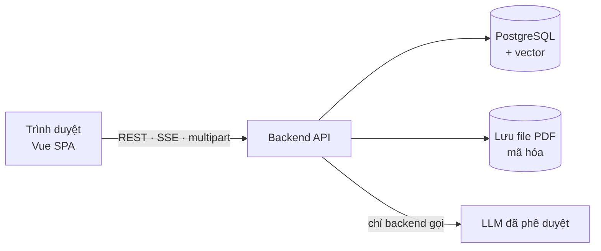

# Kế hoạch phát triển (Implement Plan) — Chat với tài liệu (MVP)

> **Phiên bản:** 0.1 (Draft) · **Ngày:** 2026-10-23
> **Căn cứ:** [SDD UI/UX](../design/SDD_UIUX_Blueprint.md) · [User stories xương sống](../user_stories/US_Backbone_Upload_va_HoiDap.md) · [PRD](../requirements/PRD.md) · [Prototype HTML](../design/html_design/index.html)
> **Phạm vi kế hoạch:** chỉ hai chức năng chính — **BB-01 Tải lên PDF** và **BB-02 Hỏi đáp có trích nguồn** — cùng phần tối thiểu để chạy được (đăng nhập). Các story P1/P2 khác làm sau.

> **Chi tiết từng task:** xem [README.md](README.md) trong thư mục này — 23 task (T01–T23), mỗi task một file với đặc tả, tiêu chí hoàn thành và cách kiểm thử.

## 1. Mục tiêu và kết quả

**Mục tiêu:** một người dùng đăng nhập, tải PDF lên workspace chung, hỏi bằng tiếng Việt/Anh và nhận câu trả lời **có trích dẫn tên tài liệu + trang kiểm chứng được**; khi không có căn cứ thì từ chối thay vì bịa.

**Sản phẩm bàn giao:** web app chạy được trên staging; bộ câu hỏi chuẩn (DEP-002) và báo cáo đánh giá; kiểm thử E2E cho luồng chính.

**Chỉ tiêu phải đạt:**

| Chỉ tiêu | Ngưỡng |
|---|---|
| Xử lý tài liệu 100 trang | p90 ≤ 60 s (TH-03) |
| Token đầu tiên / trả lời hoàn chỉnh | p90 ≤ 3 s / ≤ 15 s (TH-01/02) |
| Trích dẫn đúng trang | ≥ 90% (TH-04) |
| Câu hỏi ngoài phạm vi nhận "không tìm thấy" | ≥ 90% (TH-06) |
| Câu trả lời bịa đặt | ≤ 5% (TH-07) |

## 2. Việc cần chốt trước khi code (chặn tiến độ)

| # | Việc | Ai | Hạn chót |
|---|---|---|---|
| 1 | Chọn công nghệ backend và nhà cung cấp LLM (xem mục 3) | Tech Lead | Cuối Giai đoạn 0 |
| 2 | Thỏa thuận LLM không lưu, không huấn luyện + chữ ký An toàn thông tin/Pháp chế (D-006, G-08) | PO, ATTT | **Trước launch**; cần bắt đầu ngay vì thường lâu |
| 3 | Xác nhận AI không dùng kiến thức ngoài tài liệu (OQ-016) | Quản lý | Giai đoạn 0 |
| 4 | Backend trả được **vị trí đoạn trích** trên trang không? (OQ-UX-01) | Tech Lead | Giai đoạn 0 — quyết định cách làm nổi bật ở Giai đoạn 3 |
| 5 | Proxy nội bộ có đệm SSE không? (OQ-UX-02) | CNTT | Giai đoạn 0 |
| 6 | Bộ câu hỏi chuẩn DEP-002 (≥ 50 câu) và tập PDF thật để thử | Đội PTKD | Hoàn tất trước Giai đoạn 4; bắt đầu từ Giai đoạn 1 |

## 3. Kiến trúc và công nghệ

| Tầng | Chọn **[Đề xuất]** | Ghi chú |
|---|---|---|
| Frontend | **Vue 3** + TypeScript + Vite, Pinia, Vue Router, TanStack Query (vue-query), Reka UI + Tailwind, `pdfjs-dist`, `markdown-it` + DOMPurify | Theo SDD §1.2; tải lười pdf.js |
| Backend | Một service REST + SSE; **Java 21 + Spring Boot 3** (Maven); SSE bằng `SseEmitter` trên virtual threads | Chốt theo môi trường PC của đội (việc #1) |
| Dữ liệu | **PostgreSQL 16** + pgvector (một CSDL cho cả dữ liệu thường và vector), Flyway quản lý migration | Đủ cho 20 tài liệu; tránh thêm dịch vụ; cài native hoặc Docker |
| Xử lý PDF | Trích văn bản **từng trang** (Apache PDFBox `PDFTextStripper`); không OCR (D-008) | Giữ số trang + vị trí ký tự cho trích dẫn |
| Kiểm thử | Vitest + Vue Test Utils, Playwright + axe-core, MSW (API giả), JUnit 5 + Testcontainers | |

**Mô hình dữ liệu tối thiểu:** `users` · `documents` (tên, số trang, trạng thái, lỗi, người tải) · `chunks` (document, trang, offset, văn bản, vector) · `conversations` · `messages` (câu hỏi, câu trả lời, kết quả: answered/not_found/partial/…) · `citations` (message, chỉ số, document, trang, vị trí đoạn trích).

**Luồng xử lý lõi (backend):**

1. **Tải lên:** kiểm tra loại file + dung lượng + chỗ trống (nguyên tử, tối đa 20) → lưu file → tạo `documents` ở "Đang xử lý" → xử lý nền.
2. **Xử lý nền:** đếm trang, phát hiện mật khẩu/scan/hỏng/> 100 trang → trích văn bản từng trang → cắt đoạn (giữ trang + offset) → tạo vector → "Sẵn sàng" (hoặc "Lỗi" + lý do) → phát sự kiện SSE.
3. **Hỏi đáp:** vector hóa câu hỏi → lấy top-k đoạn từ **mọi** tài liệu sẵn sàng → gọi LLM với chỉ dẫn *"chỉ dùng nguồn đã cho, đánh dấu [n] cho mỗi ý, không có căn cứ thì trả NOT_FOUND"* → phát `delta`/`citation`/`done` qua SSE → lưu hội thoại.

## 4. Lộ trình

Thời lượng ước tính cho **1 FE + 1 BE toàn thời gian và 1 QA bán thời gian** [Đề xuất]; điều chỉnh khi biết nguồn lực thực tế (ngân sách/thời hạn còn mở — OQ-011). FE làm trên API giả (MSW) trong khi BE chưa xong.

| GĐ | Nội dung | Thời lượng | Kết quả kiểm chứng được |
|---|---|---|---|
| **0** | Nền tảng | 1 tuần | Repo + CI; khung Vue với design tokens; CSDL; **đăng nhập tối thiểu** (cookie HttpOnly, tài khoản Admin tạo sẵn); API giả; chốt các việc ở mục 2 |
| **1** | **BB-01 Tải lên PDF** | 2 tuần | Tải lên → Đang xử lý → Sẵn sàng/Lỗi đúng lý do; giới hạn 20 file; cập nhật thời gian thực |
| **2** | **BB-02 lõi hỏi đáp** | 2–3 tuần | Hỏi → câu trả lời streaming kèm `[n]` và danh sách nguồn; "không tìm thấy"; trả lời một phần |
| **3** | Kiểm chứng và độ bền | 1–1,5 tuần | Xem đoạn gốc (US-030), Dừng/Tạo lại (US-026), xử lý gián đoạn/quá hạn/lỗi, hỏi chéo ngôn ngữ |
| **4** | Chất lượng và phát hành | 1–2 tuần | Đánh giá DEP-002, thử tải, quét bảo mật, UAT 5 người, sửa lỗi |

**Tổng ≈ 7–9,5 tuần.** Giai đoạn 1 và phần hạ tầng LLM của Giai đoạn 2 (truy hồi, prompt) có thể chạy song song vì Giai đoạn 2 chỉ cần dữ liệu tài liệu mẫu.

## 5. Công việc chính theo giai đoạn

### GĐ 0 — Nền tảng
- [ ] Khởi tạo repo, lint (kèm luật ranh giới module R-1…R-6 của SDD), CI chạy test + build.
- [ ] `shared/ui`: tokens (màu, chữ, khoảng cách), Button, Input, Dialog, Toast, Tooltip, Skeleton.
- [ ] `shared/api` (xử lý 401/403, ánh xạ mã lỗi → thông điệp), `app` (router + guard, bố cục 3 cột).
- [ ] Backend: khung dự án, migration, đăng nhập/đăng xuất/`GET /me`, phiên 8 giờ, khóa tạm khi sai 5 lần.
- [ ] MSW mô phỏng IF-02, IF-03, IF-05, IF-06, IF-07.

### GĐ 1 — BB-01 Tải lên PDF
**FE:**
- [ ] Vùng kéo-thả toàn màn hình + chọn file; **ALG-02** (đuôi + `%PDF-` + ≤ 10 MB + chỗ trống, nhận theo thứ tự chọn).
- [ ] Hàng đợi tải lên (2 file song song, tiến trình, thử lại 1 s/2 s/4 s).
- [ ] `DocumentRow` 6 trạng thái (icon + chữ), thông điệp lỗi AC-012.x, cảnh báo trang không đọc được, bộ đếm x/20.
- [ ] Kênh SSE workspace + tự kết nối lại (ALG-03); trạng thái trống và ô nhập khóa (ST-04).

**BE:**
- [ ] IF-03 `POST /documents`: kiểm tra lại ràng buộc, giữ chỗ nguyên tử (hai người cùng tải khi còn 1 chỗ).
- [ ] Pipeline xử lý PDF (bước 2 mục 3) với đủ 7 loại lỗi AC-012.1–012.7 + cảnh báo AC-012.8.
- [ ] IF-02 `GET /documents`, IF-06 `GET /events` (SSE, `Last-Event-ID`), nhật ký kiểm toán, analytics EV-010…013.

**Nghiệm thu:** T1–T9 của BB-01; bộ file mẫu cho từng loại lỗi.

### GĐ 2 — BB-02 lõi hỏi đáp
**BE:**
- [ ] Tạo vector và truy hồi top-k đa tài liệu; prompt "chỉ dùng nguồn" + định dạng trích dẫn `[n]`.
- [ ] IF-05 `POST /conversations/:id/messages` → SSE (`meta`, `status`, `delta`, `citation`, `done`, `error`); phân loại `answered/not_found/partial`.
- [ ] Ngôn ngữ trả lời theo câu hỏi (Việt/Anh); chống chèn chỉ thị từ nội dung PDF (NFR-S05).
- [ ] Lưu hội thoại, ghi token và chi phí (EV-023).

**FE:**
- [ ] `Composer` (ST-04, bộ đếm 2.000 ký tự, Enter/Shift+Enter).
- [ ] `useAnswerStream` (**ALG-01**: fetch + ReadableStream, gộp delta theo khung hình, bộ đếm 30 s).
- [ ] `AnswerRenderer` (Markdown + sanitize, chip `[n]` chỉ thành nút khi đã có dữ liệu trích dẫn) và `AnswerCard` cho các trạng thái ST-02.
- [ ] Danh sách nguồn, câu hỏi gợi ý, dòng "AI có thể sai…", aria-live.

**Nghiệm thu:** T1–T8 của BB-02.

### GĐ 3 — Kiểm chứng và độ bền
- [ ] IF-07 + `SourceViewerPanel`: tải PDF theo byte-range, vẽ trang bằng pdf.js, làm nổi bật đoạn (tải lười + prefetch để ≤ 1,5 s). Nếu việc #4 trả lời "không": tìm chuỗi phía client.
- [ ] Dừng (≤ 1 s) và Tạo lại; trạng thái Dừng / Gián đoạn / Quá hạn / Lỗi dịch vụ.
- [ ] Trích dẫn tới tài liệu đã xóa → "Tài liệu đã bị xóa khỏi workspace".
- [ ] Kiểm thử hỏi chéo ngôn ngữ (AC-024.2).

**Nghiệm thu:** T9–T11 của BB-02.

### GĐ 4 — Chất lượng và phát hành
- [ ] Chạy DEP-002: đạt TH-04…TH-07, MET-002 ≥ 85% (G-04); tinh chỉnh prompt/top-k nếu chưa đạt.
- [ ] Thử tải 20 tài liệu × 100 trang, 10 người đồng thời (TH-01/02/03).
- [ ] Quét OWASP, kiểm thử XSS qua nội dung LLM/PDF (≥ 10 ca), kiểm thử phân quyền.
- [ ] axe-core + kiểm tra bàn phím và NVDA cho luồng chính.
- [ ] UAT ≥ 5 người PER-01: ≥ 4/5 hoàn thành "tải lên – hỏi – kiểm chứng" không cần hỗ trợ (G-12).
- [ ] Giám sát lỗi/độ trễ, cảnh báo chi phí LLM, sao lưu, kế hoạch rollback.

## 6. Cách làm việc

- **Lát cắt dọc:** mỗi giai đoạn kết thúc bằng một luồng chạy được end-to-end trên staging, không để FE và BE tích hợp muộn.
- **API trước:** chốt hợp đồng IF-0x (OpenAPI) ở GĐ 0; FE dùng MSW, BE dùng hợp đồng làm test.
- **Đo từ đầu:** ghi EV-xxx ngay khi làm tính năng, không để cuối.
- **Chất lượng AI là tính năng:** chạy lại DEP-002 sau mỗi thay đổi prompt/truy hồi; không chỉnh bằng cảm tính.
- **Quy tắc kiến trúc:** `fetch` chỉ ở `shared/api`; nội dung LLM chỉ render qua `shared/lib/markdown`; không lưu token ở `localStorage`.

## 7. Rủi ro chính

| Rủi ro | Mức | Giảm thiểu |
|---|---|---|
| Thỏa thuận LLM/ATTT chậm → chặn launch | Cao | Bắt đầu ngay; phát triển trên LLM được phép dùng thử; có phương án mô hình triển khai nội bộ nếu bị từ chối |
| Câu trả lời bịa hoặc trích dẫn sai trang | Cao | Prompt "chỉ dùng nguồn", NOT_FOUND bắt buộc, đo DEP-002 mỗi lần thay đổi, kiểm chứng bằng xem nguồn |
| Trích xuất PDF kém (bảng, bố cục nhiều cột, scan một phần) | TB | Hiển thị rõ file/trang không đọc được; thử sớm với PDF thật của đội |
| Proxy đệm SSE làm streaming giật | TB | Kiểm tra sớm (GĐ 0); phương án dự phòng: gửi từng đoạn ngắn có heartbeat |
| Bộ câu hỏi chuẩn chưa sẵn sàng | TB | Đội PTKD bắt đầu soạn từ GĐ 1; QA hỗ trợ định dạng |
| Chi phí LLM vượt ngân sách | TB | Ghi token từ GĐ 2, giới hạn top-k và độ dài ngữ cảnh, cảnh báo theo ngày |
| Phạm vi phình to | TB | Chỉ làm BB-01/BB-02; mục P1/P2 khác để sau khi đạt nghiệm thu GĐ 4 |

## 8. Điều kiện hoàn thành MVP lõi

- 100% tiêu chí chấp nhận P0 của BB-01 và BB-02 đạt (G-01); không còn lỗi Blocker/Critical (G-02).
- Đạt các chỉ tiêu ở mục 1 trên DEP-002 và thử tải (G-04, G-05).
- Bảo mật và phân quyền đạt (G-06, G-07); An toàn thông tin và Pháp chế đã ký (G-08).
- UAT đạt (G-12); có hướng dẫn sử dụng 1 trang nêu giới hạn và yêu cầu kiểm chứng trích dẫn (G-14).

## 9. Ngoài phạm vi kế hoạch này

Quản trị người dùng đầy đủ (US-002 – 005), xóa/tóm tắt/trùng tài liệu (US-013 – 015), hội thoại tiếp nối và lịch sử (US-025, US-040/041), đánh giá 👍/👎 (US-051), báo cáo tuần (US-050), nhật ký kiểm toán đầy đủ (US-061), OCR. Các mục P0 trong danh sách này (US-002/003, US-050, US-061) **vẫn bắt buộc trước launch** theo PRD và cần kế hoạch bổ sung sau GĐ 4.
