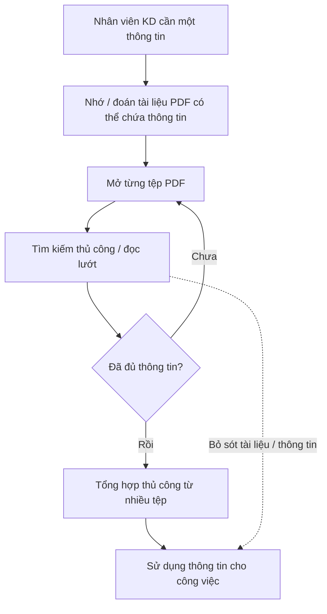
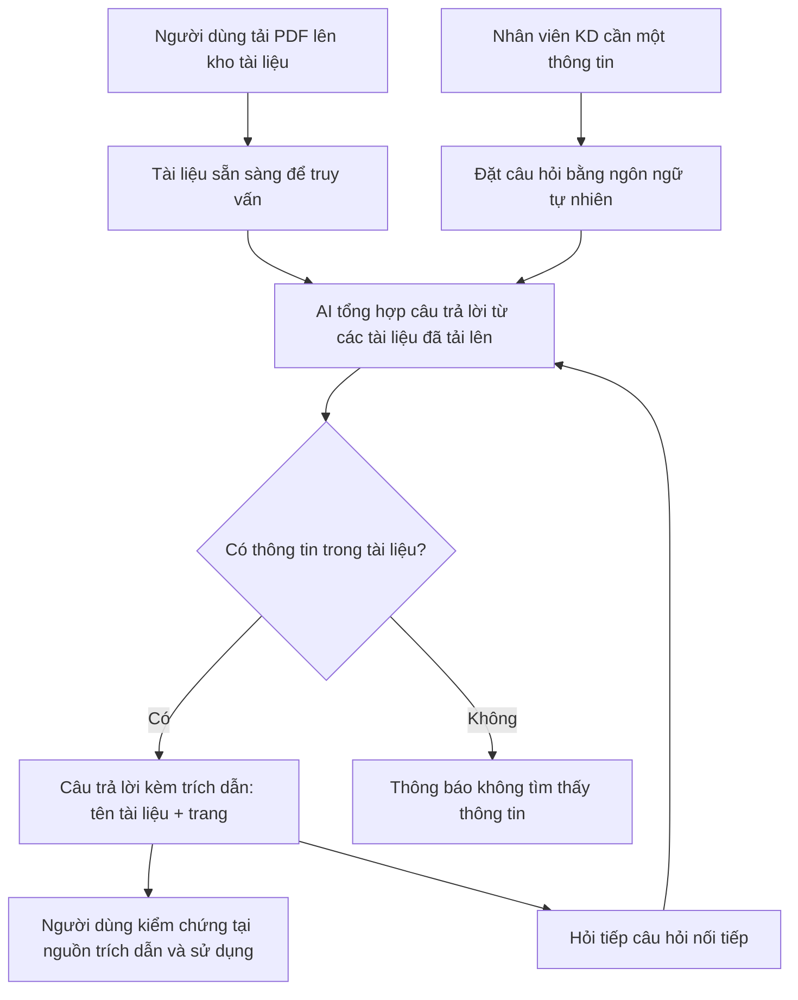

# Tài liệu Yêu cầu Nghiệp vụ (BRD) — Công cụ "Chat với tài liệu" (MVP)

> **Chuẩn áp dụng:** IEEE 29148-2018 · **Giai đoạn SDLC:** 5.2 Thu thập & khám phá yêu cầu
> **Quy ước từ chuẩn hóa:** **phải** = *shall* (bắt buộc) · **nên** = *should* (mong muốn) · **có thể** = *may* (được phép)

---

## 0. Tóm tắt kiểm tra đầu vào (Validation summary)

**Đầu vào đã nhận**

| Source ID | Nguồn | Loại | Chủ sở hữu | Ngày / Phiên bản | Nội dung chứng minh |
|---|---|---|---|---|---|
| SRC-001 | Bối cảnh & yêu cầu từ quản lý (mục 2.1 của prompt BRD) | Sponsor brief (mô tả ngắn) | Quản lý (người yêu cầu) | 2026-10-21 | Vấn đề nghiệp vụ, mục tiêu MVP, kênh web, định dạng PDF, mở cho đề xuất của đội BA |
| SRC-002 | `BRD_Prompt_IEEE_standard.md` | Hướng dẫn / quy trình | Đội dự án | v1.0 | Cấu trúc BRD, quy tắc chất lượng yêu cầu |
| SRC-003 | ISO/IEC/IEEE 29148:2018 | Tiêu chuẩn | ISO/IEC/IEEE | 2018 | Đặc tính của yêu cầu và tập yêu cầu |
| SRC-004 | Đề xuất của đội BA (trong tài liệu này) | Phân tích BA | Đội BA | 2026-10-21 | Các tính năng bổ sung: trích dẫn nguồn, quản lý tài liệu, lịch sử hội thoại, đánh giá câu trả lời — **cần sponsor xác nhận** (OQ-013) |

**Thông tin còn thiếu**

- Không có số liệu nền (baseline) về thời gian tra cứu, số lượng tài liệu, số người dùng → mọi chỉ tiêu định lượng đang là `[TBD]`.
- Không có tên sponsor, business owner, người phê duyệt; không có ngân sách, mốc thời gian.
- Không có phỏng vấn người dùng cuối (đội phát triển kinh doanh), không có chính sách bảo mật/phân loại dữ liệu.
- Không rõ ngôn ngữ tài liệu, tỷ lệ PDF dạng scan, phạm vi chia sẻ tài liệu giữa các thành viên.

**Ba rủi ro lớn nhất đối với chất lượng yêu cầu**

1. **Thiếu baseline** → mục tiêu nghiệp vụ không kiểm chứng được (RSK-007, OQ-001, OQ-002).
2. **Chưa xác định chính sách bảo mật dữ liệu khi dùng dịch vụ AI** → có thể chặn toàn bộ giải pháp (RSK-002, OQ-008).
3. **Các yêu cầu Must còn chỉ tiêu `[TBD]`** (BR-004, BR-011, BR-021) → chưa thể phê duyệt baseline cho đến khi các OQ liên quan được trả lời.

---

## 1. Kiểm soát tài liệu (Document control)

| Thuộc tính | Giá trị |
|---|---|
| Tiêu đề | Tài liệu Yêu cầu Nghiệp vụ — Công cụ "Chat với tài liệu" (MVP) |
| Mã tài liệu | BRD-DOCCHAT-001 |
| Phiên bản | 0.1 |
| Trạng thái | `Draft` |
| Tác giả | do98 — Business Analyst (soạn thảo với hỗ trợ AI) |
| Người đóng góp | Đội BA `[TBD: OQ-014]` |
| Người review | Đội phát triển kinh doanh, Đội phát triển, Bảo mật/IT `[TBD: OQ-014]` |
| Người phê duyệt | Quản lý — Executive sponsor `[TBD: OQ-014]` |
| Phân loại bảo mật | Nội bộ (Internal) |

**Lịch sử phiên bản**

| Phiên bản | Ngày | Tác giả | Tóm tắt thay đổi |
|---|---|---|---|
| 0.1 | 2026-10-21 | do98 | Bản nháp đầu tiên từ sponsor brief (SRC-001) và đề xuất BA (SRC-004) |

**Danh sách phân phối:** Quản lý (sponsor), Đội phát triển kinh doanh, Đội BA, Đội phát triển, Bộ phận Bảo mật/IT/Pháp chế.

---

## 2. Tóm tắt điều hành (Executive summary)

**Vấn đề.** Đội phát triển kinh doanh làm việc với nhiều tài liệu PDF và khó nắm bắt đầy đủ nội dung; mỗi lần cần một thông tin phải mở và tổng hợp thủ công từ nhiều tệp, tốn thời gian (SRC-001). Mức thiệt hại định lượng (giờ công/tuần, số lần tra cứu) chưa được đo `[TBD: OQ-001]`.

**Thay đổi đề xuất.** Xây dựng MVP một ứng dụng web cho phép người dùng tải tài liệu PDF lên và đặt câu hỏi bằng ngôn ngữ tự nhiên cho AI; AI trả lời dựa trên nội dung các tài liệu đã tải lên, kèm trích dẫn nguồn để người dùng kiểm chứng (SRC-001, SRC-004).

**Lợi ích kỳ vọng & chỉ số chứng minh.**
- Giảm thời gian tìm một thông tin trong tập tài liệu (MET-001).
- Câu trả lời đúng và kiểm chứng được trên bộ câu hỏi kiểm thử (MET-002).
- Mức độ sử dụng và hài lòng đủ để quyết định đầu tư giai đoạn tiếp theo (MET-003, MET-004).

**Đầu tư, thời gian, rủi ro chính.** Ngân sách và mốc thời gian chưa xác định `[TBD: OQ-011]`. Rủi ro chính: AI trả lời sai/bịa thông tin (RSK-001), lộ dữ liệu kinh doanh mật (RSK-002), chất lượng trích xuất PDF scan/bảng biểu kém (RSK-003).

**Quyết định cần từ người phê duyệt.**
1. Xác nhận phạm vi MVP (mục 5) và các tính năng BA đề xuất (OQ-013).
2. Chỉ định business owner và cung cấp/duyệt chỉ tiêu baseline–target (OQ-001, OQ-002, OQ-014).
3. Phê duyệt hướng xử lý bảo mật dữ liệu khi dùng dịch vụ AI (OQ-008).

---

## 3. Bối cảnh nghiệp vụ và phát biểu vấn đề

### 3.1 Quy trình hiện tại (As-is)

Mô tả dựa trên SRC-001; các bước chi tiết `[Unverified]` — cần xác nhận qua phỏng vấn người dùng (OQ-012).

### 3.2 Quy trình mong muốn (To-be)

### 3.3 Ai bị ảnh hưởng và như thế nào

| Nhóm | Ảnh hưởng | Bằng chứng |
|---|---|---|
| Đội phát triển kinh doanh | Mất thời gian tổng hợp thông tin từ nhiều PDF; khó nắm bắt đầy đủ | SRC-001 |
| Quản lý | Năng suất đội KD giảm; quyết định có thể dựa trên thông tin thiếu | SRC-001 (năng suất); phần "quyết định thiếu thông tin" `[Unverified]` |

### 3.4 Chi phí của việc không thay đổi

- **Chi phí thời gian:** giờ công dành cho tra cứu thủ công `[TBD: OQ-001]`.
- **Rủi ro nghiệp vụ:** bỏ sót thông tin quan trọng trong tài liệu khi trao đổi với khách hàng/đối tác `[Unverified]`.
- **Doanh thu / tuân thủ / khách hàng:** chưa có bằng chứng `[TBD: OQ-001]`.

### 3.5 Nguyên nhân gốc rễ (phân biệt với triệu chứng)

| Triệu chứng | Nguyên nhân gốc rễ (giả thuyết, cần xác nhận) |
|---|---|
| Tốn thời gian tìm thông tin | Thông tin phân tán trong nhiều tệp PDF; không có điểm truy vấn tập trung trên toàn bộ nội dung `[Unverified]` |
| Khó nắm bắt đầy đủ | Khối lượng tài liệu lớn vượt khả năng đọc của đội; công cụ tìm kiếm theo từ khóa trong từng tệp không tổng hợp được nhiều nguồn `[Unverified]` |

### 3.6 Vì sao là bây giờ

Quản lý đã yêu cầu phát triển MVP (SRC-001). Mốc thời gian và sự kiện kích hoạt cụ thể chưa được nêu `[TBD: OQ-011]`.

---

## 4. Động lực và mục tiêu nghiệp vụ

| ID | Động lực nghiệp vụ | Mục tiêu (kết quả, không phải hoạt động) | Metric ID | Baseline | Target | Thời hạn | Nguồn |
|---|---|---|---|---|---|---|---|
| BO-001 | Tra cứu thông tin trong nhiều PDF tốn thời gian | Giảm thời gian để người dùng tìm được một thông tin cần thiết trong tập tài liệu | MET-001 | `[TBD: OQ-001]` | `[TBD: OQ-002]` | Cuối giai đoạn pilot MVP `[TBD: OQ-011]` | SRC-001 |
| BO-002 | Khó nắm bắt đầy đủ nội dung tài liệu | Người dùng nhận được thông tin đúng, đầy đủ và kiểm chứng được từ tài liệu | MET-002 | `[TBD: OQ-003]` | `[TBD: OQ-003]` | Cuối giai đoạn pilot MVP | SRC-001, SRC-004 |
| BO-003 | Cần kiểm chứng giá trị trước khi đầu tư đầy đủ (bản chất MVP) | Có đủ dữ liệu sử dụng và phản hồi để ra quyết định go/no-go cho giai đoạn tiếp theo | MET-003, MET-004 | 0 (công cụ chưa tồn tại) | `[TBD: OQ-002]` | Cuối giai đoạn pilot MVP | SRC-001 |

### 4.1 Định nghĩa chỉ số

| Metric ID | Định nghĩa | Công thức | Nguồn dữ liệu | Chủ sở hữu | Tần suất | Ngày baseline |
|---|---|---|---|---|---|---|
| MET-001 | Thời gian trung bình để tìm được câu trả lời cho một câu hỏi nghiệp vụ trong tập tài liệu | Tổng thời gian tìm (phút) / số câu hỏi, đo trên cùng một bộ câu hỏi chuẩn, trước (thủ công) và sau (dùng công cụ) | Phiên đo có bấm giờ với người dùng pilot | Business owner `[TBD: OQ-014]` | Một lần trước pilot, một lần cuối pilot | `[TBD: OQ-001]` |
| MET-002 | Tỷ lệ câu trả lời đạt yêu cầu trên bộ câu hỏi kiểm thử | Số câu trả lời được chuyên gia nghiệp vụ chấm "đúng và có trích dẫn đúng nguồn" / tổng số câu hỏi kiểm thử × 100% | Bộ câu hỏi kiểm thử + đáp án do đội KD cung cấp (DEP-003) | Business owner | Mỗi bản phát hành MVP | `[TBD: OQ-003]` |
| MET-003 | Số người dùng hoạt động hằng tuần | Số người dùng khác nhau đặt ít nhất 1 câu hỏi trong tuần / số người dùng pilot × 100% | Số liệu sử dụng của công cụ (BR-023) | Product owner `[TBD: OQ-014]` | Hằng tuần | Ngày bắt đầu pilot |
| MET-004 | Tỷ lệ câu trả lời được người dùng đánh giá hữu ích | Số đánh giá "hữu ích" / tổng số đánh giá × 100% | Đánh giá của người dùng (BR-022) | Product owner | Hằng tuần | Ngày bắt đầu pilot |

---

## 5. Phạm vi (Scope)

### 5.1 Trong phạm vi (MVP)

- **Năng lực nghiệp vụ:** đưa tài liệu PDF vào kho; hỏi đáp bằng ngôn ngữ tự nhiên trên nội dung tài liệu; trích dẫn nguồn câu trả lời; quản lý danh sách tài liệu; thu thập số liệu đo lường MVP.
- **Đơn vị tổ chức:** Đội phát triển kinh doanh (người dùng pilot) `[TBD: OQ-012]`.
- **Kênh:** ứng dụng web truy cập qua trình duyệt (CON-001).
- **Miền dữ liệu:** tài liệu PDF nghiệp vụ của dự án kinh doanh.
- **Địa lý:** `[TBD: OQ-012]`.

### 5.2 Ngoài phạm vi

| Hạng mục | Lý do |
|---|---|
| Định dạng khác PDF (Word, Excel, PowerPoint, ảnh, email) | Sponsor chỉ yêu cầu PDF (SRC-001) |
| Kết nối tự động với kho tài liệu bên ngoài (Google Drive, SharePoint…) | Không có trong yêu cầu MVP; tăng phạm vi tích hợp |
| AI soạn thảo/chỉnh sửa tài liệu, tạo báo cáo | Mục tiêu là truy vấn nội dung, không phải tạo nội dung |
| Trả lời dựa trên kiến thức bên ngoài tài liệu (Internet) | Mâu thuẫn với mục tiêu kiểm chứng được (BO-002, BRU-002) |
| Ứng dụng di động gốc (native app) | Sponsor yêu cầu ứng dụng web (SRC-001) |

### 5.3 Hoãn lại (Deferred)

| Hạng mục | Giai đoạn dự kiến |
|---|---|
| Nhận dạng ký tự (OCR) cho PDF dạng scan | Chờ quyết định OQ-010 |
| Phân quyền chi tiết theo nhóm/dự án | Chờ quyết định OQ-007 |
| Lịch sử hội thoại lâu dài (BR-019) | Có thể đưa vào MVP nếu sponsor đồng ý (OQ-013) |
| Xuất câu trả lời/hội thoại ra tệp | Sau MVP |

### 5.4 Ranh giới

Sáng kiến bắt đầu từ thời điểm người dùng có tệp PDF trong tay và kết thúc khi người dùng nhận được câu trả lời có trích dẫn. Việc thu thập, tạo lập, phê duyệt nội dung tài liệu gốc nằm ngoài sáng kiến. Việc người dùng sử dụng câu trả lời cho quyết định kinh doanh thuộc trách nhiệm người dùng (BRU-005).

---

## 6. Các bên liên quan và nhu cầu

### 6.1 Danh sách bên liên quan

| ID | Bên liên quan / nhóm | Vai trò nghiệp vụ | Mối quan tâm | Ảnh hưởng | Nhu cầu | Nguồn |
|---|---|---|---|---|---|---|
| STK-001 | Quản lý (người yêu cầu) | Executive sponsor, ra quyết định đầu tư | Năng suất đội KD; bằng chứng giá trị của MVP | High | SN-005, SN-006 | SRC-001 |
| STK-002 | Đội phát triển kinh doanh | Người dùng chính | Tìm thông tin nhanh, đầy đủ, tin cậy | High | SN-001, SN-002, SN-003, SN-004, SN-008, SN-009 | SRC-001 |
| STK-003 | Đội BA | Phân tích, đề xuất tính năng, chuyển giao yêu cầu | Yêu cầu rõ ràng, truy vết được sang PRD/SRS | Med | SN-010 | SRC-001 |
| STK-004 | Đội phát triển | Xây dựng MVP | Phạm vi khả thi, chỉ tiêu rõ ràng | Med | SN-011 | SRC-001 (ngụ ý) `[Unverified]` |
| STK-005 | Bảo mật / IT / Pháp chế | Kiểm soát dữ liệu, có thể **chặn triển khai** | Tài liệu kinh doanh không bị lộ; tuân thủ chính sách dữ liệu | High | SN-007 | `[Unverified]` — cần xác nhận tồn tại vai trò này (OQ-008) |
| STK-006 | Chủ sở hữu nội dung tài liệu (khách hàng/đối tác có điều khoản bảo mật) | Bên thứ ba bị tác động gián tiếp, có thể **phản đối** việc đưa tài liệu lên AI | Thỏa thuận bảo mật (NDA) được tôn trọng | Med | SN-007 | `[Unverified]` (OQ-008) |

### 6.2 Nhu cầu của bên liên quan

| ID | Bên liên quan | Phát biểu nhu cầu | Khó khăn hiện tại | Bằng chứng | Ưu tiên |
|---|---|---|---|---|---|
| SN-001 | STK-002 | "Tôi cần tìm một thông tin trong nhiều tài liệu mà không phải mở từng tệp." | Mở và đọc thủ công nhiều PDF | SRC-001 | Must |
| SN-002 | STK-002 | "Tôi muốn tự đưa tài liệu PDF của mình vào công cụ." | Không có kho tập trung để truy vấn | SRC-001 | Must |
| SN-003 | STK-002 | "Tôi muốn hỏi bằng câu hỏi thông thường và nhận câu trả lời đã tổng hợp." | Phải tự tổng hợp từ nhiều nguồn | SRC-001 | Must |
| SN-004 | STK-002 | "Tôi cần biết câu trả lời lấy từ tài liệu nào, trang nào để kiểm tra lại." | Không tin tưởng được câu trả lời AI nếu không có nguồn | SRC-004 `[Unverified]` | Must |
| SN-005 | STK-001 | "Tôi cần một MVP sớm để đánh giá có nên đầu tư tiếp." | Chưa có bằng chứng giá trị | SRC-001 | Must |
| SN-006 | STK-001 | "Tôi cần số liệu cho thấy công cụ có giúp đội làm việc hiệu quả hơn." | Không có số liệu đo | SRC-001 (ngụ ý), SRC-002 | Must |
| SN-007 | STK-005, STK-006 | "Tài liệu kinh doanh chỉ được người có quyền truy cập." | Rủi ro lộ dữ liệu khi đưa lên công cụ AI | `[Unverified]` | Must |
| SN-008 | STK-002 | "Tôi muốn xem và loại bỏ những tài liệu đã đưa lên." | Tài liệu lỗi thời làm sai câu trả lời | SRC-004 `[Unverified]` | Should |
| SN-009 | STK-002 | "Tôi muốn hỏi tiếp và xem lại các câu hỏi trước." | Phải hỏi lại từ đầu | SRC-004 `[Unverified]` | Should |
| SN-010 | STK-003 | "Tôi cần yêu cầu nghiệp vụ được truy vết để viết PRD/SRS." | — | SRC-002 | Should |
| SN-011 | STK-004 | "Tôi cần chỉ tiêu định lượng rõ ràng để thiết kế và kiểm thử." | Chỉ tiêu chưa có | SRC-002 | Should |

---

## 7. Yêu cầu nghiệp vụ

Thang ưu tiên: **Must** (thiếu thì sáng kiến thất bại) · **Should** (giá trị đáng kể, có cách thay thế) · **Could** (mong muốn) · **Won't** (loại khỏi bản phát hành này).
Ánh xạ thang 1–5 (nếu tổ chức sử dụng): Must = 5, Should = 4, Could = 2–3, Won't = 1.

### 7.1 Nhóm A — Đưa tài liệu vào kho

| ID | Yêu cầu | Lý do | Nguồn | Ưu tiên | AC | Phương pháp kiểm chứng | Trạng thái |
|---|---|---|---|---|---|---|---|
| BR-001 | Người dùng **phải** tải được tệp PDF lên kho tài liệu của công cụ. | Không có tài liệu thì không có gì để truy vấn | BO-001 / SN-002 | Must | AC-001 | Demonstration | Draft |
| BR-002 | Khi người dùng tải lên tệp không phải PDF, công cụ **phải** từ chối tệp đó và hiển thị lý do từ chối. | Thực thi BRU-001 | BO-002 / SN-002 | Must | AC-002 | Test | Draft |
| BR-003 | Người dùng **nên** tải được nhiều tệp PDF trong một lần thao tác, tối đa `[TBD: OQ-004]` tệp. | Giảm công sức khi nạp tập tài liệu lớn | BO-001 / SN-002 | Should | AC-003 | Test | Draft |
| BR-004 | Tệp PDF có dung lượng không vượt giới hạn tại BRU-003 **phải** sẵn sàng để truy vấn trong vòng `[TBD: OQ-005]` phút kể từ khi tải lên hoàn tất. | Người dùng cần dùng tài liệu ngay trong ngày làm việc | BO-001 / SN-002 | Must | AC-004 | Test | Draft — chặn bởi OQ-005 |
| BR-005 | Khi không trích xuất được nội dung văn bản từ tệp PDF, công cụ **phải** thông báo cho người dùng rằng tệp đó không thể truy vấn. | Tránh người dùng tưởng tài liệu đã được dùng để trả lời (RSK-003) | BO-002 / SN-004 | Must | AC-005 | Test | Draft |

### 7.2 Nhóm B — Hỏi đáp trên nội dung tài liệu

| ID | Yêu cầu | Lý do | Nguồn | Ưu tiên | AC | Phương pháp kiểm chứng | Trạng thái |
|---|---|---|---|---|---|---|---|
| BR-006 | Người dùng **phải** đặt được câu hỏi bằng ngôn ngữ tự nhiên về nội dung các tài liệu đã tải lên. | Năng lực cốt lõi của sáng kiến | BO-001 / SN-003 | Must | AC-006 | Demonstration | Draft |
| BR-007 | Công cụ **phải** tạo câu trả lời chỉ từ nội dung các tài liệu mà người dùng được phép truy cập trong kho. | Bảo đảm câu trả lời kiểm chứng được (BRU-002) | BO-002 / SN-003 | Must | AC-007 | Test | Draft |
| BR-008 | Khi thông tin liên quan nằm ở nhiều tài liệu, công cụ **phải** tổng hợp thông tin từ tất cả các tài liệu đó vào một câu trả lời. | Đây là khó khăn chính hiện tại (tổng hợp từ nhiều tệp) | BO-001 / SN-001 | Must | AC-008 | Test | Draft |
| BR-009 | Khi các tài liệu không chứa thông tin để trả lời câu hỏi, công cụ **phải** thông báo rằng không tìm thấy thông tin trong tài liệu. | Ngăn câu trả lời bịa đặt (RSK-001) | BO-002 / SN-004 | Must | AC-009 | Test | Draft |
| BR-010 | Khi câu hỏi được đặt bằng tiếng Việt, công cụ **phải** trả lời bằng tiếng Việt. | Người dùng là đội KD tại Việt Nam `[Unverified]` | BO-001 / SN-003 | Must | AC-010 | Test | Draft — phạm vi ngôn ngữ chờ OQ-009 |
| BR-011 | Công cụ **phải** trả lời `[TBD: OQ-006]`% câu hỏi trong vòng `[TBD: OQ-006]` giây kể từ khi người dùng gửi câu hỏi. | Thời gian chờ quyết định việc công cụ có nhanh hơn tra cứu thủ công (MET-001) | BO-001 / SN-001 | Must | AC-011 | Test | Draft — chặn bởi OQ-006 |
| BR-012 | Trong cùng một phiên hội thoại, công cụ **nên** trả lời câu hỏi nối tiếp có tính đến nội dung các câu hỏi và câu trả lời trước đó trong phiên. | Người dùng thường làm rõ dần thông tin | BO-001 / SN-009 | Should | AC-012 | Test | Draft |
| BR-013 | Người dùng **có thể** giới hạn phạm vi câu hỏi vào một hoặc một số tài liệu được chọn. | Tăng độ chính xác khi kho có nhiều tài liệu không liên quan | BO-002 / SN-001 | Could | AC-013 | Test | Draft |

### 7.3 Nhóm C — Kiểm chứng câu trả lời

| ID | Yêu cầu | Lý do | Nguồn | Ưu tiên | AC | Phương pháp kiểm chứng | Trạng thái |
|---|---|---|---|---|---|---|---|
| BR-014 | Mỗi câu trả lời có nội dung từ tài liệu **phải** kèm trích dẫn gồm tên tài liệu và số trang của từng nguồn được sử dụng. | Người dùng cần kiểm chứng trước khi dùng thông tin (đề xuất BA) | BO-002 / SN-004 | Must | AC-014 | Test | Draft — chờ sponsor xác nhận OQ-013 |
| BR-015 | Người dùng **nên** xem được đoạn nội dung gốc tương ứng với mỗi trích dẫn. | Rút ngắn thời gian kiểm chứng | BO-002 / SN-004 | Should | AC-015 | Demonstration | Draft |

### 7.4 Nhóm D — Quản lý tài liệu

| ID | Yêu cầu | Lý do | Nguồn | Ưu tiên | AC | Phương pháp kiểm chứng | Trạng thái |
|---|---|---|---|---|---|---|---|
| BR-016 | Người dùng **phải** xem được danh sách các tài liệu trong kho mà mình được phép truy cập. | Người dùng cần biết câu trả lời dựa trên tập tài liệu nào | BO-002 / SN-008 | Must | AC-016 | Demonstration | Draft |
| BR-017 | Người dùng **nên** xóa được một tài liệu do mình tải lên khỏi kho. | Loại bỏ tài liệu lỗi thời, tải nhầm | BO-002 / SN-008 | Should | AC-017 | Test | Draft |
| BR-018 | Sau khi một tài liệu bị xóa, công cụ **phải** không sử dụng nội dung của tài liệu đó cho các câu trả lời mới. | Thực thi BRU-004; tránh trả lời từ tài liệu không còn hiệu lực | BO-002 / SN-007 | Must | AC-018 | Test | Draft |

### 7.5 Nhóm E — Lịch sử hội thoại

| ID | Yêu cầu | Lý do | Nguồn | Ưu tiên | AC | Phương pháp kiểm chứng | Trạng thái |
|---|---|---|---|---|---|---|---|
| BR-019 | Người dùng **có thể** xem lại các phiên hội thoại trước đó của chính mình. | Tránh hỏi lại thông tin đã tra cứu | BO-001 / SN-009 | Could | AC-019 | Demonstration | Draft — chờ OQ-013, OQ-015 |

### 7.6 Nhóm F — Truy cập và bảo vệ dữ liệu

| ID | Yêu cầu | Lý do | Nguồn | Ưu tiên | AC | Phương pháp kiểm chứng | Trạng thái |
|---|---|---|---|---|---|---|---|
| BR-020 | Chỉ người dùng đã được xác thực và nằm trong danh sách người dùng được cấp quyền **phải** truy cập được công cụ. | Tài liệu kinh doanh là dữ liệu nội bộ | BO-002 / SN-007 | Must | AC-020 | Test | Draft — cơ chế xác thực chờ OQ-016 |
| BR-021 | Một tài liệu **phải** chỉ được xem và truy vấn bởi người dùng thuộc phạm vi chia sẻ `[TBD: OQ-007]` của tài liệu đó. | Ngăn người không có quyền tiếp cận nội dung | BO-002 / SN-007 | Must | AC-021 | Test | Draft — chặn bởi OQ-007 |

### 7.7 Nhóm G — Đo lường MVP

| ID | Yêu cầu | Lý do | Nguồn | Ưu tiên | AC | Phương pháp kiểm chứng | Trạng thái |
|---|---|---|---|---|---|---|---|
| BR-022 | Người dùng **nên** đánh giá được mỗi câu trả lời là "hữu ích" hoặc "không hữu ích". | Cung cấp dữ liệu cho MET-004 | BO-003 / SN-006 | Should | AC-022 | Demonstration | Draft |
| BR-023 | Product owner **phải** nhận được báo cáo hằng tuần gồm số người dùng hoạt động và số câu hỏi được đặt trong tuần. | Cung cấp dữ liệu cho MET-003 và quyết định go/no-go | BO-003 / SN-005, SN-006 | Must | AC-023 | Inspection | Draft |

### 7.8 Tiêu chí chấp nhận

| ID | Yêu cầu | Tiêu chí chấp nhận (quyết định được khách quan) |
|---|---|---|
| AC-001 | BR-001 | Với 1 tệp PDF hợp lệ nằm trong giới hạn BRU-003, sau khi tải lên, tệp xuất hiện trong danh sách tài liệu của người dùng. |
| AC-002 | BR-002 | Với các tệp .docx, .xlsx, .jpg và một tệp đổi đuôi thành .pdf nhưng không phải PDF, 4/4 tệp bị từ chối và mỗi lần đều hiển thị thông báo nêu lý do là sai định dạng. |
| AC-003 | BR-003 | Chọn đồng thời `[TBD: OQ-004]` tệp PDF hợp lệ trong một thao tác; 100% tệp xuất hiện trong danh sách tài liệu. |
| AC-004 | BR-004 | Với bộ 10 tệp PDF mẫu (DEP-003) trong giới hạn BRU-003, 10/10 tệp trả lời được một câu hỏi về nội dung của chính nó trong vòng `[TBD: OQ-005]` phút sau khi tải lên hoàn tất. |
| AC-005 | BR-005 | Với 1 tệp PDF chỉ chứa ảnh scan (không có lớp văn bản), người dùng nhận được thông báo rằng tệp không thể truy vấn. |
| AC-006 | BR-006 | Người dùng pilot nhập 5 câu hỏi dạng câu hoàn chỉnh (không dùng cú pháp đặc biệt) và nhận được câu trả lời cho cả 5. |
| AC-007 | BR-007 | Với 10 câu hỏi mà đáp án có trong kiến thức phổ thông nhưng **không** có trong tài liệu, 10/10 câu trả lời không đưa ra nội dung ngoài tài liệu (được thông báo "không tìm thấy" theo BR-009). |
| AC-008 | BR-008 | Với 10 câu hỏi có đáp án nằm rải rác ở ít nhất 2 tài liệu khác nhau, chuyên gia nghiệp vụ chấm ≥ `[TBD: OQ-003]`/10 câu trả lời có đủ thông tin từ tất cả các tài liệu liên quan. |
| AC-009 | BR-009 | Với 10 câu hỏi không có đáp án trong tài liệu, ≥ `[TBD: OQ-003]`/10 câu trả lời là thông báo không tìm thấy thông tin. |
| AC-010 | BR-010 | Với 10 câu hỏi tiếng Việt, 10/10 câu trả lời được viết bằng tiếng Việt. |
| AC-011 | BR-011 | Trên ≥ 100 câu hỏi trong giai đoạn kiểm thử chấp nhận, tỷ lệ câu trả lời hiển thị trong vòng `[TBD: OQ-006]` giây đạt ≥ `[TBD: OQ-006]`%. |
| AC-012 | BR-012 | Với 5 cặp câu hỏi trong đó câu thứ hai dùng đại từ thay thế (ví dụ: "Còn thời hạn của **nó** thì sao?"), ≥ 4/5 câu trả lời thứ hai được chuyên gia chấm đúng ngữ cảnh. |
| AC-013 | BR-013 | Khi chọn 1 tài liệu A và hỏi về nội dung chỉ có trong tài liệu B, câu trả lời không chứa trích dẫn từ tài liệu B. |
| AC-014 | BR-014 | Trên bộ câu hỏi kiểm thử MET-002, 100% câu trả lời có nội dung từ tài liệu có trích dẫn; ≥ `[TBD: OQ-003]`% trích dẫn trỏ đúng tài liệu và trang chứa thông tin. |
| AC-015 | BR-015 | Với 5 trích dẫn bất kỳ, người dùng mở được đoạn nội dung gốc của cả 5 trích dẫn. |
| AC-016 | BR-016 | Người dùng có 3 tài liệu được phép truy cập thấy đúng 3 tài liệu đó trong danh sách, kèm tên tệp. |
| AC-017 | BR-017 | Sau khi người dùng xóa 1 tài liệu do mình tải lên, tài liệu đó không còn xuất hiện trong danh sách (BR-016). |
| AC-018 | BR-018 | Sau khi xóa tài liệu X, hỏi 5 câu chỉ có đáp án trong X: 5/5 câu trả lời không chứa nội dung hoặc trích dẫn từ X. |
| AC-019 | BR-019 | Sau khi đăng xuất và đăng nhập lại, người dùng thấy và mở được phiên hội thoại trước đó của mình, và không thấy phiên của người dùng khác. |
| AC-020 | BR-020 | Truy cập công cụ khi chưa xác thực, hoặc bằng tài khoản không nằm trong danh sách được cấp quyền: 100% lần thử bị từ chối truy cập. |
| AC-021 | BR-021 | Người dùng ngoài phạm vi chia sẻ của tài liệu Y: không thấy Y trong danh sách và 5/5 câu hỏi về nội dung riêng của Y không trả về nội dung hoặc trích dẫn từ Y. |
| AC-022 | BR-022 | Người dùng gửi đánh giá cho 1 câu trả lời; đánh giá đó được tính trong số liệu MET-004 của tuần. |
| AC-023 | BR-023 | Trong 2 tuần pilot liên tiếp, product owner nhận được báo cáo mỗi tuần; số câu hỏi trong báo cáo lệch ≤ 5% so với số câu hỏi đếm từ mẫu kiểm tra. |

---

## 8. Quy tắc nghiệp vụ

| ID | Quy tắc | Loại | Phạm vi | Chủ sở hữu thực thi | Nguồn |
|---|---|---|---|---|---|
| BRU-001 | Trong MVP, chỉ tài liệu định dạng PDF được đưa vào kho. | Policy | Đưa tài liệu vào kho | Product owner | SRC-001 |
| BRU-002 | Câu trả lời chỉ được dựa trên nội dung tài liệu trong kho; không bổ sung kiến thức bên ngoài. | Decision | Hỏi đáp | Product owner | SRC-001 (diễn giải "truy vấn về nội dung các tài liệu đã upload"); cần sponsor xác nhận `[Unverified]` |
| BRU-003 | Mỗi tệp PDF không vượt quá `[TBD: OQ-004]` MB và `[TBD: OQ-004]` trang. | Policy | Đưa tài liệu vào kho | Product owner | `[TBD: OQ-004]` |
| BRU-004 | Tài liệu đã bị xóa khỏi kho không được dùng làm nguồn cho câu trả lời mới. | Policy | Quản lý tài liệu, hỏi đáp | Product owner | SRC-004 |
| BRU-005 | Câu trả lời của công cụ mang tính tham khảo; người dùng phải kiểm chứng tại nguồn trích dẫn trước khi dùng cho quyết định hoặc cam kết với khách hàng. | Policy | Sử dụng câu trả lời | Business owner | `[Unverified]` (OQ-017) |
| BRU-006 | Thời gian lưu giữ tài liệu và hội thoại trong công cụ là `[TBD: OQ-015]`. | Legal / Policy | Dữ liệu | Bảo mật/IT | `[TBD: OQ-015]` |

---

## 9. Ràng buộc

| ID | Ràng buộc | Loại | Bên áp đặt | Tác động | Nguồn |
|---|---|---|---|---|---|
| CON-001 | Giải pháp là ứng dụng web, người dùng truy cập qua trình duyệt. | Technical | Quản lý (sponsor) | Loại trừ ứng dụng desktop/di động gốc | SRC-001 |
| CON-002 | Câu trả lời được tạo bởi AI (mô hình ngôn ngữ). | Technical | Quản lý (sponsor) | Cần quản lý rủi ro độ chính xác (RSK-001) và dữ liệu (RSK-002) | SRC-001 |
| CON-003 | Sản phẩm bàn giao ở mức MVP. | Organizational | Quản lý (sponsor) | Ưu tiên Must; các mục Should/Could có thể bị cắt | SRC-001 |
| CON-004 | Nguồn dữ liệu đầu vào chỉ là tệp PDF. | Organizational | Quản lý (sponsor) | Xem BRU-001 | SRC-001 |
| CON-005 | Ngân sách và thời hạn MVP: `[TBD: OQ-011]`. | Budget / Time | Quản lý (sponsor) | Quyết định số lượng yêu cầu Should/Could được thực hiện | `[TBD: OQ-011]` |
| CON-006 | Chính sách bảo mật dữ liệu nội bộ và điều khoản bảo mật với đối tác (nếu có). | Regulatory / Contractual | Bảo mật/Pháp chế, đối tác | Có thể giới hạn việc gửi tài liệu tới dịch vụ AI bên ngoài | `[Unverified]` (OQ-008) |

---

## 10. Giả định, phụ thuộc và rủi ro

| ID | Hạng mục | Loại | Mô tả | Tác động nếu sai | Chủ sở hữu | Xác nhận / giảm thiểu | Hạn |
|---|---|---|---|---|---|---|---|
| ASM-001 | PDF có lớp văn bản | Assumption | Phần lớn tài liệu là PDF có lớp văn bản, không phải bản scan | Nhiều tài liệu không truy vấn được; cần OCR, tăng phạm vi | Đội BA | Lấy mẫu 20 tệp từ đội KD, đếm tỷ lệ bản scan | 2026-10-28 |
| ASM-002 | Ngôn ngữ tài liệu | Assumption | Tài liệu chủ yếu bằng tiếng Việt và/hoặc tiếng Anh | Chất lượng trả lời giảm với ngôn ngữ khác | Đội BA | Xác nhận qua OQ-009 | 2026-10-28 |
| ASM-003 | Được phép dùng dịch vụ AI | Assumption | Tổ chức cho phép gửi nội dung tài liệu tới dịch vụ AI đã được phê duyệt | Có thể phải đổi hướng giải pháp hoặc dừng MVP | Bảo mật/IT | Xác nhận qua OQ-008 trước khi bắt đầu xây dựng | 2026-10-28 |
| ASM-004 | Quy mô pilot nhỏ | Assumption | Pilot với một nhóm người dùng nhỏ của đội KD `[TBD: OQ-012]` | Chỉ tiêu hiệu năng/chi phí sai lệch | Quản lý | Xác nhận qua OQ-012 | 2026-10-28 |
| ASM-005 | Tài khoản người dùng | Assumption | Người dùng có tài khoản công ty có thể dùng để xác thực | Phải xây dựng quản lý tài khoản riêng | Bảo mật/IT | Xác nhận qua OQ-016 | 2026-11-04 |
| DEP-001 | Dịch vụ mô hình AI | Dependency | Có quyền truy cập và ngân sách cho dịch vụ mô hình AI | Không thể đáp ứng BR-006 đến BR-014 | Đội phát triển | Theo dõi phê duyệt ngân sách (OQ-011) | 2026-11-04 |
| DEP-002 | Phê duyệt bảo mật | Dependency | Bộ phận Bảo mật/Pháp chế phê duyệt việc xử lý tài liệu | Không được triển khai pilot | Bảo mật/IT | Lên lịch review bảo mật | 2026-11-04 |
| DEP-003 | Bộ tài liệu & câu hỏi kiểm thử | Dependency | Đội KD cung cấp ≥ 10 PDF mẫu và bộ câu hỏi có đáp án | Không đo được MET-002, không kiểm chứng AC-004, AC-007–AC-014 | Business owner | Yêu cầu chính thức tới đội KD | 2026-11-04 |
| DEP-004 | Đo baseline | Dependency | Thực hiện phiên đo thời gian tra cứu thủ công trước pilot | Không chứng minh được BO-001 | Đội BA | Lập kế hoạch phiên đo | 2026-11-11 |
| RSK-001 | AI trả lời sai | Risk | AI suy diễn ngoài tài liệu → người dùng nhận thông tin sai → quyết định kinh doanh sai | Cao | Product owner | BR-007, BR-009, BR-014, BRU-005; đo MET-002 mỗi bản phát hành | Liên tục |
| RSK-002 | Lộ dữ liệu | Risk | Tài liệu mật bị truy cập trái phép hoặc gửi tới bên thứ ba không được phép → vi phạm chính sách/NDA → thiệt hại pháp lý, uy tín | Cao | Bảo mật/IT | BR-020, BR-021, CON-006; review bảo mật (DEP-002) | 2026-11-04 |
| RSK-003 | PDF khó trích xuất | Risk | PDF scan, bảng biểu, nhiều cột → trích xuất sai → câu trả lời thiếu/sai | Trung bình | Đội phát triển | BR-005; lấy mẫu theo ASM-001; cân nhắc OCR (OQ-010) | 2026-10-28 |
| RSK-004 | Mức sử dụng thấp | Risk | Người dùng không tin tưởng hoặc không đổi thói quen → MET-003 thấp → không có cơ sở quyết định | Trung bình | Business owner | Chọn người dùng pilot có nhu cầu thực; trích dẫn nguồn (BR-014); thu phản hồi (BR-022) | Trong pilot |
| RSK-005 | Phình phạm vi | Risk | Các đề xuất bổ sung được thêm dần → trễ hạn MVP | Trung bình | Product owner | Khóa phạm vi Must; sponsor quyết định OQ-013 | 2026-10-28 |
| RSK-006 | Chi phí AI vượt dự toán | Risk | Số câu hỏi/tài liệu lớn hơn dự kiến → chi phí dịch vụ AI tăng | Trung bình | Product owner | Giới hạn BRU-003; theo dõi qua BR-023 | Trong pilot |
| RSK-007 | Không có baseline | Risk | Không đo trước → không chứng minh được lợi ích → quyết định go/no-go thiếu căn cứ | Cao | Đội BA | DEP-004 | 2026-11-11 |

---

## 11. Truy vết (Traceability)

### 11.1 Ma trận truy vết

| Mục tiêu nghiệp vụ | Nhu cầu | Yêu cầu nghiệp vụ | Tiêu chí chấp nhận | ID PRD/SRS |
|---|---|---|---|---|
| BO-001 | SN-002 | BR-001 | AC-001 | [TBD] |
| BO-002 | SN-002 | BR-002 | AC-002 | [TBD] |
| BO-001 | SN-002 | BR-003 | AC-003 | [TBD] |
| BO-001 | SN-002 | BR-004 | AC-004 | [TBD] |
| BO-002 | SN-004 | BR-005 | AC-005 | [TBD] |
| BO-001 | SN-003 | BR-006 | AC-006 | [TBD] |
| BO-002 | SN-003 | BR-007 | AC-007 | [TBD] |
| BO-001 | SN-001 | BR-008 | AC-008 | [TBD] |
| BO-002 | SN-004 | BR-009 | AC-009 | [TBD] |
| BO-001 | SN-003 | BR-010 | AC-010 | [TBD] |
| BO-001 | SN-001 | BR-011 | AC-011 | [TBD] |
| BO-001 | SN-009 | BR-012 | AC-012 | [TBD] |
| BO-002 | SN-001 | BR-013 | AC-013 | [TBD] |
| BO-002 | SN-004 | BR-014 | AC-014 | [TBD] |
| BO-002 | SN-004 | BR-015 | AC-015 | [TBD] |
| BO-002 | SN-008 | BR-016 | AC-016 | [TBD] |
| BO-002 | SN-008 | BR-017 | AC-017 | [TBD] |
| BO-002 | SN-007 | BR-018 | AC-018 | [TBD] |
| BO-001 | SN-009 | BR-019 | AC-019 | [TBD] |
| BO-002 | SN-007 | BR-020 | AC-020 | [TBD] |
| BO-002 | SN-007 | BR-021 | AC-021 | [TBD] |
| BO-003 | SN-006 | BR-022 | AC-022 | [TBD] |
| BO-003 | SN-005, SN-006 | BR-023 | AC-023 | [TBD] |

### 11.2 Báo cáo độ phủ

| Kiểm tra | Kết quả |
|---|---|
| Mục tiêu không có yêu cầu | Không có — BO-001 (9 BR), BO-002 (12 BR), BO-003 (2 BR) |
| Yêu cầu mồ côi (không có mục tiêu/nhu cầu) | Không có |
| Nhu cầu không có yêu cầu | **SN-010** (STK-003) và **SN-011** (STK-004): là nhu cầu về chất lượng tài liệu yêu cầu, được đáp ứng bởi chính BRD này (mục 7.8, 11.1), không phải yêu cầu đối với công cụ — chấp nhận, không cần BR |
| Yêu cầu không có AC hoặc phương pháp kiểm chứng | Không có. Lưu ý: AC-003, AC-004, AC-008, AC-009, AC-011, AC-014 còn ngưỡng `[TBD]` |

---

## 12. Câu hỏi mở và quyết định

Hạn chót là đề xuất của BA, cần sponsor xác nhận.

| ID | Câu hỏi / quyết định cần có | Vì sao quan trọng | Chủ sở hữu | Cần trước | Trạng thái | Giải quyết |
|---|---|---|---|---|---|---|
| OQ-001 | Hiện tại mất trung bình bao lâu để tìm một thông tin? Bao nhiêu lần tra cứu/tuần/người? | Baseline cho MET-001, BO-001; định lượng chi phí của việc không thay đổi | Đội BA + Đội KD | 2026-11-11 | Open | — |
| OQ-002 | Chỉ tiêu target cho MET-001, MET-003, MET-004 là bao nhiêu để coi MVP thành công? | BO-001, BO-003 không kiểm chứng được nếu thiếu target | Quản lý (sponsor) | 2026-11-11 | Open | — |
| OQ-003 | Ngưỡng chấp nhận về độ chính xác (MET-002, AC-008, AC-009, AC-014) là bao nhiêu %? Ai chấm? | Định nghĩa "đủ tốt" cho câu trả lời AI | Business owner | 2026-11-04 | Open | — |
| OQ-004 | Số tệp tối đa mỗi lần tải, dung lượng và số trang tối đa mỗi tệp, tổng số tài liệu dự kiến? | BR-003, BRU-003; ảnh hưởng chi phí (RSK-006) | Đội KD + Đội phát triển | 2026-10-28 | Open | — |
| OQ-005 | Thời gian tối đa chấp nhận được từ lúc tải lên đến lúc truy vấn được? | Chặn BR-004 (Must) | Business owner | 2026-10-28 | Open | — |
| OQ-006 | Thời gian phản hồi tối đa chấp nhận được và tỷ lệ câu hỏi phải đạt? | Chặn BR-011 (Must) | Business owner | 2026-10-28 | Open | — |
| OQ-007 | Tài liệu là riêng từng người, chung toàn đội, hay chia sẻ theo nhóm/dự án? | Chặn BR-021 (Must); ảnh hưởng BR-016, BR-017 | Quản lý + Bảo mật/IT | 2026-10-28 | Open | — |
| OQ-008 | Tài liệu có được gửi tới dịch vụ AI bên ngoài/cloud không? Có ràng buộc NDA, nơi lưu trữ dữ liệu không? | Có thể chặn toàn bộ giải pháp (ASM-003, CON-006, RSK-002) | Bảo mật/Pháp chế | 2026-10-28 | Open | — |
| OQ-009 | Tài liệu và câu hỏi dùng những ngôn ngữ nào? Có cần hỏi tiếng Việt trên tài liệu tiếng Anh không? | BR-010, ASM-002 | Đội KD | 2026-10-28 | Open | — |
| OQ-010 | MVP có cần hỗ trợ PDF dạng scan (OCR) không? | Phạm vi (mục 5.3), RSK-003 | Quản lý | 2026-10-28 | Open | — |
| OQ-011 | Ngân sách, mốc thời gian MVP và thời lượng pilot? | CON-005, DEP-001; thời hạn các mục tiêu | Quản lý (sponsor) | 2026-10-28 | Open | — |
| OQ-012 | Danh sách và số lượng người dùng pilot? Địa điểm làm việc? | ASM-004, MET-003, phạm vi | Quản lý | 2026-10-28 | Open | — |
| OQ-013 | Sponsor có chấp nhận các tính năng BA đề xuất (trích dẫn nguồn BR-014/015, quản lý tài liệu BR-016/017, hội thoại nối tiếp BR-012, lịch sử BR-019, đánh giá BR-022) và mức ưu tiên đã gán? | Khóa phạm vi MVP (RSK-005) | Quản lý (sponsor) | 2026-10-28 | Open | — |
| OQ-014 | Tên executive sponsor, business owner, product owner và người phê duyệt? | Chủ sở hữu chỉ số và phê duyệt BRD | Quản lý | 2026-10-24 | Open | — |
| OQ-015 | Tài liệu và hội thoại được lưu giữ bao lâu và xóa thế nào? | BRU-006, BR-019 | Bảo mật/Pháp chế | 2026-11-04 | Open | — |
| OQ-016 | Người dùng xác thực bằng tài khoản công ty hiện có hay tài khoản riêng? | BR-020, ASM-005 | Bảo mật/IT | 2026-11-04 | Open | — |
| OQ-017 | Có cần thông báo miễn trừ trách nhiệm (BRU-005) hiển thị cho người dùng không? | Trách nhiệm khi AI trả lời sai | Pháp chế | 2026-11-04 | Open | — |

**Quyết định đã ghi nhận trong quá trình thu thập:** chưa có.

---

## 13. Thuật ngữ và tài liệu tham chiếu

### 13.1 Thuật ngữ

| Thuật ngữ | Định nghĩa trong tài liệu này |
|---|---|
| MVP | Minimum Viable Product — phiên bản tối thiểu đủ để người dùng thật sử dụng và đánh giá giá trị |
| Kho tài liệu | Tập hợp các tệp PDF đã được tải lên công cụ và có thể truy vấn |
| Tài liệu sẵn sàng để truy vấn | Tài liệu mà nội dung của nó đã có thể được dùng để trả lời câu hỏi |
| Câu hỏi ngôn ngữ tự nhiên | Câu hỏi viết như khi hỏi người khác, không cần từ khóa hay cú pháp đặc biệt |
| Trích dẫn | Thông tin chỉ ra tên tài liệu và số trang chứa nội dung được dùng trong câu trả lời |
| Phiên hội thoại | Chuỗi câu hỏi và câu trả lời liên tiếp mà công cụ xem là cùng một ngữ cảnh |
| Câu hỏi nối tiếp | Câu hỏi phụ thuộc vào ngữ cảnh của câu hỏi/câu trả lời trước trong cùng phiên |
| Người dùng hoạt động | Người dùng đặt ít nhất 1 câu hỏi trong kỳ đo |
| PDF dạng scan | PDF chỉ chứa hình ảnh trang giấy, không có lớp văn bản chọn/sao chép được |
| OCR | Optical Character Recognition — nhận dạng ký tự từ hình ảnh |
| AI bịa đặt (hallucination) | AI đưa ra thông tin không có trong tài liệu nguồn như thể đó là sự thật |
| Pilot | Giai đoạn dùng thử MVP với nhóm người dùng giới hạn |
| Phạm vi chia sẻ | Tập người dùng được phép xem và truy vấn một tài liệu — **định nghĩa còn tranh luận**, chờ OQ-007 |

### 13.2 Tài liệu tham chiếu

| Tên | Phiên bản | Vị trí | Ngày truy cập |
|---|---|---|---|
| ISO/IEC/IEEE 29148:2018 — Requirements engineering | 2018 | iso.org | 2026-10-21 |
| BRD Prompt — IEEE standard | 1.0 | `BRD_Prompt_IEEE_standard.md` | 2026-10-21 |

---

## 14. Phê duyệt

| Vai trò | Họ tên | Quyết định | Chữ ký / ngày |
|---|---|---|---|
| Executive sponsor | `[TBD: OQ-014]` | [Approve / Approve with conditions / Reject] | |
| Business owner | `[TBD: OQ-014]` | [Approve / Reject] | |
| Product manager / product owner | `[TBD: OQ-014]` | [Approve / Reject] | |
| Bảo mật / Pháp chế | `[TBD: OQ-014]` | [Approve / Reject] | |

**Điều kiện phê duyệt:** phiên bản được phê duyệt làm baseline phải là phiên bản ≥ 1.0, sau khi OQ-005, OQ-006, OQ-007, OQ-008 được giải quyết và các giá trị `[TBD]` trong yêu cầu Must được điền.

---

## 15. Phụ lục

### 15.1 Ghi chú cho PRD/SAD (không phải yêu cầu nghiệp vụ)

Các ý tưởng thiết kế sau được ghi nhận để đội phát triển cân nhắc ở PRD/SAD, **không** ràng buộc giải pháp:

- Kỹ thuật truy xuất tăng cường (Retrieval-Augmented Generation) là hướng phổ biến để đáp ứng BR-007, BR-008, BR-014.
- Hiển thị trạng thái xử lý tài liệu (đang xử lý / sẵn sàng / lỗi) hỗ trợ BR-004, BR-005.
- Lựa chọn nhà cung cấp mô hình AI phụ thuộc kết quả OQ-008.

### 15.2 Ghi chú phỏng vấn, số liệu

Chưa có. Cần bổ sung sau phiên phỏng vấn đội KD (OQ-001, OQ-012) và phiên đo baseline (DEP-004).

---

## 16. Kết quả tự kiểm tra (Mục 5 của prompt)

### 16.1 Chất lượng yêu cầu

| Kiểm tra | Kết quả | Ghi chú |
|---|---|---|
| Mọi yêu cầu dùng cú pháp "phải/nên/có thể" và chỉ một nghĩa vụ | Đạt | |
| Không có ngôn ngữ thiết kế giải pháp | Đạt | Ý tưởng thiết kế chuyển sang 15.1; "ứng dụng web" ghi là CON-001 |
| Định lượng khi số lượng ảnh hưởng chấp nhận | **Chưa đạt** | BR-003, BR-004, BR-011 còn `[TBD]` |
| Không còn từ mơ hồ | Đạt | |
| Thuật ngữ chuyên biệt có trong glossary | Đạt | |
| Không trùng lặp/mâu thuẫn | Đạt | |
| ID duy nhất, cố định | Đạt | |

### 16.2 Độ đầy đủ và truy vết

| Kiểm tra | Kết quả | Ghi chú |
|---|---|---|
| Mỗi mục tiêu có ≥ 1 yêu cầu | Đạt | |
| Mỗi yêu cầu truy vết tới mục tiêu/nhu cầu | Đạt | |
| Mỗi yêu cầu có ≥ 1 AC | Đạt | 6 AC còn ngưỡng `[TBD]` |
| Mỗi yêu cầu có phương pháp kiểm chứng | Đạt | |
| Mỗi nhóm bên liên quan có ≥ 1 nhu cầu | Đạt | |
| Phạm vi, loại trừ, giả định, phụ thuộc, rủi ro đầy đủ | Đạt | |
| Mỗi câu hỏi mở có chủ sở hữu và hạn | Đạt | Chủ sở hữu theo vai trò, chờ tên (OQ-014) |

### 16.3 Xác nhận nghiệp vụ

| Kiểm tra | Kết quả | Ghi chú |
|---|---|---|
| Phát biểu vấn đề có bằng chứng | **Một phần** | Chỉ có SRC-001, chưa có số liệu |
| Baseline và target có nguồn, đo được | **Chưa đạt** | OQ-001, OQ-002, OQ-003 |
| Lợi ích và chi phí nêu bằng thuật ngữ nghiệp vụ | **Một phần** | Chi phí chờ OQ-011 |
| Sponsor xác nhận vấn đề và kết quả mong muốn | **Chưa thực hiện** | Cần review với sponsor |
| Người đọc nghiệp vụ hiểu được không cần dịch kỹ thuật | Đạt | |

---

## 17. Tuyên bố sẵn sàng

**Trạng thái: `Ready with conditions`** — sẵn sàng cho buổi review với sponsor và các bên liên quan; **chưa sẵn sàng để phê duyệt baseline**.

Hạng mục chặn phê duyệt:

- **BR-004** (Must) — ngưỡng thời gian chờ OQ-005.
- **BR-011** (Must) — ngưỡng thời gian phản hồi chờ OQ-006.
- **BR-021** (Must) — phạm vi chia sẻ chờ OQ-007.
- **BR-014** (Must) — chờ sponsor xác nhận đề xuất BA (OQ-013).
- **OQ-008** — quyết định bảo mật dữ liệu khi dùng dịch vụ AI (có thể chặn toàn bộ giải pháp).
- **OQ-001, OQ-002, OQ-003** — baseline và target của BO-001, BO-002, BO-003.
- **OQ-014** — chưa có người phê duyệt được chỉ định.
