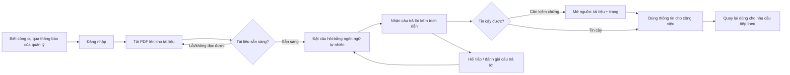

# Tài liệu Yêu cầu Sản phẩm (PRD) — Công cụ "Chat với tài liệu" (MVP)

> **Chuẩn áp dụng:** IEEE 29148-2018 · **Đầu vào:** [BRD.md](BRD.md) v0.1 (BRD-DOCCHAT-001)
> **Mã tài liệu:** PRD-DOCCHAT-001 · **Phiên bản:** 0.1 · **Trạng thái:** `Draft` · **Ngày:** 2026-10-26
> **Quy ước ưu tiên:** **P0** = bắt buộc để phát hành (tương ứng *Must* trong BRD) · **P1** = nên có (*Should*) · **P2** = mong muốn (*Could*)
> **Quy ước thiếu dữ liệu:** `[TBD: OQ-xxx]` = chờ câu hỏi mở trong BRD mục 12; `[Unverified]` = chưa có bằng chứng.

---

## 0. Kiểm tra các trụ cột sản phẩm (Product pillars validation)

| Trụ cột | Nội dung | Nguồn | Đánh giá |
|---|---|---|---|
| Tên sản phẩm | Công cụ "Chat với tài liệu" (MVP) | BRD §1 | Hợp lệ |
| Người dùng mục tiêu | Đội phát triển kinh doanh | BRD STK-002 | Hợp lệ; chưa có phỏng vấn người dùng (persona là giả thuyết) |
| Vấn đề | Nhiều PDF, khó nắm đầy đủ, mỗi lần tra cứu phải tổng hợp thủ công từ nhiều tệp | BRD §3 | Hợp lệ; chưa định lượng (`OQ-001`) |
| Giải pháp cốt lõi | Ứng dụng web: tải PDF lên, hỏi AI bằng ngôn ngữ tự nhiên, nhận câu trả lời tổng hợp kèm trích dẫn | BRD §2, BR-006..BR-014 | Hợp lệ |
| Trụ cột UX | Không được nêu trong đầu vào | — | **Thiếu** — PRD **đề xuất** 4 trụ cột ở mục 4.0, cần sponsor/design xác nhận |

**Ba rủi ro lớn nhất đối với PRD này**
1. **Chưa có baseline và mục tiêu định lượng** → OKR chưa đo được (`OQ-001`, `OQ-002`, `OQ-003`).
2. **Chưa chốt chính sách gửi tài liệu tới dịch vụ AI** → có thể thay đổi kiến trúc hoặc chặn phát hành (`OQ-008`).
3. **Chưa có nghiên cứu người dùng** → persona và hành trình là giả thuyết; cần phỏng vấn 3–5 người dùng pilot.

---

## 1. Tóm tắt điều hành và chiến lược

### 1.1 Tầm nhìn sản phẩm

> Mọi thành viên đội phát triển kinh doanh tìm được thông tin họ cần từ toàn bộ tài liệu dự án chỉ bằng một câu hỏi, nhận câu trả lời có nguồn để kiểm chứng ngay, thay vì mở và đọc từng tệp PDF.

Tầm nhìn dài hạn (sau MVP, phụ thuộc kết quả pilot): mở rộng sang các định dạng và nguồn tài liệu khác. Hiện **ngoài phạm vi MVP** (BRD §5.2).

### 1.2 Mục tiêu và kết quả then chốt (OKR)

Giá trị baseline/target chưa có số liệu nên để `[TBD]`; không tự đặt số.

| Objective | Key Result | Chỉ số BRD | Baseline | Target | Hạn |
|---|---|---|---|---|---|
| **O1.** Rút ngắn thời gian tìm một thông tin trong tập tài liệu | KR1.1: Thời gian trung bình tìm được câu trả lời trên bộ câu hỏi chuẩn giảm so với làm thủ công | MET-001 (BO-001) | `[TBD: OQ-001]` | `[TBD: OQ-002]` | Cuối pilot `[TBD: OQ-011]` |
| **O2.** Người dùng tin dùng được câu trả lời | KR2.1: Tỷ lệ câu trả lời đúng và trích dẫn đúng nguồn trên bộ câu hỏi kiểm thử | MET-002 (BO-002) | `[TBD: OQ-003]` | `[TBD: OQ-003]` | Mỗi bản phát hành |
| **O3.** Có đủ bằng chứng để quyết định đầu tư tiếp | KR3.1: Số người dùng hoạt động hằng tuần / số người dùng pilot | MET-003 (BO-003) | 0 | `[TBD: OQ-002]` | Cuối pilot |
| | KR3.2: Tỷ lệ câu trả lời được đánh giá "hữu ích" | MET-004 (BO-003) | 0 | `[TBD: OQ-002]` | Cuối pilot |

---

## 2. Persona và hành trình người dùng

> Mô tả persona dưới đây rút từ BRD (STK-001..003) và là **giả thuyết `[Unverified]`**; cần xác nhận qua phỏng vấn người dùng trước khi baseline.

### 2.1 Persona

| | **Persona chính — "Minh", Nhân viên phát triển kinh doanh** | **Persona phụ — "Lan", Product Owner / Quản lý** | **Persona phụ — "Hùng", Quản trị viên** (đề xuất) |
|---|---|---|---|
| Vai trò | Dùng công cụ hằng ngày để tìm thông tin từ PDF dự án (STK-002) | Theo dõi hiệu quả MVP, quyết định đầu tư tiếp (STK-001) | Cấp quyền truy cập, quản lý người dùng (chờ OQ-007, OQ-016) |
| Mục tiêu | Tìm thông tin nhanh, đầy đủ, đáng tin; chuẩn bị làm việc với khách hàng | Có số liệu chứng minh giá trị công cụ | Bảo đảm chỉ người có quyền mới truy cập |
| Nỗi đau | Mở từng tệp PDF, tổng hợp tay, sợ bỏ sót (SN-001) | Chưa có số liệu đo hiệu quả (SN-006) | Rủi ro lộ tài liệu mật (SN-007) |
| Bối cảnh dùng | Máy tính văn phòng, trình duyệt `[TBD: OQ-012]` | Xem báo cáo hằng tuần | Khi có người dùng mới/nghỉ việc |
| Trình độ | Quen nghiệp vụ kinh doanh; mức quen công cụ AI `[Unverified]` | — | — |
| Stories chính | US-001..US-023 | US-023 | US-021 |

### 2.2 Hành trình người dùng cấp cao



| Giai đoạn | Hành động | Cảm xúc mong muốn | Điểm rủi ro | Stories |
|---|---|---|---|---|
| Khám phá | Nhận thông báo và quyền truy cập | Tò mò, kỳ vọng thấp | Không hiểu giá trị | — |
| Bắt đầu | Đăng nhập, tải PDF | Dễ, nhanh | Tải lỗi, định dạng sai | US-001..006 |
| Hỏi đáp | Gõ câu hỏi, đọc trả lời | Ngạc nhiên vì nhanh và đúng | AI trả lời sai/chậm | US-007..014 |
| Kiểm chứng | Mở trích dẫn | Yên tâm | Trích dẫn sai trang | US-015, 016 |
| Duy trì | Quay lại hằng tuần, đánh giá | Thành thói quen | Mất niềm tin sau vài câu sai | US-017..023 |

---

## 3. Yêu cầu chức năng và User Story

### 3.1 Ma trận Epic

| Epic | Mô tả | Stories | BR liên quan |
|---|---|---|---|
| E1 | Truy cập & xác thực | US-001 | BR-020 |
| E2 | Đưa tài liệu vào kho | US-002..006 | BR-001..005 |
| E3 | Hỏi đáp trên tài liệu | US-007..014 | BR-006..013 |
| E4 | Kiểm chứng câu trả lời | US-015, 016 | BR-014, 015 |
| E5 | Quản lý tài liệu | US-017..019 | BR-016..018 |
| E6 | Lịch sử hội thoại | US-020 | BR-019 |
| E7 | Phân quyền tài liệu | US-021 | BR-021 |
| E8 | Đo lường MVP | US-022, 023 | BR-022, 023 |

### 3.2 User story theo Epic

Thuật ngữ viết tắt trong Given-When-Then: **kho** = kho tài liệu của người dùng; **AC** = tiêu chí chấp nhận (map với AC-xxx trong BRD).

#### E1 — Truy cập & xác thực

**US-001 · P0** — Là *nhân viên KD*, tôi muốn đăng nhập bằng tài khoản được cấp quyền, để chỉ người có quyền mới dùng được công cụ. *(BR-020, AC-020; cơ chế xác thực chờ `OQ-016`)*
- **Given** tôi chưa đăng nhập, **When** truy cập bất kỳ trang nào của công cụ, **Then** tôi được chuyển tới màn hình đăng nhập và không thấy dữ liệu nào.
- **Given** tôi đăng nhập bằng tài khoản **không** nằm trong danh sách được cấp quyền, **When** gửi thông tin đăng nhập, **Then** hệ thống từ chối và hiển thị thông báo không nêu chi tiết lý do bảo mật.
- **Given** tôi có tài khoản hợp lệ, **When** đăng nhập thành công, **Then** tôi vào màn hình chính trong `[TBD: OQ-006]` giây.

#### E2 — Đưa tài liệu vào kho

**US-002 · P0** — Là *nhân viên KD*, tôi muốn tải tệp PDF lên kho, để có tài liệu truy vấn. *(BR-001, AC-001)*
- **Given** tôi đã đăng nhập và có PDF hợp lệ trong giới hạn `[TBD: OQ-004]`, **When** tôi chọn tệp và tải lên, **Then** tệp xuất hiện trong danh sách tài liệu với trạng thái "Đang xử lý".

**US-003 · P0** — Là *nhân viên KD*, tôi muốn được báo rõ khi tải tệp không phải PDF, để sửa ngay. *(BR-002, AC-002)*
- **Given** tôi chọn tệp .docx / .xlsx / .jpg hoặc tệp đổi đuôi thành .pdf, **When** tôi tải lên, **Then** tệp bị từ chối và thông báo nêu lý do "sai định dạng" bằng tiếng Việt.
- **Given** tệp vượt giới hạn dung lượng/số trang `[TBD: OQ-004]`, **When** tôi tải lên, **Then** tệp bị từ chối và thông báo nêu giới hạn cho phép.

**US-004 · P0** — Là *nhân viên KD*, tôi muốn tài liệu sẵn sàng truy vấn trong thời gian ngắn, để dùng ngay trong ngày làm việc. *(BR-004, AC-004; ngưỡng chờ `OQ-005`)*
- **Given** tôi vừa tải lên PDF hợp lệ, **When** việc xử lý hoàn tất, **Then** trạng thái chuyển thành "Sẵn sàng" trong vòng `[TBD: OQ-005]` phút.
- **Given** tài liệu đang xử lý, **When** tôi xem danh sách, **Then** tôi thấy trạng thái "Đang xử lý" và chưa được chọn để hỏi.

**US-005 · P0** — Là *nhân viên KD*, tôi muốn biết khi tệp PDF không đọc được nội dung, để không tưởng tệp đã được dùng. *(BR-005, AC-005; RSK-003)*
- **Given** tôi tải lên PDF chỉ chứa ảnh scan, **When** hệ thống không trích xuất được văn bản, **Then** tệp có trạng thái "Không truy vấn được" kèm lý do, và không được dùng để trả lời.

**US-006 · P1** — Là *nhân viên KD*, tôi muốn tải nhiều PDF cùng lúc, để nạp tập tài liệu nhanh hơn. *(BR-003, AC-003; giới hạn `OQ-004`)*

#### E3 — Hỏi đáp trên tài liệu

**US-007 · P0** — Là *nhân viên KD*, tôi muốn hỏi bằng câu hỏi thông thường, để không phải học cú pháp tìm kiếm. *(BR-006, AC-006)*
- **Given** có ít nhất 1 tài liệu "Sẵn sàng", **When** tôi nhập câu hỏi hoàn chỉnh và gửi, **Then** tôi nhận được câu trả lời trong khung hội thoại.
- **Given** kho chưa có tài liệu "Sẵn sàng", **When** tôi cố gửi câu hỏi, **Then** hệ thống hướng dẫn tôi tải tài liệu lên trước.

**US-008 · P0** — Là *nhân viên KD*, tôi muốn câu trả lời chỉ dựa trên tài liệu của tôi, để tin được nội dung. *(BR-007, BRU-002, AC-007)*
- **Given** câu hỏi về kiến thức phổ thông không có trong tài liệu, **When** tôi gửi, **Then** hệ thống không đưa ra nội dung ngoài tài liệu mà trả lời theo US-010.

**US-009 · P0** — Là *nhân viên KD*, tôi muốn thông tin nằm ở nhiều tài liệu được tổng hợp vào một câu trả lời, để không phải ghép tay. *(BR-008, AC-008)*
- **Given** đáp án nằm rải ở ≥ 2 tài liệu "Sẵn sàng", **When** tôi hỏi, **Then** câu trả lời chứa thông tin từ tất cả các tài liệu liên quan và liệt kê đủ nguồn.

**US-010 · P0** — Là *nhân viên KD*, tôi muốn được báo khi tài liệu không có thông tin, để không bị đánh lừa bởi câu trả lời bịa. *(BR-009, AC-009; RSK-001)*
- **Given** tài liệu không chứa thông tin cho câu hỏi, **When** tôi gửi, **Then** hệ thống trả lời rõ "Không tìm thấy thông tin trong tài liệu" và **không** kèm trích dẫn.

**US-011 · P0** — Là *nhân viên KD*, tôi muốn hỏi và nhận trả lời bằng tiếng Việt, để làm việc tự nhiên. *(BR-010, AC-010; ngôn ngữ tài liệu chờ `OQ-009`)*
- **Given** tôi hỏi bằng tiếng Việt, **When** hệ thống trả lời, **Then** câu trả lời viết bằng tiếng Việt.

**US-012 · P0** — Là *nhân viên KD*, tôi muốn nhận câu trả lời nhanh hơn tra cứu thủ công, để công cụ có giá trị. *(BR-011, AC-011; ngưỡng `OQ-006`)*
- **Given** hệ thống chạy bình thường, **When** tôi gửi câu hỏi, **Then** câu trả lời hiển thị trong `[TBD: OQ-006]` giây với ≥ `[TBD: OQ-006]`% câu hỏi.
- **Given** đang chờ câu trả lời, **When** quá thời gian chờ, **Then** tôi thấy chỉ báo tiến trình và có thể hủy hoặc thử lại.

**US-013 · P1** — Là *nhân viên KD*, tôi muốn hỏi tiếp dựa trên câu trước, để làm rõ dần. *(BR-012, AC-012)*

**US-014 · P2** — Là *nhân viên KD*, tôi muốn giới hạn câu hỏi vào các tài liệu tôi chọn, để tăng độ chính xác. *(BR-013, AC-013)*

#### E4 — Kiểm chứng câu trả lời

**US-015 · P0** — Là *nhân viên KD*, tôi muốn mỗi câu trả lời kèm tên tài liệu và số trang, để kiểm chứng trước khi dùng. *(BR-014, AC-014; chờ sponsor xác nhận `OQ-013`)*
- **Given** câu trả lời có nội dung lấy từ tài liệu, **When** hiển thị, **Then** mỗi nguồn được dùng có trích dẫn gồm tên tài liệu và số trang.
- **Given** trích dẫn hiển thị, **When** tôi nhấp vào nó, **Then** tôi thấy tên tài liệu và trang chính xác chứa thông tin đó.

**US-016 · P1** — Là *nhân viên KD*, tôi muốn xem đoạn gốc của trích dẫn, để đọc ngay không cần mở PDF. *(BR-015, AC-015)*

#### E5 — Quản lý tài liệu

**US-017 · P0** — Là *nhân viên KD*, tôi muốn xem danh sách tài liệu mình được truy cập, để biết câu trả lời dựa trên tập nào. *(BR-016, AC-016)*
- **Given** tôi được phép truy cập 3 tài liệu, **When** mở danh sách, **Then** tôi thấy đúng 3 tài liệu với tên tệp và trạng thái.
- **Given** tôi chưa có tài liệu nào, **When** mở danh sách, **Then** tôi thấy trạng thái trống kèm nút "Tải PDF lên" (xem 4.2).

**US-018 · P1** — Là *nhân viên KD*, tôi muốn xóa tài liệu do mình tải lên, để loại tài liệu lỗi thời. *(BR-017, AC-017)*

**US-019 · P0** — Là *nhân viên KD*, tôi muốn tài liệu đã xóa không còn xuất hiện trong câu trả lời, để không trả lời từ nội dung hết hiệu lực. *(BR-018, BRU-004, AC-018)*
- **Given** tôi đã xóa tài liệu X, **When** tôi hỏi câu chỉ có đáp án trong X, **Then** câu trả lời không chứa nội dung hay trích dẫn từ X.

#### E6 — Lịch sử hội thoại

**US-020 · P2** — Là *nhân viên KD*, tôi muốn xem lại các phiên hội thoại trước của mình, để không hỏi lại. *(BR-019, AC-019; chờ `OQ-013`, `OQ-015`)*

#### E7 — Phân quyền tài liệu

**US-021 · P0** — Là *quản trị viên / chủ tài liệu*, tôi muốn tài liệu chỉ hiển thị với người trong phạm vi chia sẻ, để bảo vệ dữ liệu. *(BR-021, AC-021; phạm vi chờ `OQ-007`)*
- **Given** tài liệu Y không chia sẻ cho tôi, **When** tôi mở danh sách hoặc hỏi về nội dung riêng của Y, **Then** tôi không thấy Y và không nhận nội dung/trích dẫn từ Y.

#### E8 — Đo lường MVP

**US-022 · P1** — Là *nhân viên KD*, tôi muốn đánh giá "hữu ích / không hữu ích" cho mỗi câu trả lời, để cải thiện công cụ. *(BR-022, AC-022)*

**US-023 · P0** — Là *Product Owner*, tôi muốn nhận báo cáo hằng tuần về số người dùng hoạt động và số câu hỏi, để quyết định đầu tư tiếp. *(BR-023, AC-023)*
- **Given** pilot đang chạy, **When** kết thúc mỗi tuần, **Then** tôi nhận báo cáo gồm số người dùng hoạt động và số câu hỏi trong tuần.
- **Given** số liệu báo cáo, **When** đối chiếu với mẫu kiểm tra, **Then** sai lệch số câu hỏi ≤ 5%.

### 3.3 Tổng hợp ưu tiên

| Ưu tiên | Số stories | Stories |
|---|---|---|
| P0 | 16 | US-001..005, 007..012, 015, 017, 019, 021, 023 |
| P1 | 5 | US-006, 013, 016, 018, 022 |
| P2 | 2 | US-014, 020 |

### 3.4 Yêu cầu phi chức năng (cấp sản phẩm)

Chỉ nêu khi BRD đã có căn cứ; giá trị còn lại là `[TBD]`.

| ID | Yêu cầu | Chỉ tiêu | Nguồn |
|---|---|---|---|
| NFR-001 | Thời gian phản hồi câu hỏi | `[TBD: OQ-006]` | BR-011 |
| NFR-002 | Thời gian tài liệu sẵn sàng | `[TBD: OQ-005]` | BR-004 |
| NFR-003 | Chỉ người dùng được cấp quyền truy cập | 100% lần thử trái phép bị từ chối | AC-020 |
| NFR-004 | Phân tách dữ liệu giữa người dùng | 0 rò rỉ trong kiểm thử phân quyền | AC-021 |
| NFR-005 | Tính sẵn sàng / thời gian ngừng chấp nhận được | `[TBD: OQ-018 — đề xuất bổ sung vào BRD]` | Checklist BRD (dòng "Business Continuity") |
| NFR-006 | Nhật ký kiểm toán (tải lên, xóa, truy vấn) | `[TBD: OQ-008, OQ-015]` | Checklist BRD (dòng "Compliance") |

---

## 4. Yêu cầu UX và UI

### 4.0 Trụ cột UX (đề xuất — cần xác nhận)

1. **Đơn giản tối đa:** hoàn thành hành trình "tải PDF → hỏi → có câu trả lời" không cần hướng dẫn.
2. **Minh bạch nguồn:** mọi câu trả lời cho phép kiểm chứng trong ≤ 2 thao tác.
3. **Trung thực về giới hạn:** nói rõ khi không biết hoặc tệp không đọc được.
4. **Trình duyệt máy tính trước:** ứng dụng web (CON-001); mức hỗ trợ di động `[TBD: OQ-012]`.

### 4.1 Luồng và bố cục chính

Bố cục mô tả ở mức kỳ vọng, không phải thiết kế hình ảnh cuối cùng.

```
┌──────────────────────────────────────────────────────────────┐
│ Logo · Tên công cụ                          [Người dùng ▾]   │
├──────────────────────┬───────────────────────────────────────┤
│ TÀI LIỆU             │ HỘI THOẠI                             │
│ [+ Tải PDF lên]      │  Bạn: Điều khoản thanh toán là gì?    │
│ ☑ HopDong_A.pdf  ✔   │  AI : ... (tổng hợp)                  │
│ ☑ BaoGia_B.pdf   ⏳   │       Nguồn: HopDong_A.pdf, tr.12 [↗] │
│ ☐ Scan_C.pdf     ✖   │       👍 Hữu ích   👎 Không hữu ích   │
│   (không đọc được)   │                                       │
│                      │  ┌─────────────────────────────┐ [Gửi]│
│ [Phiên cũ ▸]         │  │ Nhập câu hỏi…               │      │
└──────────────────────┴───────────────────────────────────────┘
```

| Thành phần | Hành vi kỳ vọng | Story |
|---|---|---|
| Khu tài liệu | Danh sách tên, trạng thái (Đang xử lý / Sẵn sàng / Không truy vấn được); tải lên; xóa; chọn phạm vi | US-002..006, 014, 017, 018 |
| Khu hội thoại | Tin nhắn người dùng và AI theo thứ tự; ô nhập; gửi bằng nút hoặc Enter | US-007, 013 |
| Trích dẫn | Hiển thị cuối câu trả lời; nhấp xem tên tài liệu, trang, đoạn gốc | US-015, 016 |
| Đánh giá | Hai nút dưới mỗi câu trả lời | US-022 |
| Phiên cũ | Danh sách phiên trước của chính người dùng | US-020 |

### 4.2 Trường hợp biên và trạng thái lỗi

| Tình huống | Hành vi kỳ vọng | Story / BR |
|---|---|---|
| Kho trống | Hiển thị trạng thái trống: giải thích và nút "Tải PDF lên"; chặn gửi câu hỏi | US-007, 017 |
| Tệp không phải PDF | Từ chối, nêu lý do và định dạng được hỗ trợ | US-003 |
| Tệp vượt giới hạn | Từ chối, nêu giới hạn `[TBD: OQ-004]` | US-003 |
| PDF scan/hỏng/có mật khẩu | Trạng thái "Không truy vấn được" kèm lý do; không dùng để trả lời | US-005 |
| Tải lên bị đứt mạng | Báo lỗi, giữ tệp trong hàng đợi, cho phép "Thử lại"; không tạo bản ghi tài liệu nửa vời | US-002 |
| Mất mạng khi đang hỏi | Giữ nội dung câu hỏi trong ô nhập, báo lỗi và cho phép gửi lại | US-012 |
| Chờ quá lâu | Chỉ báo tiến trình; sau ngưỡng `[TBD: OQ-006]` cho phép hủy/thử lại | US-012 |
| Không có thông tin trong tài liệu | Trả lời "Không tìm thấy thông tin trong tài liệu", không trích dẫn | US-010 |
| Câu hỏi rỗng / quá dài | Vô hiệu hóa nút Gửi khi rỗng; báo giới hạn độ dài khi quá dài `[TBD]` | US-007 |
| Dịch vụ AI không khả dụng | Thông báo tạm thời không trả lời được và gợi ý thử lại; không hiển thị câu trả lời giả | US-007 |
| Tài liệu bị xóa khi đang dùng | Câu trả lời mới không dùng tài liệu đó; trích dẫn cũ vẫn xem được tên nhưng ghi "đã xóa" `[Unverified]` | US-019 |
| Phiên đăng nhập hết hạn | Chuyển về màn đăng nhập, giữ lại câu hỏi đang nhập nếu có thể | US-001 |

### 4.3 Yêu cầu nội dung

- Toàn bộ giao diện và thông báo lỗi bằng tiếng Việt.
- Thông báo miễn trừ ngắn dưới khung hội thoại: câu trả lời mang tính tham khảo, cần kiểm chứng tại nguồn (BRU-005, chờ `OQ-017`).

---

## 5. Tiêu chí phát hành và chỉ số sau phát hành

### 5.1 Cổng phát hành (Launch gate)

Các ngưỡng đánh dấu *đề xuất* do PM đề nghị, cần sponsor và QA xác nhận.

| # | Hạng mục | Tiêu chí | Căn cứ |
|---|---|---|---|
| G1 | Phạm vi | 100% story P0 (16) đã được xác nhận bằng AC tương ứng | §3 |
| G2 | Chất lượng câu trả lời | Đạt ngưỡng MET-002 trên bộ câu hỏi kiểm thử ≥ 100 câu | `[TBD: OQ-003]`, DEP-003 |
| G3 | Hiệu năng | Đạt NFR-001, NFR-002 | `[TBD: OQ-005, OQ-006]` |
| G4 | Bảo mật | Kiểm thử phân quyền: 0 trường hợp người ngoài phạm vi thấy tài liệu/trích dẫn; phê duyệt của Bảo mật/Pháp chế | AC-020, AC-021, DEP-002, `OQ-008` |
| G5 | Lỗi | 0 lỗi mức Blocker/Critical đang mở; lỗi Major có kế hoạch xử lý *(đề xuất)* | — |
| G6 | Kiểm thử | 100% AC của story P0 được chạy, đạt; kiểm thử hồi quy cho phân quyền và xóa tài liệu *(đề xuất)* | — |
| G7 | Dữ liệu đo | Báo cáo hằng tuần (US-023) và sự kiện ở 5.2 hoạt động đúng trước khi pilot | BR-023 |
| G8 | Pháp lý | Có quyết định về lưu giữ dữ liệu và thông báo miễn trừ | `OQ-015`, `OQ-017` |
| G9 | Đào tạo | Người dùng pilot nhận hướng dẫn ngắn; kênh phản hồi sẵn sàng *(đề xuất)* | — |

### 5.2 Phân tích và theo dõi (telemetry)

Không thu thập nội dung tài liệu hay câu hỏi vào sự kiện phân tích nếu chính sách bảo mật chưa cho phép `[TBD: OQ-008]`; chỉ ghi định danh và số liệu.

| Sự kiện | Thuộc tính chính | Dùng để đo | Story |
|---|---|---|---|
| `login_success` / `login_denied` | user_id, thời điểm | MET-003, NFR-003 | US-001 |
| `doc_upload_started` | user_id, size, số trang | Phễu tải lên | US-002 |
| `doc_upload_rejected` | lý do (định dạng / dung lượng) | Lỗi tải lên | US-003 |
| `doc_ready` | thời gian xử lý (giây) | NFR-002 | US-004 |
| `doc_unreadable` | lý do | RSK-003 | US-005 |
| `doc_deleted` | doc_id | Quản lý tài liệu | US-018 |
| `question_submitted` | session_id, số tài liệu trong phạm vi | MET-003, BR-023 | US-007 |
| `answer_returned` | latency_ms, result_type (answered / not_found / error), số trích dẫn | MET-002, NFR-001 | US-007..012 |
| `citation_opened` | doc_id, page | Mức kiểm chứng | US-015, 016 |
| `answer_rated` | rating | MET-004 | US-022 |
| `history_opened` | session_id | Mức dùng lịch sử | US-020 |
| `weekly_report_sent` | tuần, số người dùng, số câu hỏi | BR-023 | US-023 |

**Phễu chính cần theo dõi:** đăng nhập → tải tài liệu → tài liệu sẵn sàng → đặt câu hỏi đầu tiên → mở trích dẫn → quay lại tuần sau. Điểm rơi rụng lớn nhất sẽ quyết định ưu tiên sau MVP.

**Ngưỡng quyết định go/no-go sau pilot:** dựa trên MET-001..004 với target do sponsor đặt `[TBD: OQ-002]`.

---

## 6. Truy vết

| Mục tiêu BRD | Epic | Stories | BR |
|---|---|---|---|
| BO-001 | E2, E3, E6 | US-002, 004, 006, 007, 009, 011, 012, 013, 020 | BR-001, 003, 004, 006, 008, 010, 011, 012, 019 |
| BO-002 | E1..E5, E7 | US-001, 003, 005, 008, 010, 014..019, 021 | BR-002, 005, 007, 009, 013..018, 020, 021 |
| BO-003 | E8 | US-022, 023 | BR-022, 023 |

Mọi BR (BR-001..BR-023) đều có ít nhất một story; mọi story P0 có Given-When-Then.

---

## 7. Câu hỏi mở kế thừa và mới

Toàn bộ `OQ-001..017` giữ nguyên theo BRD §12. Các câu hỏi chặn PRD này:

| ID | Nội dung | Chặn |
|---|---|---|
| OQ-001, 002, 003 | Baseline, target, ngưỡng độ chính xác | OKR §1.2, cổng G2 |
| OQ-004, 005, 006 | Giới hạn tệp, thời gian xử lý, thời gian phản hồi | US-003, 004, 012; NFR |
| OQ-007, 016 | Phạm vi chia sẻ, cơ chế xác thực | US-001, 021 |
| OQ-008 | Chính sách gửi tài liệu tới dịch vụ AI | Cổng G4, telemetry |
| OQ-013 | Sponsor xác nhận tính năng BA đề xuất | US-015, 016, 013, 020, 022 |
| **OQ-018** *(mới)* | Kỳ vọng về giờ hoạt động và thời gian ngừng chấp nhận được | NFR-005 |
| **OQ-019** *(mới)* | Có cần hỗ trợ mức tối thiểu trên thiết bị di động/trình duyệt nào? | §4.0, §4.1 |

Hai câu hỏi mới nên được thêm vào BRD §12 ở lần cập nhật sau.

---

## 8. Phê duyệt và tuyên bố sẵn sàng

| Vai trò | Họ tên | Quyết định | Ngày |
|---|---|---|---|
| Product Owner | `[TBD: OQ-014]` | | |
| Executive sponsor | `[TBD: OQ-014]` | | |
| Trưởng nhóm phát triển | `[TBD: OQ-014]` | | |
| QA | `[TBD: OQ-014]` | | |
| Bảo mật / Pháp chế | `[TBD: OQ-014]` | | |

**Trạng thái: `Ready with conditions`** — đủ để review với Engineering, Design và QA; **chưa đủ để khóa phạm vi và phát hành**. Hạng mục chặn: `OQ-001..003` (OKR), `OQ-005..007` (US-004, 012, 021), `OQ-008` (bảo mật dữ liệu), `OQ-013` (xác nhận tính năng đề xuất), `OQ-014` (người phê duyệt).
