# User Stories kèm màn hình thiết kế — Công cụ "Chat với tài liệu" (MVP)

> **Mã tài liệu:** US-SCREENS-001 · **Phiên bản:** 0.1 · **Trạng thái:** `Draft` · **Ngày:** 2026-10-28
> **Nguồn:** [UserStories.md](UserStories.md) (nội dung story và tiêu chí chấp nhận giữ nguyên) · [UIUX_Blueprint.md](../design/UIUX_Blueprint.md) · bản thiết kế HTML trong [html_design](../design/html_design/index.html)
> **Ưu tiên:** **P0** bắt buộc · **P1** nên có · **P2** mong muốn · `[TBD: OQ-xxx]` = chờ câu hỏi mở · `[Unverified]` = chưa có bằng chứng.

---

## 1. Cách đọc tài liệu này

- Mỗi user story giữ nguyên câu chuyện, tiêu chí chấp nhận (Given-When-Then) và truy vết từ [UserStories.md](UserStories.md); **phần mới** là mục **"Màn hình thiết kế"** ngay dưới bảng tiêu chí.
- Ảnh được **chụp tự động từ chính các file HTML** trong [html_design](../design/html_design/index.html): một trình duyệt thật chạy đúng thao tác của story (tải tệp, hỏi đáp, hủy, xóa tài liệu, đánh giá...) rồi chụp ở trạng thái cần xem. Không phải ảnh dựng tay. Thanh "chế độ xem thiết kế" màu đen được ẩn để ảnh chỉ có giao diện sản phẩm.
- Mỗi ảnh có chú thích **màn hình (SCR-xx)**, **tiêu chí được minh họa** và liên kết **"mở bản thiết kế"** (có kèm trạng thái trong địa chỉ, ví dụ `#sim=notfound`; các trạng thái cần thao tác như "đang chờ AI" phải tự thao tác).
- **Dữ liệu, câu trả lời và số liệu trong ảnh là minh họa**; không có máy chủ hay AI thật. Một tiêu chí **không có ảnh** thường vì đó là hành vi backend hoặc cần đo kiểm; lý do ghi ngay dưới mỗi story.

## 2. Bảng ánh xạ story → màn hình

| Story | FR | Ưu tiên | Màn hình | Số ảnh | AC có ảnh |
|---|---|---|---|---|---|
| US-001 | FR-001 | P0 | SCR-01 | 3 | 4/4 |
| US-002 | FR-002 | P0 | SCR-03, SCR-02 | 2 | 2/3 |
| US-003 | FR-003 | P0 | SCR-02 | 1 | 3/4 |
| US-004 | FR-004 | P0 | SCR-02 | 1 | 2/3 |
| US-005 | FR-005 | P0 | SCR-02 | 1 | 2/3 |
| US-006 | FR-006 | P1 | SCR-03 | 1 | 2/3 |
| US-007 | FR-007 | P0 | SCR-02 | 4 | 4/5 |
| US-008 | FR-008 | P0 | SCR-02 | 1 | 0/3 |
| US-009 | FR-009 | P0 | SCR-02 | 1 | 1/3 |
| US-010 | FR-010 | P0 | SCR-02 | 1 | 2/3 |
| US-011 | FR-011 | P0 | SCR-02 | 1 | 2/3 |
| US-012 | FR-012 | P0 | SCR-02 | 3 | 3/4 |
| US-013 | FR-013 | P1 | SCR-02 | 1 | 0/3 |
| US-014 | FR-014 | P2 | SCR-02 | 2 | 2/3 |
| US-015 | FR-015 | P0 | SCR-02 | 2 | 3/4 |
| US-016 | FR-016 | P1 | SCR-04 | 3 | 3/3 |
| US-017 | FR-017 | P0 | SCR-02 | 2 | 2/3 |
| US-018 | FR-018 | P1 | SCR-09, SCR-02 | 2 | 2/3 |
| US-019 | FR-019 | P0 | SCR-02 | 1 | 1/3 |
| US-020 | FR-020 | P2 | SCR-05 | 2 | 2/3 |
| US-021 | FR-021 | P0 | SCR-07, SCR-02, SCR-08 | 3 | 2/4 |
| US-022 | FR-022 | P1 | SCR-02 | 1 | 2/3 |
| US-023 | FR-023 | P0 | SCR-06 | 3 | 3/4 |

**Độ phủ:** 49/77 tiêu chí chấp nhận có hình minh họa (64%); 28 tiêu chí còn lại có lý do ghi rõ (backend, đo kiểm, hoặc chờ quyết định OQ). Dùng 37 ảnh khác nhau (một số ảnh được dùng lại cho nhiều story).

---

## 3. User Stories theo Epic, kèm màn hình

### E1 — Truy cập & xác thực

#### US-001 · FR-001 · P0
**As a** nhân viên KD, **I want** đăng nhập bằng tài khoản được cấp quyền, **so that** chỉ người có quyền mới xem và dùng được tài liệu kinh doanh.
*Trace:* BR-020 · SN-007 · BO-002 · AC-020 · cơ chế xác thực chờ `OQ-016`

| AC | Given | When | Then |
|---|---|---|---|
| US-001-AC1 | Tôi chưa đăng nhập | Tôi truy cập bất kỳ trang nào của công cụ | Tôi được chuyển tới màn hình đăng nhập và không thấy dữ liệu nào |
| US-001-AC2 | Tôi có tài khoản hợp lệ và nằm trong danh sách được cấp quyền | Tôi đăng nhập | Tôi vào màn hình chính |
| US-001-AC3 | Tôi dùng tài khoản không nằm trong danh sách được cấp quyền | Tôi gửi thông tin đăng nhập | Hệ thống từ chối truy cập và không tiết lộ lý do chi tiết |
| US-001-AC4 | Phiên đăng nhập của tôi đã hết hạn | Tôi thực hiện thao tác bất kỳ | Tôi được chuyển về màn hình đăng nhập |

**Màn hình thiết kế**

> **SCR-01 · Đăng nhập / Không có quyền** — Đăng nhập bằng tài khoản công ty; người chưa xác thực không thấy dữ liệu nào. · *Minh họa:* US-001-AC1, US-001-AC2 · [mở bản thiết kế](../design/html_design/scr-01-dang-nhap.html#state=login)

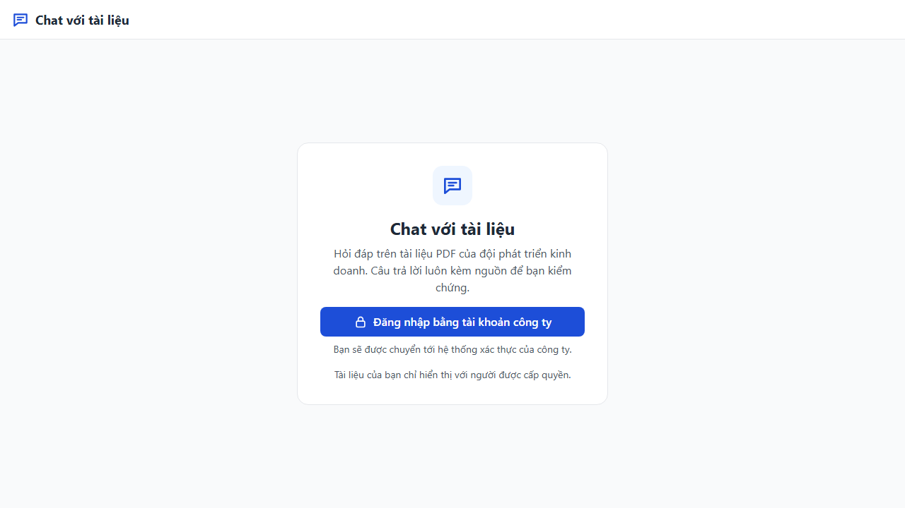

> **SCR-01 · Đăng nhập / Không có quyền** — Tài khoản không được cấp quyền: từ chối, <b>không nêu lý do chi tiết</b>. · *Minh họa:* US-001-AC3 · [mở bản thiết kế](../design/html_design/scr-01-dang-nhap.html#state=forbidden)

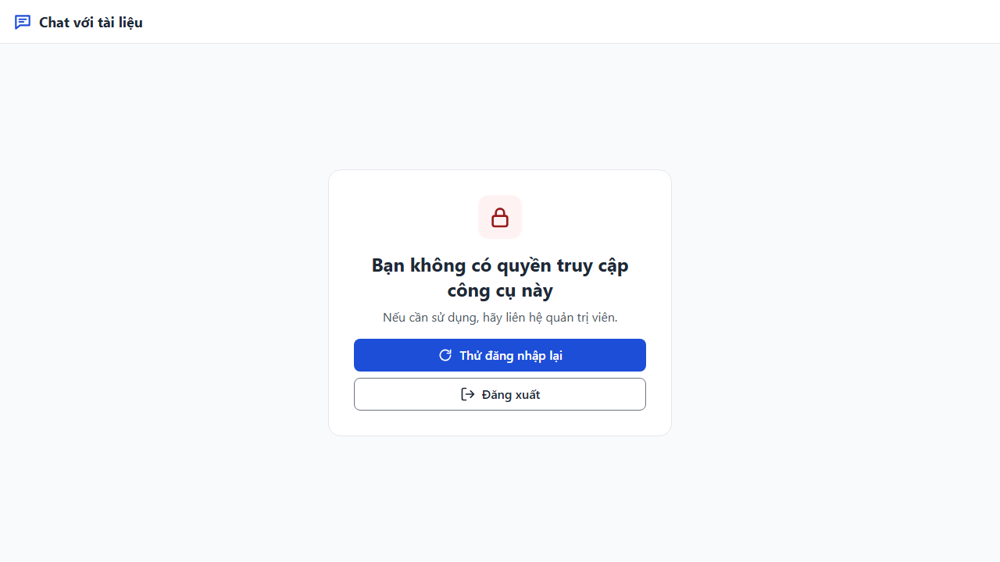

> **SCR-01 · Đăng nhập / Không có quyền** — Phiên hết hạn: quay về đăng nhập kèm thông báo. · *Minh họa:* US-001-AC4 · [mở bản thiết kế](../design/html_design/scr-01-dang-nhap.html#state=expired)

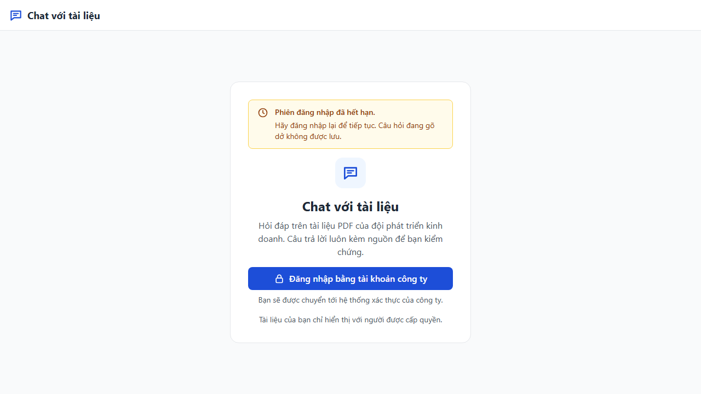

---

### E2 — Đưa tài liệu vào kho

#### US-002 · FR-002 · P0
**As a** nhân viên KD, **I want** tải tệp PDF lên kho tài liệu, **so that** có tài liệu để truy vấn thay vì mở từng tệp thủ công.
*Trace:* BR-001 · SN-002 · BO-001 · AC-001

| AC | Given | When | Then |
|---|---|---|---|
| US-002-AC1 | Tôi đã đăng nhập và có một PDF hợp lệ trong giới hạn `[TBD: OQ-004]` | Tôi chọn tệp và tải lên | Tệp xuất hiện trong danh sách tài liệu của tôi với trạng thái "Đang xử lý" |
| US-002-AC2 | Mạng bị đứt giữa chừng khi đang tải | Quá trình tải bị gián đoạn | Tôi thấy thông báo lỗi và nút "Thử lại"; không có tài liệu nửa vời trong danh sách |
| US-002-AC3 | Tôi tải lại đúng tệp đã tải trước đó | Tôi tải lên | Hệ thống xử lý theo quy tắc trùng tệp `[TBD: OQ-020 — đề xuất bổ sung vào BRD]` |

**Màn hình thiết kế**

> **SCR-03 · Khu tải tài liệu** — Hàng chờ tải lên: tệp đang tải (thanh tiến trình), tệp chờ lượt, tệp bị từ chối, tệp mất mạng có nút <b>Thử lại</b>. · *Minh họa:* US-002-AC2 · [mở bản thiết kế](../design/html_design/scr-03-tai-tai-lieu.html)

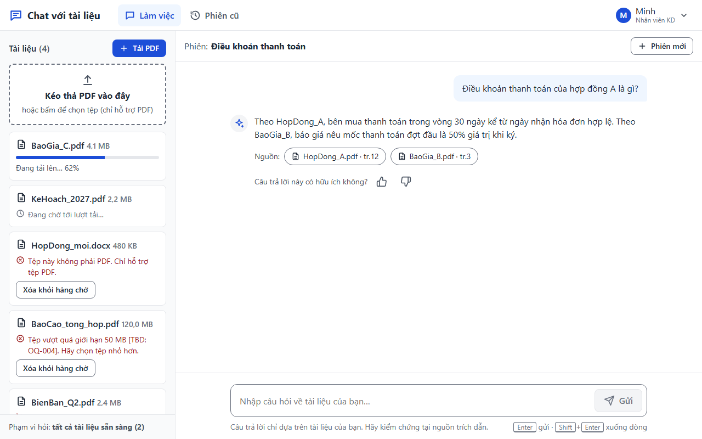

> **SCR-02 · Màn hình làm việc** — Tải xong: tệp xuất hiện đầu danh sách với trạng thái <b>Đang xử lý</b>. · *Minh họa:* US-002-AC1 · [mở bản thiết kế](../design/html_design/scr-02-man-hinh-lam-viec.html)

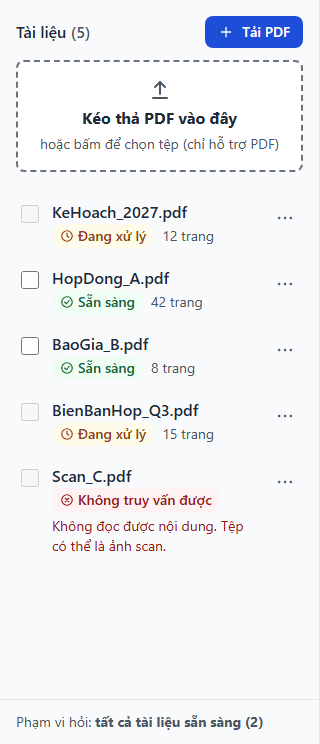

**Tiêu chí chưa có hình minh họa**

- `US-002-AC3`: quy tắc tệp trùng chờ quyết định OQ-020, chưa có thiết kế.

#### US-003 · FR-003 · P0
**As a** nhân viên KD, **I want** được báo rõ khi tệp tải lên không hợp lệ, **so that** tôi sửa ngay và không tưởng tệp đã vào kho.
*Trace:* BR-002 · BRU-001 · BRU-003 · SN-002 · BO-002 · AC-002

| AC | Given | When | Then |
|---|---|---|---|
| US-003-AC1 | Tôi chọn tệp .docx, .xlsx hoặc .jpg | Tôi tải lên | Tệp bị từ chối; thông báo tiếng Việt nêu lý do "sai định dạng" và định dạng được hỗ trợ (PDF) |
| US-003-AC2 | Tôi chọn tệp đổi đuôi thành .pdf nhưng nội dung không phải PDF | Tôi tải lên | Tệp bị từ chối với cùng thông báo "sai định dạng" |
| US-003-AC3 | Tệp PDF vượt giới hạn dung lượng hoặc số trang `[TBD: OQ-004]` | Tôi tải lên | Tệp bị từ chối; thông báo nêu giới hạn cho phép |
| US-003-AC4 | Một tệp bị từ chối | Tôi xem danh sách tài liệu | Tệp bị từ chối không xuất hiện trong danh sách |

**Màn hình thiết kế**

> **SCR-02 · Màn hình làm việc** — Tệp .docx và tệp quá lớn bị từ chối ngay trong hàng chờ, nêu lý do; không vào danh sách tài liệu. · *Minh họa:* US-003-AC1, US-003-AC3, US-003-AC4 · [mở bản thiết kế](../design/html_design/scr-02-man-hinh-lam-viec.html)

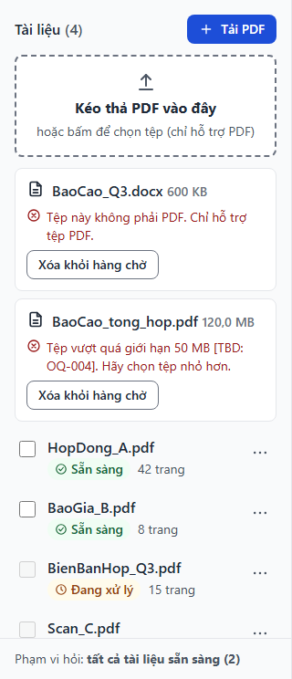

**Tiêu chí chưa có hình minh họa**

- `US-003-AC2`: nhận diện tệp đổi đuôi thành .pdf do backend (SAD §3.2.1); bản thiết kế chỉ kiểm theo đuôi tệp, thông báo hiển thị giống AC1.

#### US-004 · FR-004 · P0
**As a** nhân viên KD, **I want** tài liệu sẵn sàng truy vấn trong thời gian ngắn và thấy rõ trạng thái xử lý, **so that** tôi dùng được ngay trong ngày làm việc.
*Trace:* BR-004 · SN-002 · BO-001 · AC-004 · ngưỡng chờ `OQ-005`

| AC | Given | When | Then |
|---|---|---|---|
| US-004-AC1 | Tôi vừa tải lên PDF hợp lệ | Việc tải lên hoàn tất | Trong vòng `[TBD: OQ-005]` phút, trạng thái chuyển thành "Sẵn sàng" |
| US-004-AC2 | Tài liệu đang xử lý | Tôi xem danh sách | Tôi thấy trạng thái "Đang xử lý"; tài liệu chưa được dùng để trả lời |
| US-004-AC3 | Bộ 10 PDF mẫu trong giới hạn (DEP-003) | Tôi hỏi 1 câu về nội dung từng tệp sau khi "Sẵn sàng" | 10/10 tệp trả lời được trong thời hạn của AC1 |

**Màn hình thiết kế**

> **SCR-02 · Màn hình làm việc** — Trạng thái trên từng tài liệu: <b>Đang xử lý</b> (BienBanHop_Q3) và <b>Sẵn sàng</b>; chip dùng biểu tượng kèm chữ, không chỉ màu. Tài liệu đang xử lý tự chuyển sang Sẵn sàng sau vài giây (mô phỏng thăm dò 3 s). · *Minh họa:* US-004-AC1, US-004-AC2 · [mở bản thiết kế](../design/html_design/scr-02-man-hinh-lam-viec.html)

**Tiêu chí chưa có hình minh họa**

- `US-004-AC3`: đo thời hạn xử lý 10 tệp mẫu là kiểm thử backend, ngưỡng chờ OQ-005.

#### US-005 · FR-005 · P0
**As a** nhân viên KD, **I want** biết khi PDF không đọc được nội dung, **so that** tôi không tưởng tệp đã được dùng để trả lời.
*Trace:* BR-005 · SN-004 · BO-002 · AC-005 · RSK-003

| AC | Given | When | Then |
|---|---|---|---|
| US-005-AC1 | Tôi tải lên PDF chỉ chứa ảnh scan (không có lớp văn bản) | Hệ thống không trích xuất được văn bản | Tệp có trạng thái "Không truy vấn được" kèm lý do |
| US-005-AC2 | Tệp ở trạng thái "Không truy vấn được" | Tôi đặt câu hỏi | Nội dung tệp không được dùng và không xuất hiện trong trích dẫn |
| US-005-AC3 | PDF bị hỏng hoặc có mật khẩu | Tôi tải lên | Tệp được báo "Không truy vấn được" kèm lý do tương ứng |

**Màn hình thiết kế**

> **SCR-02 · Màn hình làm việc** — PDF scan: trạng thái <b>Không truy vấn được</b> kèm lý do; ô chọn phạm vi bị tắt nên không được dùng để trả lời. · *Minh họa:* US-005-AC1, US-005-AC2 · [mở bản thiết kế](../design/html_design/scr-02-man-hinh-lam-viec.html)

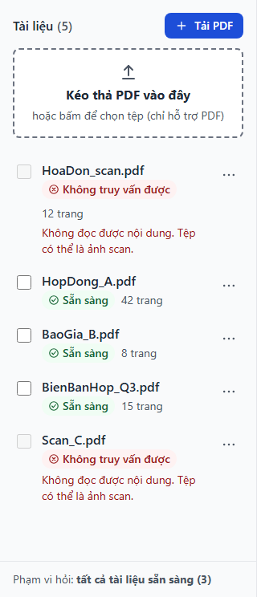

**Tiêu chí chưa có hình minh họa**

- `US-005-AC3`: PDF hỏng/có mật khẩu dùng cùng bố cục, chỉ khác dòng lý do ("Không mở được tệp…"); chưa chụp riêng.

#### US-006 · FR-006 · P1
**As a** nhân viên KD, **I want** chọn nhiều PDF và tải lên trong một thao tác, **so that** nạp cả tập tài liệu dự án nhanh hơn.
*Trace:* BR-003 · SN-002 · BO-001 · AC-003 · giới hạn `OQ-004`

| AC | Given | When | Then |
|---|---|---|---|
| US-006-AC1 | Tôi chọn đồng thời `[TBD: OQ-004]` PDF hợp lệ | Tôi tải lên | 100% tệp xuất hiện trong danh sách |
| US-006-AC2 | Trong nhóm tệp chọn có 1 tệp không hợp lệ | Tôi tải lên | Các tệp hợp lệ vẫn được nhận; tệp lỗi được báo riêng theo US-003 |
| US-006-AC3 | Tôi chọn nhiều tệp hơn số tối đa `[TBD: OQ-004]` | Tôi tải lên | Hệ thống báo giới hạn và không nhận nhóm vượt mức |

**Màn hình thiết kế**

> **SCR-03 · Khu tải tài liệu** — Nhiều tệp trong cùng hàng chờ (tối đa 3 tệp tải đồng thời); tệp lỗi được báo riêng, các tệp hợp lệ vẫn được nhận. · *Minh họa:* US-006-AC1, US-006-AC2 · [mở bản thiết kế](../design/html_design/scr-03-tai-tai-lieu.html)

**Tiêu chí chưa có hình minh họa**

- `US-006-AC3`: giới hạn số tệp mỗi lần chờ OQ-004, chưa có thiết kế.

---

### E3 — Hỏi đáp trên tài liệu

#### US-007 · FR-007 · P0
**As a** nhân viên KD, **I want** đặt câu hỏi bằng ngôn ngữ thông thường, **so that** không phải học cú pháp tìm kiếm.
*Trace:* BR-006 · SN-003 · BO-001 · AC-006

| AC | Given | When | Then |
|---|---|---|---|
| US-007-AC1 | Có ít nhất 1 tài liệu "Sẵn sàng" | Tôi nhập một câu hỏi hoàn chỉnh và gửi | Tôi nhận được câu trả lời trong khung hội thoại |
| US-007-AC2 | 5 câu hỏi dạng câu thông thường, không dùng cú pháp đặc biệt | Tôi gửi lần lượt | Cả 5 câu đều nhận được câu trả lời |
| US-007-AC3 | Kho chưa có tài liệu "Sẵn sàng" | Tôi cố gửi câu hỏi | Hệ thống hướng dẫn tải tài liệu lên trước; không gọi dịch vụ AI |
| US-007-AC4 | Ô nhập câu hỏi đang trống | Tôi xem nút gửi | Nút gửi bị vô hiệu hóa |
| US-007-AC5 | Dịch vụ AI không khả dụng | Tôi gửi câu hỏi | Tôi thấy thông báo tạm thời không trả lời được và nút thử lại; không có câu trả lời giả |

**Màn hình thiết kế**

> **SCR-02 · Màn hình làm việc** — Phiên trống: gợi ý câu hỏi; nút <b>Gửi</b> tắt khi ô nhập rỗng. · *Minh họa:* US-007-AC4 · [mở bản thiết kế](../design/html_design/scr-02-man-hinh-lam-viec.html#chat=empty)

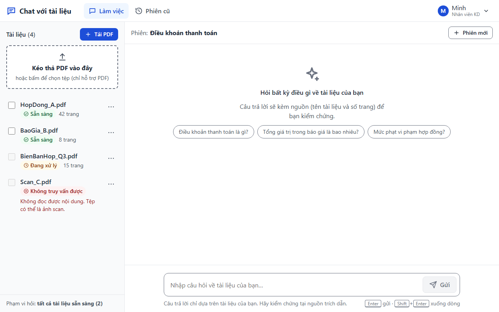

> **SCR-02 · Màn hình làm việc** — Gõ hoặc chọn gợi ý: nút Gửi bật; <kbd>Enter</kbd> để gửi. · *Minh họa:* US-007-AC1 · [mở bản thiết kế](../design/html_design/scr-02-man-hinh-lam-viec.html#chat=empty)

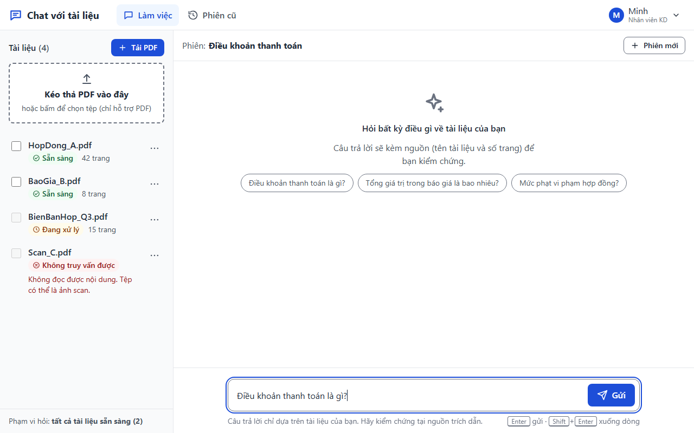

> **SCR-02 · Màn hình làm việc** — Chưa có tài liệu sẵn sàng: Gửi tắt, hướng dẫn tải PDF lên trước. · *Minh họa:* US-007-AC3 · [mở bản thiết kế](../design/html_design/scr-02-man-hinh-lam-viec.html#list=empty&chat=empty)

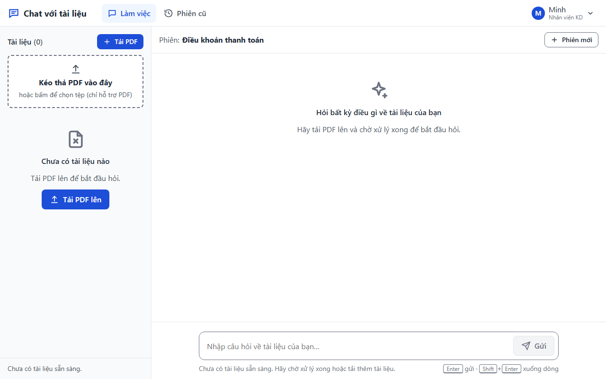

> **SCR-02 · Màn hình làm việc** — Dịch vụ AI không khả dụng: thông báo tiếng Việt + <b>Thử lại</b>, không có câu trả lời giả. · *Minh họa:* US-007-AC5 · [mở bản thiết kế](../design/html_design/scr-02-man-hinh-lam-viec.html#sim=aierror)

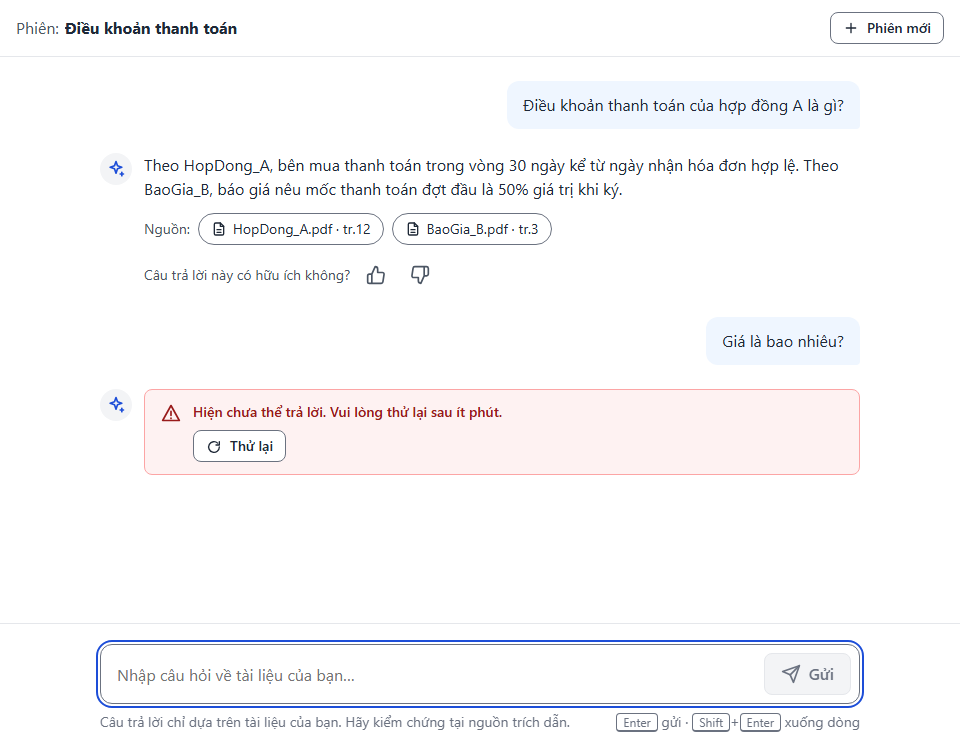

**Tiêu chí chưa có hình minh họa**

- `US-007-AC2`: kiểm tra 5 câu hỏi thường là kiểm thử nội dung, không có màn hình riêng.

#### US-008 · FR-008 · P0
**As a** nhân viên KD, **I want** câu trả lời chỉ dựa trên nội dung tài liệu của tôi, **so that** tôi tin được rằng mọi thông tin đều có căn cứ.
*Trace:* BR-007 · BRU-002 · SN-003 · BO-002 · AC-007 · RSK-001

| AC | Given | When | Then |
|---|---|---|---|
| US-008-AC1 | 10 câu hỏi kiến thức phổ thông không có trong tài liệu | Tôi gửi từng câu | 10/10 câu trả lời không chứa nội dung ngoài tài liệu và theo US-010 |
| US-008-AC2 | Tôi chỉ được phép truy cập tài liệu A | Tôi hỏi về nội dung có trong tài liệu B (tôi không có quyền) | Câu trả lời không chứa nội dung từ B |
| US-008-AC3 | Câu hỏi có một phần đáp án trong tài liệu, phần còn lại không có | Tôi gửi câu hỏi | Câu trả lời chỉ nêu phần có trong tài liệu (kèm trích dẫn) và nói rõ phần còn lại không tìm thấy |

**Màn hình thiết kế**

> **SCR-02 · Màn hình làm việc** — Câu trả lời chỉ dựa trên tài liệu của người dùng; ô nhập có dòng nhắc <i>"Câu trả lời chỉ dựa trên tài liệu của bạn. Hãy kiểm chứng tại nguồn trích dẫn."</i>. · [mở bản thiết kế](../design/html_design/scr-02-man-hinh-lam-viec.html)

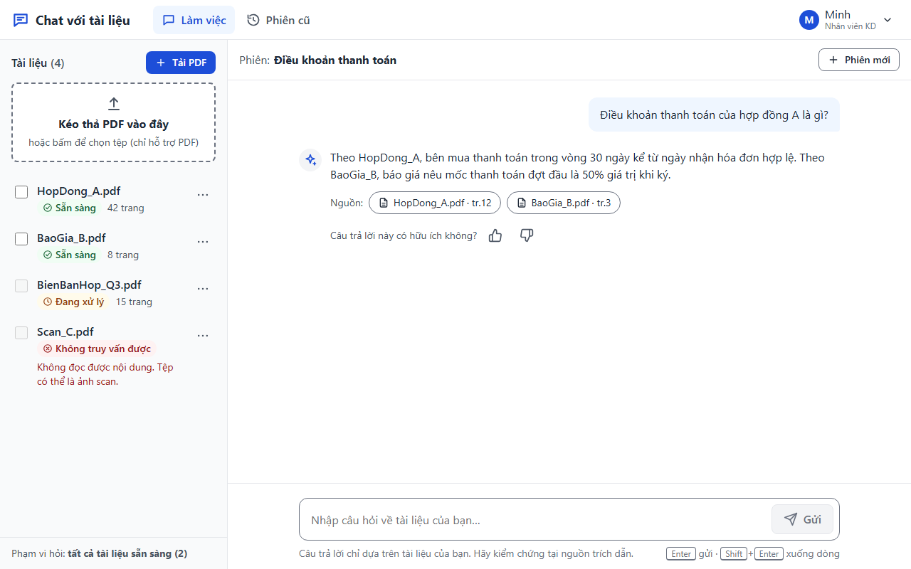

**Tiêu chí chưa có hình minh họa**

- `US-008-AC1`: hành vi backend (BR-007, BRU-002); giao diện chỉ hiển thị đúng nội dung API trả về và nhắc người dùng kiểm chứng.
- `US-008-AC2`: như AC1 (kiểm soát quyền ở backend, SAD §3.2.2).
- `US-008-AC3`: như AC1 (trả lời một phần do backend).

#### US-009 · FR-009 · P0
**As a** nhân viên KD, **I want** thông tin nằm ở nhiều tài liệu được tổng hợp vào một câu trả lời, **so that** tôi không phải ghép tay từ nhiều tệp.
*Trace:* BR-008 · SN-001 · BO-001 · AC-008

| AC | Given | When | Then |
|---|---|---|---|
| US-009-AC1 | Đáp án nằm rải ở ít nhất 2 tài liệu "Sẵn sàng" | Tôi đặt câu hỏi | Câu trả lời chứa thông tin từ tất cả tài liệu liên quan và trích dẫn đủ các nguồn |
| US-009-AC2 | Bộ 10 câu hỏi nhiều nguồn do đội KD cung cấp (DEP-003) | Chuyên gia nghiệp vụ chấm | Đạt ≥ `[TBD: OQ-003]`/10 câu có đủ thông tin từ mọi tài liệu liên quan |
| US-009-AC3 | Hai tài liệu có thông tin mâu thuẫn nhau | Tôi đặt câu hỏi | Câu trả lời nêu rõ cả hai và trích dẫn từng nguồn; không tự chọn một bên `[Unverified]` |

**Màn hình thiết kế**

> **SCR-02 · Màn hình làm việc** — Một câu trả lời tổng hợp từ <b>hai tài liệu</b>, kèm trích dẫn riêng cho từng tài liệu. · *Minh họa:* US-009-AC1 · [mở bản thiết kế](../design/html_design/scr-02-man-hinh-lam-viec.html)

**Tiêu chí chưa có hình minh họa**

- `US-009-AC2`: chấm điểm 10 câu hỏi nhiều nguồn là đánh giá chất lượng (MET-002, OQ-003).
- `US-009-AC3`: xử lý thông tin mâu thuẫn là [Unverified], chưa có thiết kế.

#### US-010 · FR-010 · P0
**As a** nhân viên KD, **I want** được báo rõ khi tài liệu không có thông tin cần tìm, **so that** tôi không bị đánh lừa bởi câu trả lời bịa.
*Trace:* BR-009 · SN-004 · BO-002 · AC-009 · RSK-001

| AC | Given | When | Then |
|---|---|---|---|
| US-010-AC1 | Các tài liệu không chứa thông tin cho câu hỏi | Tôi gửi câu hỏi | Hệ thống trả lời rõ "Không tìm thấy thông tin trong tài liệu" |
| US-010-AC2 | Câu trả lời thuộc loại không tìm thấy | Tôi xem câu trả lời | Không có trích dẫn nào kèm theo |
| US-010-AC3 | 10 câu hỏi không có đáp án trong tài liệu | Tôi gửi từng câu | Đạt ≥ `[TBD: OQ-003]`/10 câu trả lời là thông báo không tìm thấy |

**Màn hình thiết kế**

> **SCR-02 · Màn hình làm việc** — Không có thông tin trong tài liệu: thông báo <b>"Không tìm thấy thông tin này trong tài liệu của bạn."</b> và <b>không có trích dẫn</b>. · *Minh họa:* US-010-AC1, US-010-AC2 · [mở bản thiết kế](../design/html_design/scr-02-man-hinh-lam-viec.html#sim=notfound)

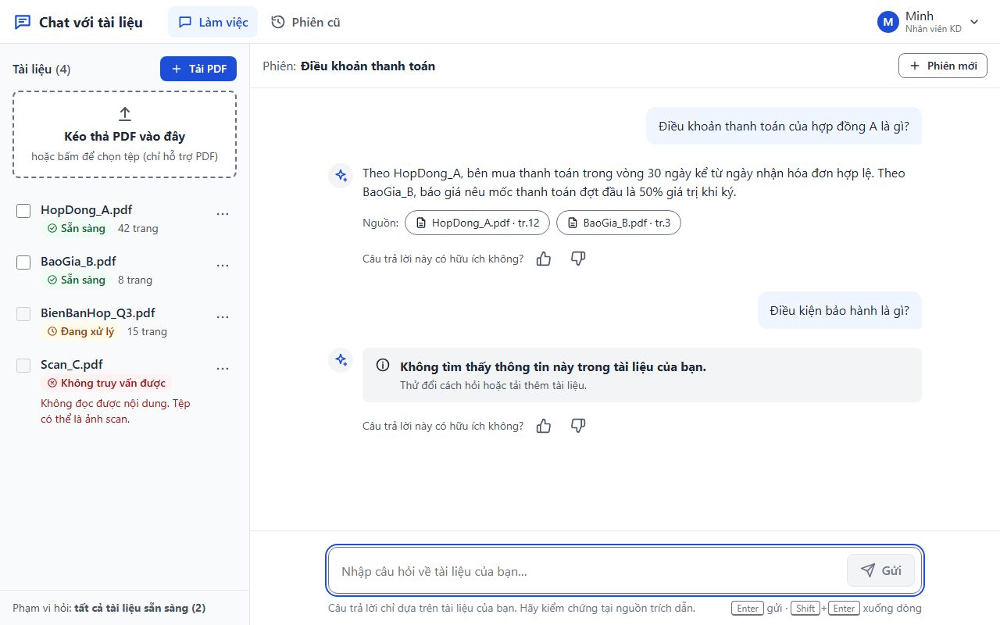

**Tiêu chí chưa có hình minh họa**

- `US-010-AC3`: đo 10 câu hỏi không có đáp án là đánh giá chất lượng (OQ-003).

#### US-011 · FR-011 · P0
**As a** nhân viên KD, **I want** hỏi và nhận câu trả lời bằng tiếng Việt, **so that** làm việc tự nhiên bằng ngôn ngữ của mình.
*Trace:* BR-010 · SN-003 · BO-001 · AC-010 · phạm vi ngôn ngữ `OQ-009`

| AC | Given | When | Then |
|---|---|---|---|
| US-011-AC1 | Tôi hỏi bằng tiếng Việt | Hệ thống trả lời | Câu trả lời viết bằng tiếng Việt |
| US-011-AC2 | 10 câu hỏi tiếng Việt | Tôi gửi từng câu | 10/10 câu trả lời bằng tiếng Việt |
| US-011-AC3 | Tài liệu nguồn viết bằng tiếng Anh `[TBD: OQ-009]` | Tôi hỏi bằng tiếng Việt | Câu trả lời bằng tiếng Việt, trích dẫn giữ nguyên tên tài liệu và số trang |

**Màn hình thiết kế**

> **SCR-02 · Màn hình làm việc** — Hỏi và trả lời bằng tiếng Việt; toàn bộ giao diện và thông báo bằng tiếng Việt. · *Minh họa:* US-011-AC1, US-011-AC2 · [mở bản thiết kế](../design/html_design/scr-02-man-hinh-lam-viec.html)

**Tiêu chí chưa có hình minh họa**

- `US-011-AC3`: tài liệu tiếng Anh chờ OQ-009.

#### US-012 · FR-012 · P0
**As a** nhân viên KD, **I want** nhận câu trả lời trong thời gian ngắn, **so that** công cụ thực sự nhanh hơn tra cứu thủ công.
*Trace:* BR-011 · SN-001 · BO-001 · AC-011 · ngưỡng `OQ-006`

| AC | Given | When | Then |
|---|---|---|---|
| US-012-AC1 | Hệ thống hoạt động bình thường, ≥ 100 câu hỏi kiểm thử chấp nhận | Tôi đo thời gian từ lúc gửi đến lúc hiển thị | ≥ `[TBD: OQ-006]`% câu hỏi có câu trả lời trong `[TBD: OQ-006]` giây |
| US-012-AC2 | Tôi đang chờ câu trả lời | Thời gian chờ kéo dài | Tôi thấy chỉ báo tiến trình |
| US-012-AC3 | Thời gian chờ vượt ngưỡng `[TBD: OQ-006]` | Tôi vẫn chưa nhận được câu trả lời | Tôi có thể hủy hoặc thử lại, nội dung câu hỏi được giữ nguyên |
| US-012-AC4 | Mất kết nối mạng khi đang hỏi | Câu hỏi không gửi được | Tôi thấy thông báo lỗi, câu hỏi vẫn còn trong ô nhập để gửi lại |

**Màn hình thiết kế**

> **SCR-02 · Màn hình làm việc** — Chờ AI: chỉ báo <b>"Đang tìm trong tài liệu…"</b> hiện ngay (≤ 300 ms); nút <b>Hủy</b> thay cho Gửi. · *Minh họa:* US-012-AC2 · [mở bản thiết kế](../design/html_design/scr-02-man-hinh-lam-viec.html)

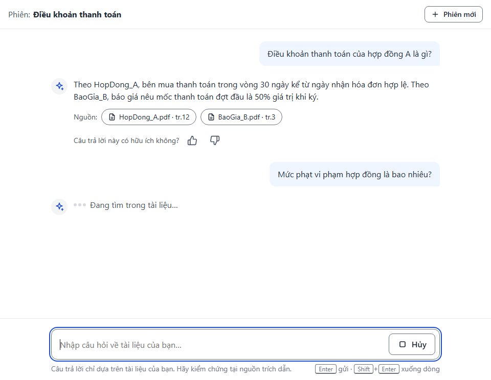

> **SCR-02 · Màn hình làm việc** — Quá hạn: thông báo + <b>Thử lại</b>; câu hỏi được giữ nguyên. · *Minh họa:* US-012-AC3 · [mở bản thiết kế](../design/html_design/scr-02-man-hinh-lam-viec.html#sim=timeout)

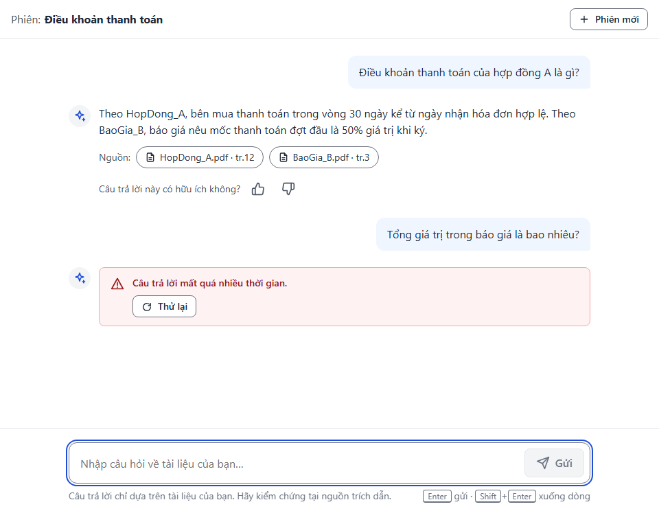

> **SCR-02 · Màn hình làm việc** — Mất mạng khi hỏi: câu hỏi <b>vẫn nằm trong ô nhập</b>, có nút <b>Gửi lại</b>. · *Minh họa:* US-012-AC4 · [mở bản thiết kế](../design/html_design/scr-02-man-hinh-lam-viec.html#sim=network)

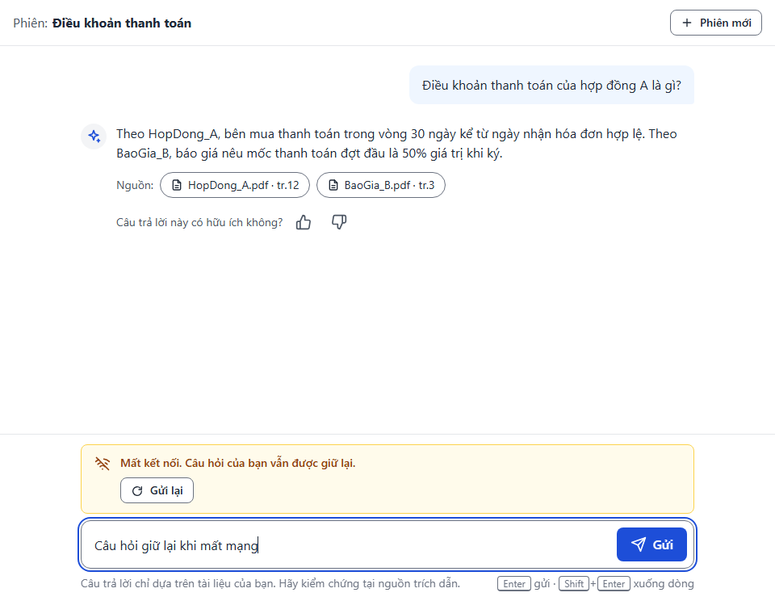

**Tiêu chí chưa có hình minh họa**

- `US-012-AC1`: đo thời gian phản hồi ≥ 100 câu hỏi là kiểm thử hiệu năng, ngưỡng chờ OQ-006.

#### US-013 · FR-013 · P1
**As a** nhân viên KD, **I want** hỏi tiếp dựa trên câu hỏi và trả lời trước, **so that** tôi làm rõ thông tin dần mà không phải nhắc lại bối cảnh.
*Trace:* BR-012 · SN-009 · BO-001 · AC-012

| AC | Given | When | Then |
|---|---|---|---|
| US-013-AC1 | Tôi vừa nhận một câu trả lời về điều khoản X | Tôi hỏi "Còn thời hạn của **nó** thì sao?" | Câu trả lời hiểu "nó" là điều khoản X |
| US-013-AC2 | 5 cặp câu hỏi nối tiếp dùng đại từ thay thế | Chuyên gia chấm | ≥ 4/5 câu trả lời thứ hai đúng ngữ cảnh |
| US-013-AC3 | Tôi bắt đầu phiên hội thoại mới | Tôi hỏi câu có đại từ tham chiếu câu cũ | Hệ thống không dùng ngữ cảnh của phiên trước |

**Màn hình thiết kế**

> **SCR-02 · Màn hình làm việc** — Câu hỏi nối tiếp trong cùng phiên: các lượt hỏi và trả lời xếp liền nhau; nút <b>Phiên mới</b> để bắt đầu phiên khác. · [mở bản thiết kế](../design/html_design/scr-02-man-hinh-lam-viec.html)

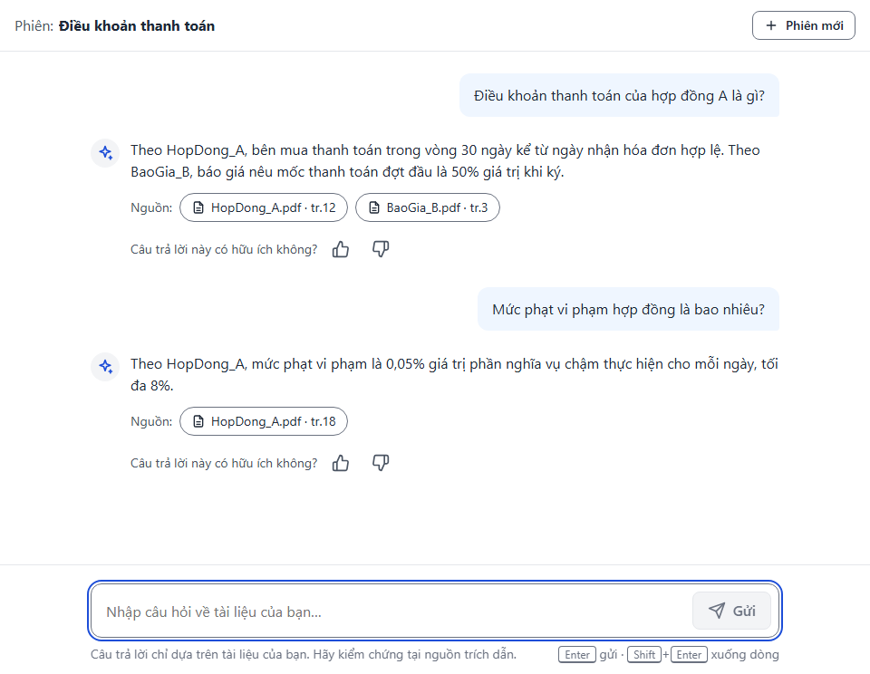

**Tiêu chí chưa có hình minh họa**

- `US-013-AC1`: hiểu đại từ tham chiếu là xử lý ở backend (viết lại câu hỏi, SAD §3.2.2); bản thiết kế chỉ mô phỏng luồng hội thoại.
- `US-013-AC2`: đánh giá chất lượng bằng chuyên gia.
- `US-013-AC3`: cô lập ngữ cảnh giữa các phiên là backend.

#### US-014 · FR-014 · P2
**As a** nhân viên KD, **I want** giới hạn câu hỏi vào một hoặc vài tài liệu tôi chọn, **so that** câu trả lời chính xác hơn khi kho có nhiều tài liệu không liên quan.
*Trace:* BR-013 · SN-001 · BO-002 · AC-013

| AC | Given | When | Then |
|---|---|---|---|
| US-014-AC1 | Tôi chọn chỉ tài liệu A làm phạm vi | Tôi hỏi về nội dung chỉ có trong tài liệu B | Câu trả lời không chứa trích dẫn từ B |
| US-014-AC2 | Tôi bỏ chọn toàn bộ tài liệu | Tôi gửi câu hỏi | Hệ thống yêu cầu chọn ít nhất 1 tài liệu hoặc dùng toàn bộ kho `[Unverified]` |
| US-014-AC3 | Tôi chọn phạm vi trong phiên | Tôi hỏi các câu nối tiếp | Phạm vi được giữ cho đến khi tôi đổi |

**Màn hình thiết kế**

> **SCR-02 · Màn hình làm việc** — Chọn tài liệu làm phạm vi hỏi: chân ngăn hiển thị <b>"1 tài liệu đã chọn"</b> và nút <b>Bỏ chọn</b>. · *Minh họa:* US-014-AC3 · [mở bản thiết kế](../design/html_design/scr-02-man-hinh-lam-viec.html)

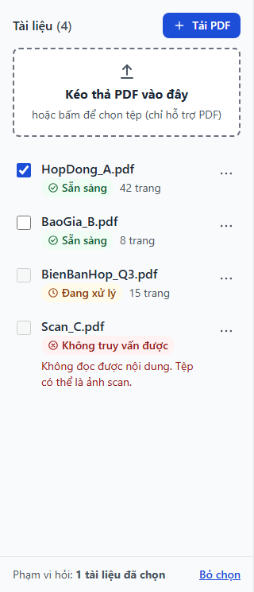

> **SCR-02 · Màn hình làm việc** — Với phạm vi chỉ HopDong_A, câu trả lời <b>chỉ trích dẫn HopDong_A</b>. · *Minh họa:* US-014-AC1 · [mở bản thiết kế](../design/html_design/scr-02-man-hinh-lam-viec.html)

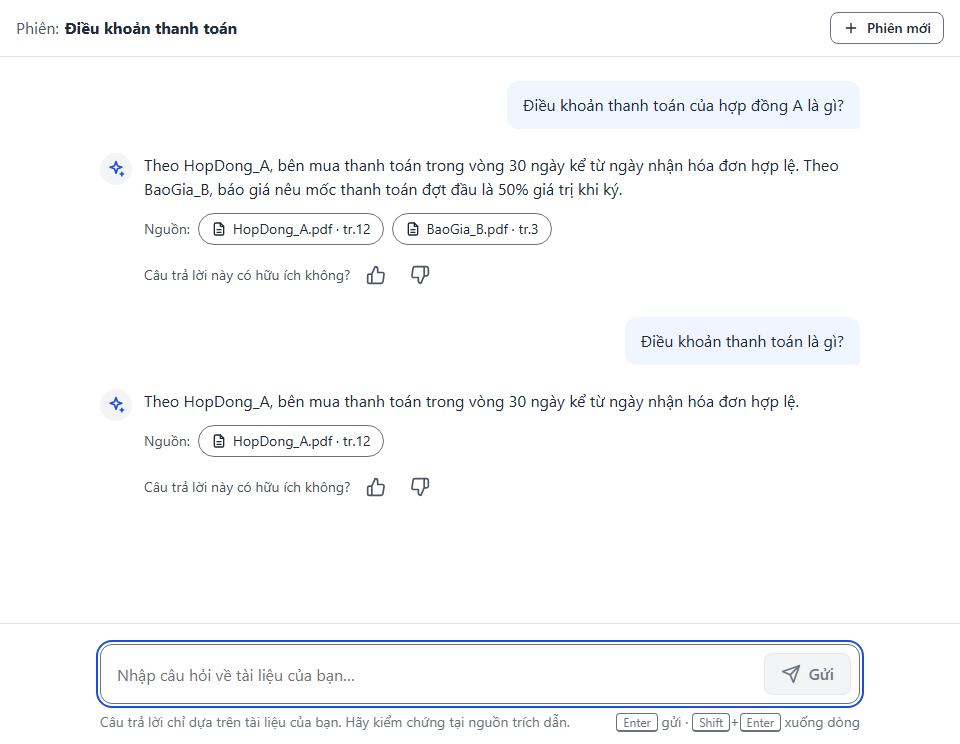

**Tiêu chí chưa có hình minh họa**

- `US-014-AC2`: bỏ chọn hết → dùng toàn bộ kho (nút "Bỏ chọn"); hành vi này là [Unverified], chưa chụp riêng.

---

### E4 — Kiểm chứng câu trả lời

#### US-015 · FR-015 · P0
**As a** nhân viên KD, **I want** mỗi câu trả lời kèm tên tài liệu và số trang nguồn, **so that** tôi kiểm chứng trước khi dùng thông tin.
*Trace:* BR-014 · SN-004 · BO-002 · AC-014 · chờ sponsor xác nhận `OQ-013`

| AC | Given | When | Then |
|---|---|---|---|
| US-015-AC1 | Câu trả lời có nội dung lấy từ tài liệu | Câu trả lời hiển thị | Mỗi nguồn được dùng có trích dẫn gồm tên tài liệu và số trang |
| US-015-AC2 | Câu trả lời tổng hợp từ nhiều tài liệu | Câu trả lời hiển thị | Mỗi tài liệu liên quan có trích dẫn riêng |
| US-015-AC3 | Bộ câu hỏi kiểm thử MET-002 | Chuyên gia đối chiếu | 100% câu trả lời có nội dung từ tài liệu đều có trích dẫn; ≥ `[TBD: OQ-003]`% trích dẫn trỏ đúng tài liệu và trang |
| US-015-AC4 | Tài liệu nguồn đã bị xóa sau khi câu trả lời được tạo | Tôi xem lại câu trả lời cũ | Trích dẫn hiển thị tên tài liệu kèm nhãn "đã xóa" `[Unverified]` |

**Màn hình thiết kế**

> **SCR-02 · Màn hình làm việc** — Mỗi nguồn là một chip <b>"Tên tài liệu · tr.N"</b>; câu trả lời nhiều tài liệu có nhiều chip. · *Minh họa:* US-015-AC1, US-015-AC2 · [mở bản thiết kế](../design/html_design/scr-02-man-hinh-lam-viec.html)

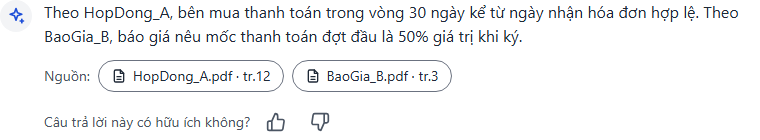

> **SCR-02 · Màn hình làm việc** — Tài liệu nguồn đã bị xóa: chip vẫn giữ tên kèm nhãn <b>"đã xóa"</b>. · *Minh họa:* US-015-AC4 · [mở bản thiết kế](../design/html_design/scr-02-man-hinh-lam-viec.html)

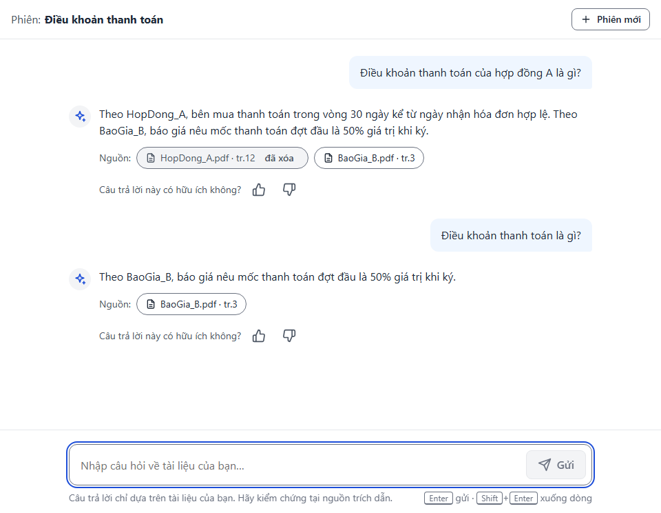

**Tiêu chí chưa có hình minh họa**

- `US-015-AC3`: đo tỉ lệ trích dẫn đúng trên bộ câu hỏi MET-002 (OQ-003).

#### US-016 · FR-016 · P1
**As a** nhân viên KD, **I want** xem đoạn nội dung gốc ứng với mỗi trích dẫn, **so that** tôi kiểm chứng ngay mà không phải mở cả tệp PDF.
*Trace:* BR-015 · SN-004 · BO-002 · AC-015

| AC | Given | When | Then |
|---|---|---|---|
| US-016-AC1 | Câu trả lời có trích dẫn | Tôi nhấp vào một trích dẫn | Tôi thấy đoạn nội dung gốc cùng tên tài liệu và số trang |
| US-016-AC2 | 5 trích dẫn bất kỳ | Tôi mở từng trích dẫn | Mở được đoạn gốc của cả 5 |
| US-016-AC3 | Tôi không còn quyền truy cập tài liệu nguồn | Tôi nhấp vào trích dẫn | Hệ thống từ chối hiển thị đoạn gốc |

**Màn hình thiết kế**

> **SCR-04 · Ngăn xem nguồn** — Ngăn nguồn: tên tài liệu, số trang và <b>đoạn gốc</b>; <kbd>Esc</kbd> đóng và trả tiêu điểm về chip đã bấm. · *Minh họa:* US-016-AC1, US-016-AC2 · [mở bản thiết kế](../design/html_design/scr-04-xem-nguon.html)

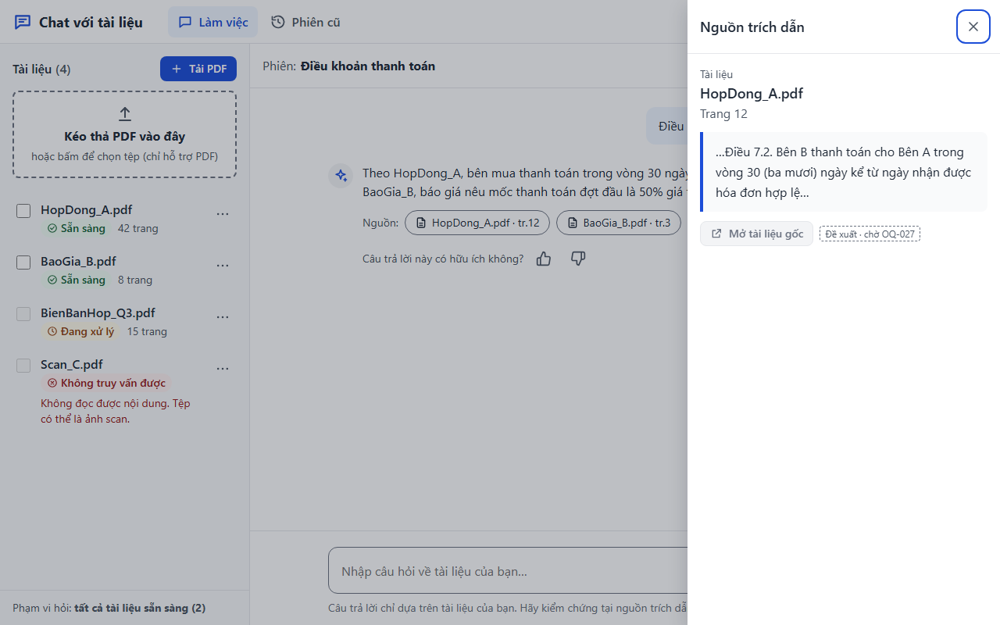

> **SCR-04 · Ngăn xem nguồn** — Nguồn đã bị xóa: thông báo "Nội dung gốc không còn khả dụng". · [mở bản thiết kế](../design/html_design/scr-04-xem-nguon.html#cite=deleted)

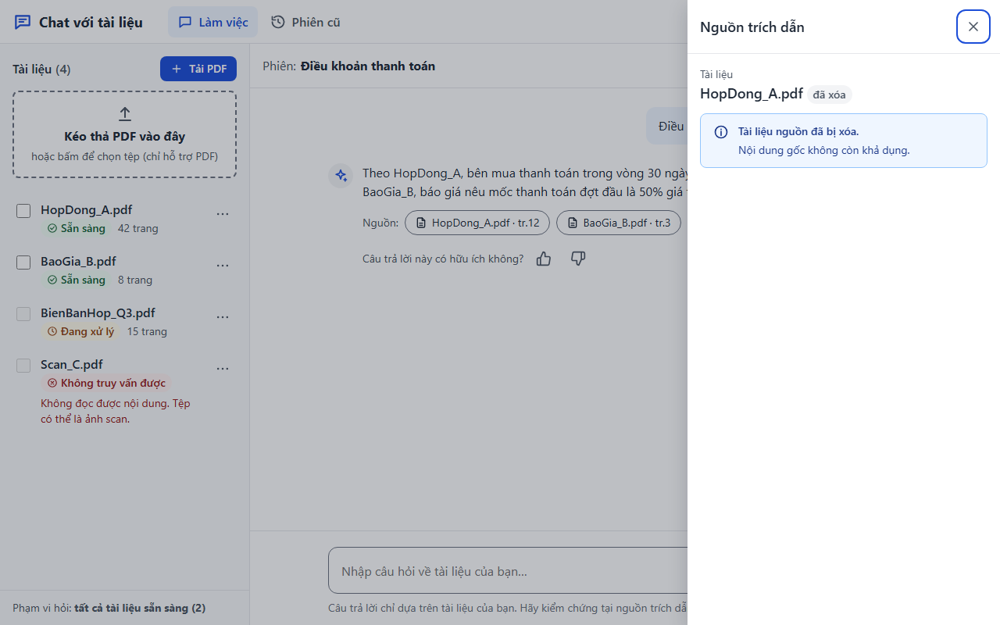

> **SCR-04 · Ngăn xem nguồn** — Không còn quyền xem: <b>"Không tìm thấy nội dung này."</b> (không tiết lộ lý do). · *Minh họa:* US-016-AC3 · [mở bản thiết kế](../design/html_design/scr-04-xem-nguon.html#cite=forbidden)

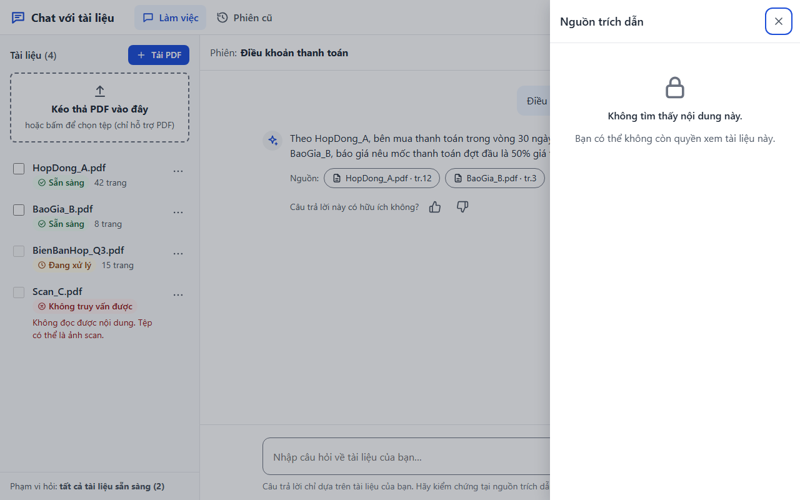

---

### E5 — Quản lý tài liệu

#### US-017 · FR-017 · P0
**As a** nhân viên KD, **I want** xem danh sách tài liệu tôi được phép truy cập, **so that** tôi biết câu trả lời đang dựa trên tập tài liệu nào.
*Trace:* BR-016 · SN-008 · BO-002 · AC-016

| AC | Given | When | Then |
|---|---|---|---|
| US-017-AC1 | Tôi được phép truy cập đúng 3 tài liệu | Tôi mở danh sách | Tôi thấy đúng 3 tài liệu với tên tệp và trạng thái |
| US-017-AC2 | Tôi chưa có tài liệu nào | Tôi mở danh sách | Tôi thấy trạng thái trống kèm nút "Tải PDF lên" |
| US-017-AC3 | Có tài liệu của người khác ngoài phạm vi chia sẻ của tôi | Tôi mở danh sách | Tôi không thấy tài liệu đó |

**Màn hình thiết kế**

> **SCR-02 · Màn hình làm việc** — Danh sách tài liệu được phép truy cập, mỗi tài liệu có tên, số trang và trạng thái. · *Minh họa:* US-017-AC1 · [mở bản thiết kế](../design/html_design/scr-02-man-hinh-lam-viec.html)

> **SCR-02 · Màn hình làm việc** — Kho trống: giải thích và nút <b>Tải PDF lên</b>. · *Minh họa:* US-017-AC2 · [mở bản thiết kế](../design/html_design/scr-02-man-hinh-lam-viec.html#list=empty)

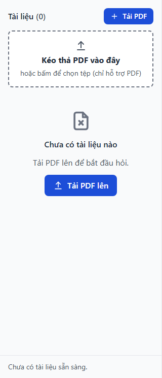

**Tiêu chí chưa có hình minh họa**

- `US-017-AC3`: ẩn tài liệu ngoài phạm vi chia sẻ do backend (US-021, OQ-007).

#### US-018 · FR-018 · P1
**As a** nhân viên KD, **I want** xóa tài liệu do mình tải lên, **so that** loại bỏ tài liệu lỗi thời hoặc tải nhầm.
*Trace:* BR-017 · SN-008 · BO-002 · AC-017

| AC | Given | When | Then |
|---|---|---|---|
| US-018-AC1 | Tôi là người tải lên tài liệu X | Tôi chọn xóa X và xác nhận | X không còn xuất hiện trong danh sách |
| US-018-AC2 | Tôi chọn xóa X | Hộp thoại xác nhận hiện ra | Tôi có thể hủy; X vẫn còn nếu tôi hủy |
| US-018-AC3 | Tài liệu X do người khác tải lên | Tôi xem tùy chọn xóa | Tôi không có quyền xóa X `[TBD: OQ-007]` |

**Màn hình thiết kế**

> **SCR-09 · Hộp thoại xác nhận xóa** — Hộp thoại xác nhận: tiêu điểm mặc định ở nút <b>Hủy</b> (an toàn); <kbd>Esc</kbd> hoặc bấm nền để hủy. · *Minh họa:* US-018-AC2 · [mở bản thiết kế](../design/html_design/scr-09-xac-nhan-xoa.html)

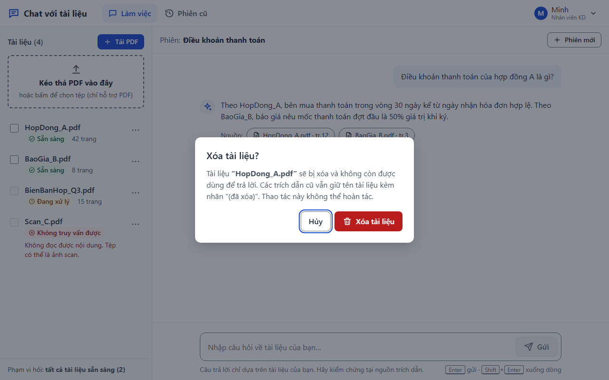

> **SCR-02 · Màn hình làm việc** — Sau khi xác nhận: tài liệu biến khỏi danh sách (còn 3), thông báo <b>"Đã xóa…"</b> tự ẩn sau 5 s. · *Minh họa:* US-018-AC1 · [mở bản thiết kế](../design/html_design/scr-02-man-hinh-lam-viec.html)

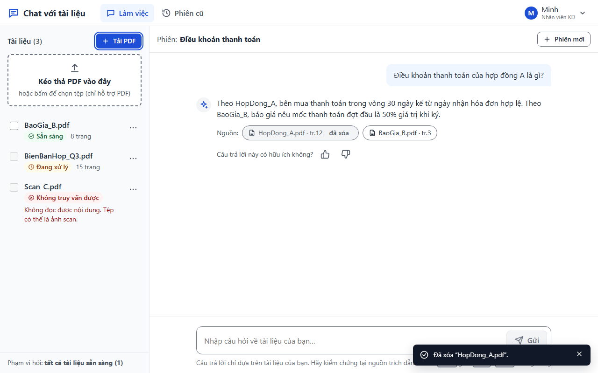

**Tiêu chí chưa có hình minh họa**

- `US-018-AC3`: tài liệu của người khác: menu không có mục Xóa (chỉ chủ sở hữu thấy); đã có trong thiết kế (isOwner) nhưng chưa chụp, chờ OQ-007.

#### US-019 · FR-019 · P0
**As a** nhân viên KD, **I want** tài liệu đã xóa không còn được dùng trong câu trả lời mới, **so that** tôi không nhận thông tin từ nội dung đã hết hiệu lực.
*Trace:* BR-018 · BRU-004 · SN-007 · BO-002 · AC-018

| AC | Given | When | Then |
|---|---|---|---|
| US-019-AC1 | Tôi đã xóa tài liệu X | Tôi hỏi 5 câu chỉ có đáp án trong X | 5/5 câu trả lời không chứa nội dung hay trích dẫn từ X |
| US-019-AC2 | Tôi xóa X trong lúc một câu hỏi đang được xử lý | Câu trả lời được tạo ra sau thời điểm xóa | Câu trả lời không dùng X |
| US-019-AC3 | Tôi đã xóa X | Tôi hỏi câu có đáp án trong X | Hệ thống trả lời theo US-010 (không tìm thấy thông tin) |

**Màn hình thiết kế**

> **SCR-02 · Màn hình làm việc** — Sau khi xóa HopDong_A, câu hỏi mới chỉ dùng <b>BaoGia_B</b>; trích dẫn cũ giữ nhãn "đã xóa". · *Minh họa:* US-019-AC1 · [mở bản thiết kế](../design/html_design/scr-02-man-hinh-lam-viec.html)

**Tiêu chí chưa có hình minh họa**

- `US-019-AC2`: xóa trong lúc câu hỏi đang xử lý là hành vi backend (SAD §3.2.3).
- `US-019-AC3`: trả "không tìm thấy" khi đáp án chỉ có ở tài liệu đã xóa: dùng lại màn hình của US-010.

---

### E6 — Lịch sử hội thoại

#### US-020 · FR-020 · P2
**As a** nhân viên KD, **I want** xem lại các phiên hội thoại trước của mình, **so that** tôi không phải hỏi lại thông tin đã tra cứu.
*Trace:* BR-019 · SN-009 · BO-001 · AC-019 · chờ `OQ-013`, `OQ-015`

| AC | Given | When | Then |
|---|---|---|---|
| US-020-AC1 | Tôi đã đăng xuất và đăng nhập lại | Tôi mở danh sách phiên cũ | Tôi thấy và mở được phiên hội thoại trước đó của mình |
| US-020-AC2 | Có phiên hội thoại của người dùng khác | Tôi xem danh sách phiên | Tôi không thấy phiên của người khác |
| US-020-AC3 | Thời hạn lưu giữ `[TBD: OQ-015]` đã hết | Tôi mở danh sách phiên | Phiên quá hạn không còn hiển thị |

**Màn hình thiết kế**

> **SCR-05 · Phiên cũ** — Danh sách phiên của <b>chính mình</b> (trái) và xem lại chỉ đọc (phải); <b>Tiếp tục phiên này</b> để hỏi thêm; <b>Xem thêm phiên</b> phân trang. · *Minh họa:* US-020-AC1, US-020-AC2 · [mở bản thiết kế](../design/html_design/scr-05-phien-cu.html)

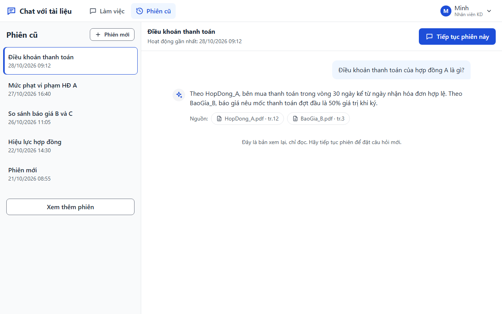

> **SCR-05 · Phiên cũ** — Chưa có phiên nào: hướng dẫn và nút Phiên mới. · [mở bản thiết kế](../design/html_design/scr-05-phien-cu.html#state=empty)

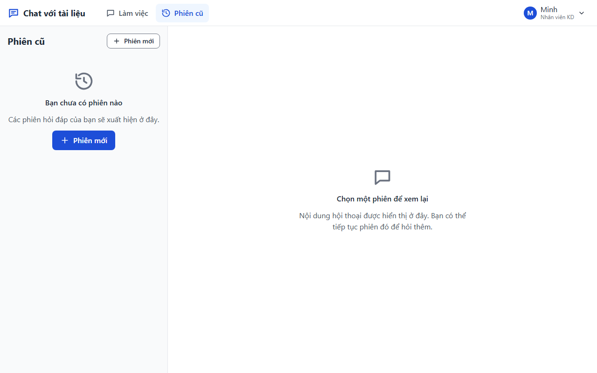

**Tiêu chí chưa có hình minh họa**

- `US-020-AC3`: phiên quá thời hạn lưu giữ chờ OQ-015.

---

### E7 — Phân quyền tài liệu

#### US-021 · FR-021 · P0
**As a** quản trị viên, **I want** tài liệu chỉ hiển thị với người trong phạm vi chia sẻ, **so that** dữ liệu kinh doanh mật không bị lộ cho người không có quyền.
*Trace:* BR-021 · SN-007 · BO-002 · AC-021 · phạm vi chia sẻ chờ `OQ-007`

| AC | Given | When | Then |
|---|---|---|---|
| US-021-AC1 | Tài liệu Y không được chia sẻ cho tôi | Tôi mở danh sách tài liệu | Tôi không thấy Y |
| US-021-AC2 | Y không được chia sẻ cho tôi | Tôi hỏi 5 câu về nội dung riêng của Y | 5/5 câu trả lời không chứa nội dung hay trích dẫn từ Y |
| US-021-AC3 | Quyền truy cập của tôi vào Y bị thu hồi | Tôi hỏi câu có đáp án trong Y | Câu trả lời không dùng Y kể từ thời điểm thu hồi |
| US-021-AC4 | Tôi thử truy cập trực tiếp bằng đường dẫn hoặc mã định danh của Y | Tôi gửi yêu cầu | Hệ thống từ chối và không tiết lộ Y có tồn tại hay không |

**Màn hình thiết kế**

> **SCR-07 · Quản lý người dùng** — Màn hình <b>đề xuất</b> cho quản trị viên: cấp và thu hồi quyền truy cập công cụ (≤ 3 thao tác). · *Minh họa:* US-021-AC3 · [mở bản thiết kế](../design/html_design/scr-07-quan-ly-nguoi-dung.html)

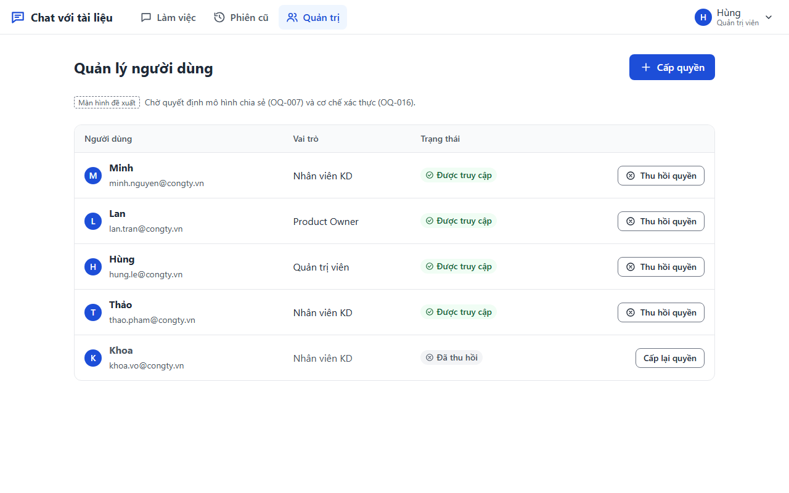

> **SCR-02 · Màn hình làm việc** — Menu tài liệu: mục <b>Chia sẻ…</b> đang ở trạng thái chờ quyết định phạm vi chia sẻ (OQ-007). · [mở bản thiết kế](../design/html_design/scr-02-man-hinh-lam-viec.html)

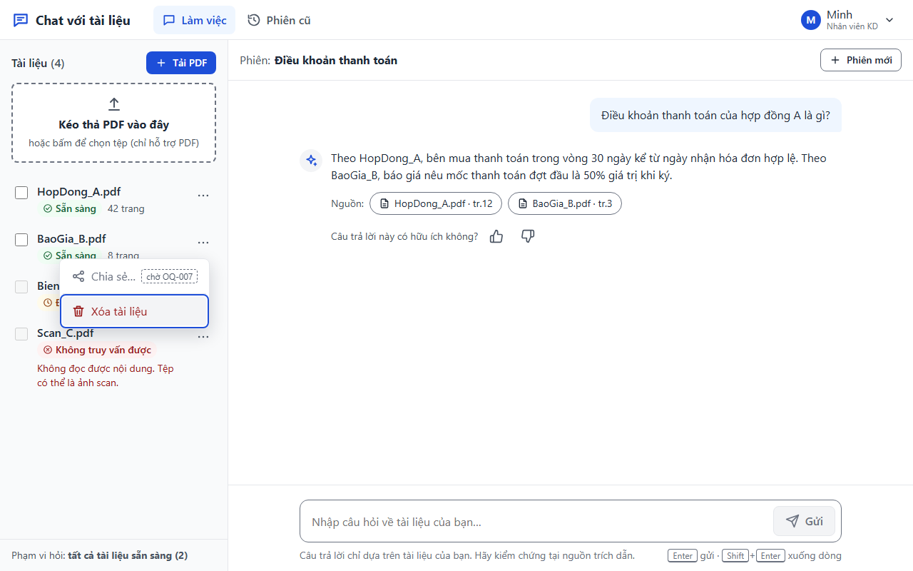

> **SCR-08 · Trang lỗi chung** — Truy cập trực tiếp nội dung ngoài quyền: trang <b>"Không tìm thấy nội dung này."</b>, không tiết lộ sự tồn tại. · *Minh họa:* US-021-AC4 · [mở bản thiết kế](../design/html_design/scr-08-trang-loi.html#state=404)

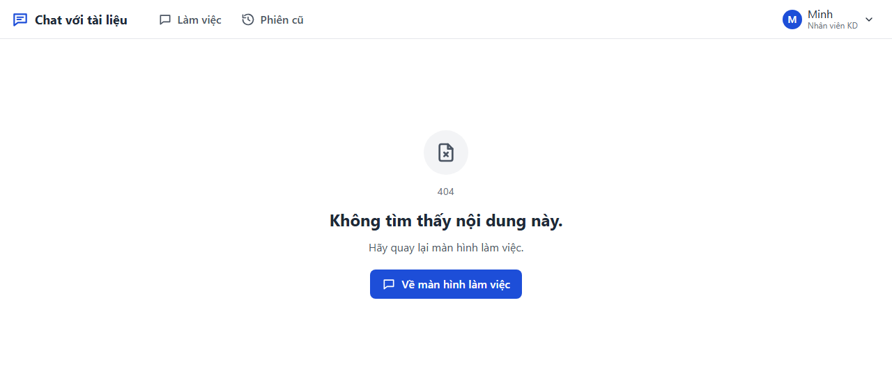

**Tiêu chí chưa có hình minh họa**

- `US-021-AC1`: ẩn tài liệu ngoài phạm vi chia sẻ do backend, mô hình chia sẻ chờ OQ-007.
- `US-021-AC2`: như AC1 (lọc quyền trong truy vấn, SAD §3.2.2).

---

### E8 — Đo lường MVP

#### US-022 · FR-022 · P1
**As a** nhân viên KD, **I want** đánh giá mỗi câu trả lời là "hữu ích" hoặc "không hữu ích", **so that** đội sản phẩm biết chất lượng thực tế và cải thiện công cụ.
*Trace:* BR-022 · SN-006 · BO-003 · AC-022 · MET-004

| AC | Given | When | Then |
|---|---|---|---|
| US-022-AC1 | Tôi vừa nhận một câu trả lời | Tôi chọn "Hữu ích" hoặc "Không hữu ích" | Đánh giá được ghi nhận và hiển thị đã chọn |
| US-022-AC2 | Tôi đã đánh giá một câu trả lời | Tôi đổi lựa chọn | Hệ thống chỉ giữ đánh giá mới nhất cho câu trả lời đó |
| US-022-AC3 | Tôi gửi đánh giá cho 1 câu trả lời | Đến hết tuần | Đánh giá được tính vào MET-004 của tuần đó |

**Màn hình thiết kế**

> **SCR-02 · Màn hình làm việc** — Đánh giá <b>Hữu ích / Không hữu ích</b>: nút giữ trạng thái đã chọn (<code>aria-pressed</code>), thông báo cảm ơn; bấm lại để đổi lựa chọn. · *Minh họa:* US-022-AC1, US-022-AC2 · [mở bản thiết kế](../design/html_design/scr-02-man-hinh-lam-viec.html)

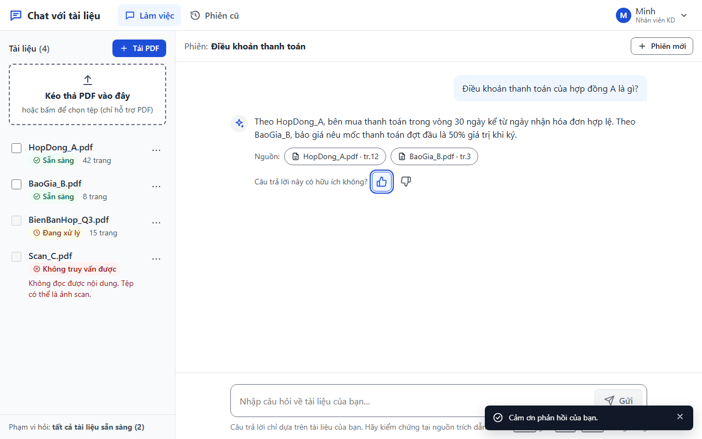

**Tiêu chí chưa có hình minh họa**

- `US-022-AC3`: tính vào MET-004 theo tuần là xử lý ở backend.

#### US-023 · FR-023 · P0
**As a** Product Owner, **I want** nhận báo cáo hằng tuần về số người dùng hoạt động và số câu hỏi, **so that** tôi có số liệu quyết định có đầu tư tiếp sau MVP hay không.
*Trace:* BR-023 · SN-005, SN-006 · BO-003 · AC-023 · MET-003

| AC | Given | When | Then |
|---|---|---|---|
| US-023-AC1 | Pilot đang chạy | Kết thúc mỗi tuần | Tôi nhận báo cáo gồm số người dùng hoạt động và số câu hỏi trong tuần |
| US-023-AC2 | Hai tuần pilot liên tiếp | Tôi đối chiếu báo cáo với mẫu kiểm tra | Mỗi tuần có báo cáo; số câu hỏi lệch ≤ 5% so với số đếm mẫu |
| US-023-AC3 | Trong tuần không có người dùng nào hoạt động | Báo cáo được tạo | Báo cáo hiển thị giá trị 0, không bị bỏ qua |
| US-023-AC4 | Người dùng không phải Product Owner | Truy cập báo cáo | Hệ thống từ chối truy cập |

**Màn hình thiết kế**

> **SCR-06 · Báo cáo tuần** — Báo cáo tuần cho Product Owner: số người dùng hoạt động, số câu hỏi, tỉ lệ hữu ích; đổi tuần bằng mũi tên. · *Minh họa:* US-023-AC1 · [mở bản thiết kế](../design/html_design/scr-06-bao-cao-tuan.html)

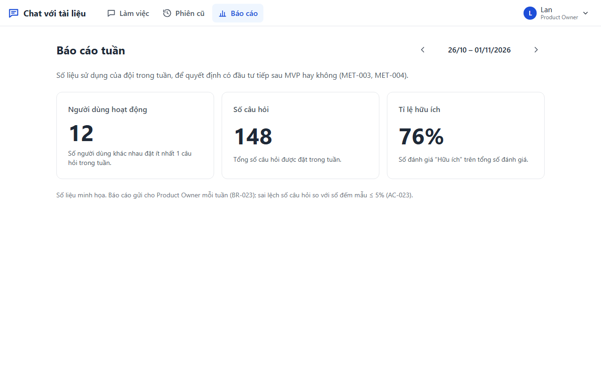

> **SCR-06 · Báo cáo tuần** — Tuần không có hoạt động: hiển thị giá trị <b>0</b>, không để trống. · *Minh họa:* US-023-AC3 · [mở bản thiết kế](../design/html_design/scr-06-bao-cao-tuan.html#role=po&state=zero)

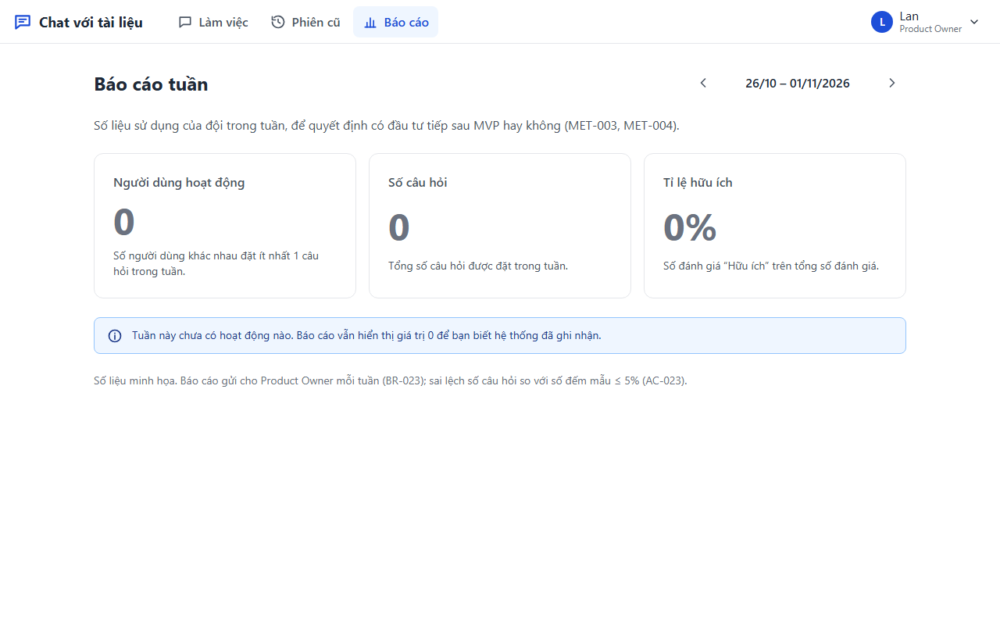

> **SCR-06 · Báo cáo tuần** — Người dùng không phải Product Owner bị từ chối, không nêu lý do. · *Minh họa:* US-023-AC4 · [mở bản thiết kế](../design/html_design/scr-06-bao-cao-tuan.html#role=kd)

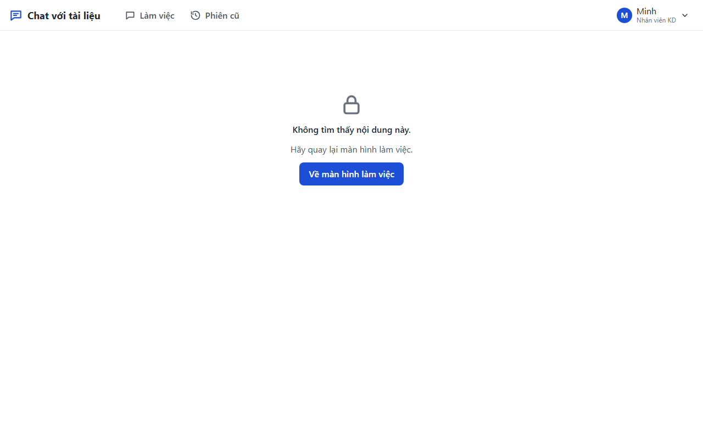

**Tiêu chí chưa có hình minh họa**

- `US-023-AC2`: đối chiếu sai lệch ≤ 5% so với số đếm mẫu là kiểm thử dữ liệu.

---

---

## 4. Ghi chú

- **Chưa có thiết kế:** quy tắc tệp trùng (OQ-020), giới hạn số tệp (OQ-004), tài liệu tiếng Anh (OQ-009), thời hạn lưu giữ phiên (OQ-015), mô hình chia sẻ tài liệu (OQ-007).
- **Màn hình đề xuất:** SCR-07 (quản lý người dùng) chưa có yêu cầu nghiệp vụ tương ứng trong BRD; chờ OQ-007, OQ-016.
- **Giới hạn của ảnh:** chụp bằng trình duyệt Edge ở độ rộng 1280 px (một số ảnh cắt theo từng khung); chưa kiểm tra trên trình duyệt khác (OQ-024) và chưa kiểm thử với người dùng thật.
- **Cập nhật ảnh:** khi bản thiết kế HTML thay đổi, chạy lại script chụp để làm mới ảnh; ảnh nằm trong [user_story_screens](user_story_screens/).
