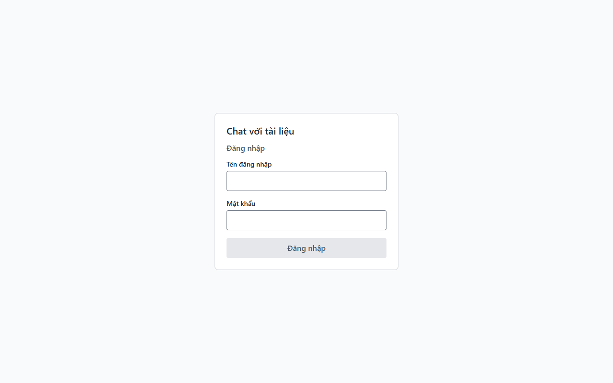
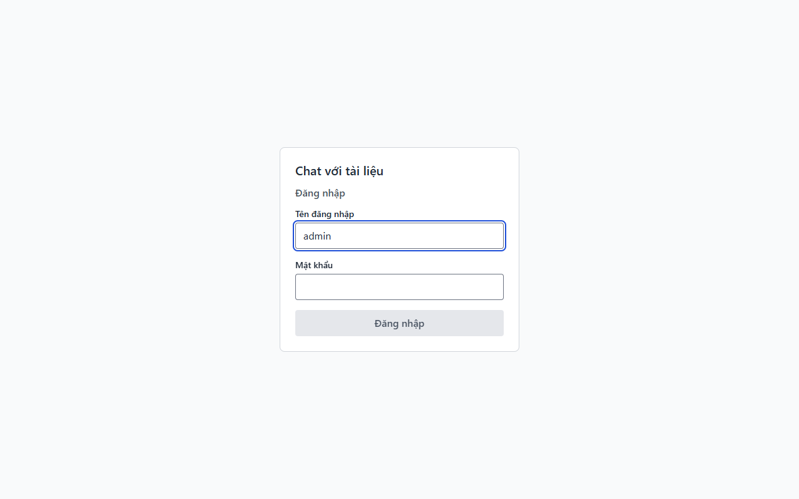
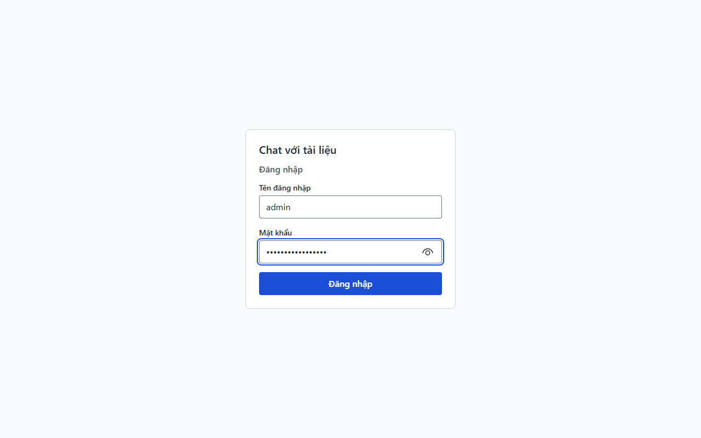
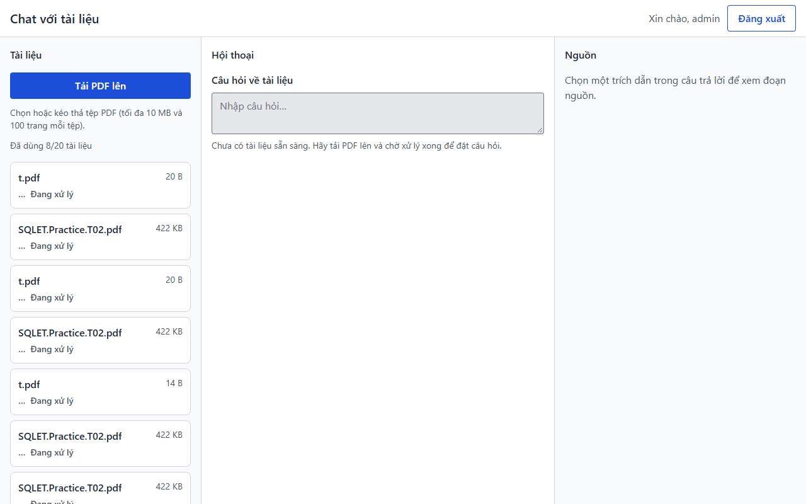
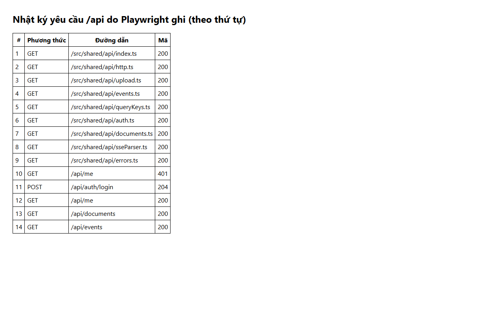

# Báo cáo kiểm thử — E2E-001

- **Kết luận: Đạt**
- Ca kiểm thử: Đăng nhập → vào màn hình chính (tệp: `docs/testing/test_cases/E2E-001.md`)
- Ngày giờ chạy: 2026-11-02T13:24:53.613Z → 2026-11-02T13:25:01.071Z
- Người chạy: agent Claude (Playwright, chạy tự động)
- Trình duyệt: Microsoft Edge 156.0.4314.58 (Playwright, channel msedge); cửa sổ mới, chưa có cookie (tương đương ẩn danh)
- URL kiểm thử: http://localhost:5173/
- Video: [./video/E2E-001.webm](./video/E2E-001.webm)
- Nhật ký console/mạng: [./data/console-va-mang.log](./data/console-va-mang.log)

## Điều kiện tiên quyết đã chuẩn bị

- Backend (cổng 8080) và giao diện chạy; `GET /api/ready` trả 200 trước khi bắt đầu.
- Cửa sổ trình duyệt mới hoàn toàn (không có cookie `DOCCHAT_SESSION`), tương đương InPrivate.
- Tài khoản dev `admin` (mật khẩu không ghi vào báo cáo).

## Bảng thực hiện

| Bước | Hành động đã làm | Kết quả mong đợi | Kết quả thực tế | Đạt? | Ảnh |
|---|---|---|---|---|---|
| 1 | Gắn bộ ghi yêu cầu mạng /api (thay cho DevTools > Network > Preserve log, vì Playwright không chụp được DevTools) | Bộ ghi sẵn sàng, chưa có yêu cầu nào | Bộ ghi mạng đã gắn; số yêu cầu hiện có: 0 | ✔ | — |
| 2 | Mở http://localhost:5173/ khi chưa đăng nhập | Tự chuyển sang /login (URL chứa /login); thấy tiêu đề "Đăng nhập", ô "Tên đăng nhập", ô "Mật khẩu", nút "Đăng nhập" | URL = http://localhost:5173/login?redirect=/; tiêu đề=1, ô tên=1, ô mật khẩu=1, nút=1 | ✔ |  |
| 3 | Quan sát nội dung trang và các yêu cầu mạng trước khi đăng nhập | Không có "Xin chào"/tên tài liệu; có GET /api/me trả 401; KHÔNG có GET /api/documents nào trả 200 | GET /api/me 401: có; GET /api/documents 200: không; có "Xin chào"/tên tệp trên trang: không | ✔ |  |
| 4 | Nhập `admin` vào ô "Tên đăng nhập" | Ô hiển thị `admin` | Giá trị ô = "admin" | ✔ |  |
| 5 | Nhập mật khẩu dev vào ô "Mật khẩu" | Ký tự hiển thị dạng chấm (type=password), không lộ chữ rõ | Thuộc tính type của ô = "password" | ✔ |  |
| 6 | Bấm nút "Đăng nhập" | Chuyển về `/`; POST /api/auth/login trả 204 | URL = http://localhost:5173/; POST /api/auth/login = 204 | ✔ |  |
| 7 | Quan sát màn hình chính sau đăng nhập | Thấy "Xin chào, admin", nút "Đăng xuất", vùng "Tài liệu" (nút "Tải PDF lên" hoặc "Chưa có tài liệu nào"), vùng "Hội thoại" với "Câu hỏi về tài liệu" | Xin chào, admin: có; Đăng xuất: có; Tài liệu: có; Tải PDF lên hoặc Chưa có tài liệu nào: có; Hội thoại: có; Câu hỏi về tài liệu: có | ✔ |  |
| 8 | Đối chiếu thứ tự yêu cầu mạng: GET /api/documents chỉ xuất hiện (200) sau POST /api/auth/login (204) | Không có GET /api/documents 200 trước đăng nhập; có sau đăng nhập | Vị trí POST login 204 = #11; GET /api/documents 200 đầu tiên = #13 | ✔ |  |

Chú giải: ✔ đạt · ✘ không đạt · — không chạy được (xem cột "Kết quả thực tế" để biết lý do).

## Lỗi phát hiện

Không phát hiện lỗi mới trong phạm vi ca này.

## Ghi chú, hạn chế, đề xuất

- Bước 1 và 8 dùng bộ ghi mạng của Playwright thay cho tab Network của DevTools (Playwright không chụp được DevTools); nhật ký đầy đủ ở `data/nhat-ky-mang.json`.
- Mật khẩu không xuất hiện trong ảnh (ô mật khẩu hiển thị dạng chấm) và không ghi vào báo cáo.
- Nội dung bước 7 chỉ kiểm sự hiện diện của các thành phần; không kiểm bố cục/thị giác (thuộc ca TC-UI-VISUAL).
