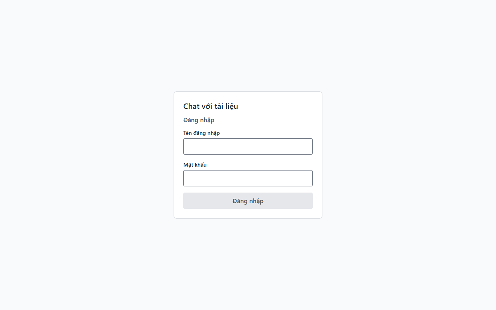
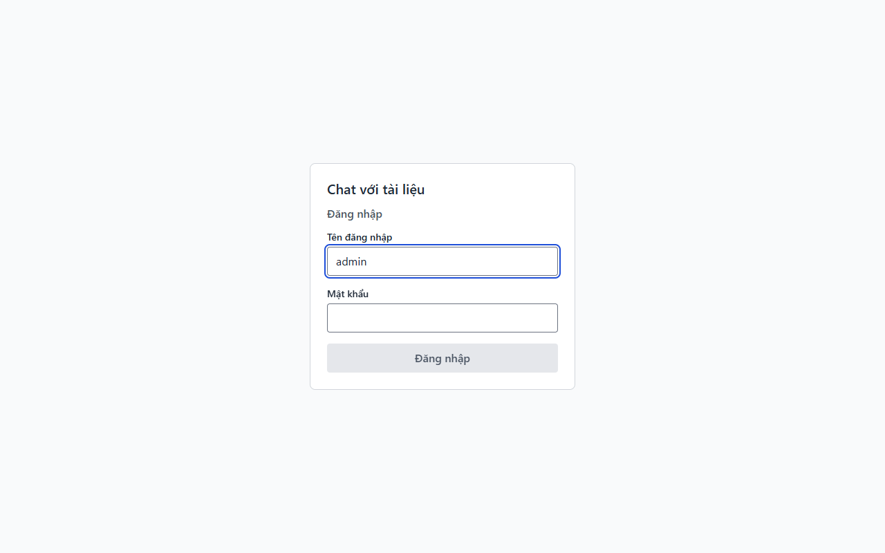
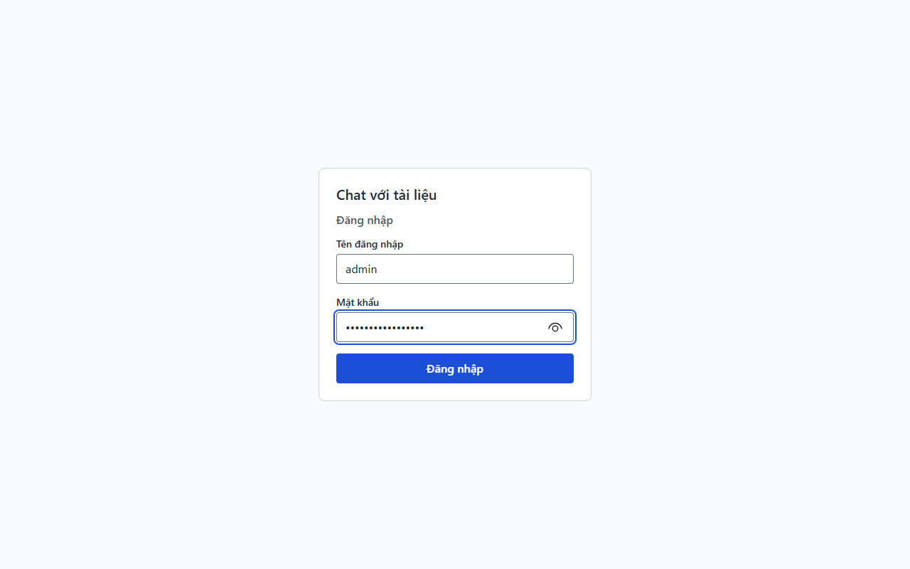
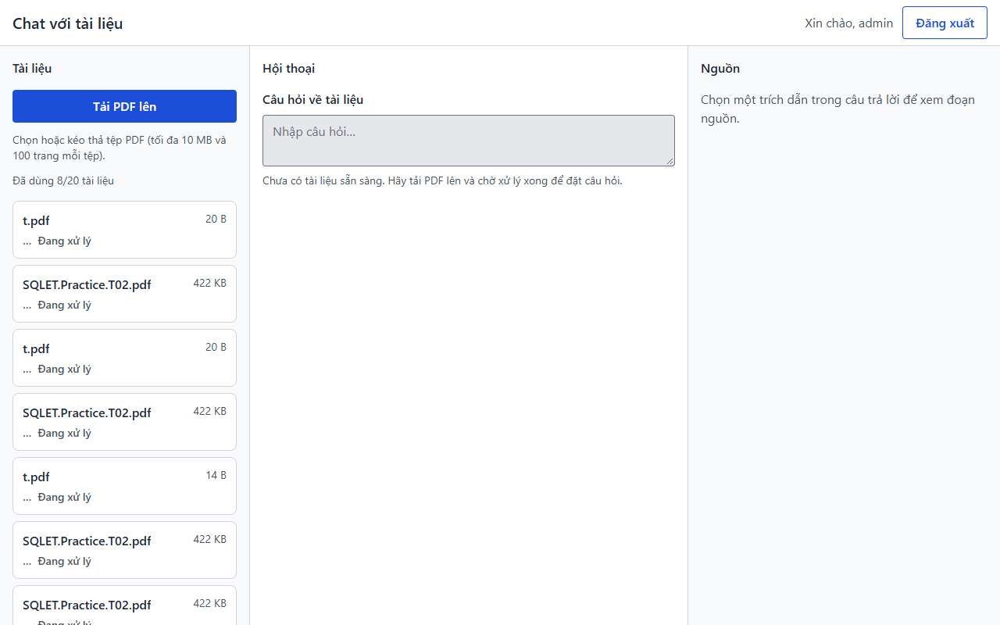
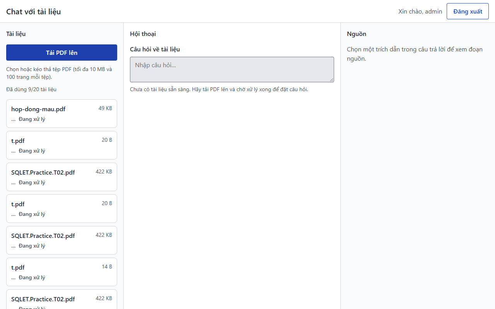

# Báo cáo kiểm thử — E2E-002

- **Kết luận: Bị chặn**
- Ca kiểm thử: Lần đầu: tải PDF → chờ sẵn sàng → hỏi → xem nguồn (tệp: `docs/testing/test_cases/E2E-002.md`)
- Ngày giờ chạy: 2026-11-02T13:25:53.825Z → 2026-11-02T13:27:03.821Z
- Người chạy: agent Claude (Playwright, chạy tự động)
- Trình duyệt: Microsoft Edge 156.0.4314.58 (Playwright, channel msedge); cửa sổ mới, chưa có cookie (tương đương ẩn danh)
- URL kiểm thử: http://localhost:5173/
- Video: [./video/E2E-002.webm](./video/E2E-002.webm)
- Nhật ký console/mạng: [./data/console-va-mang.log](./data/console-va-mang.log)

## Điều kiện tiên quyết đã chuẩn bị

- Backend (cổng 8080) và giao diện chạy; `GET /api/ready` trả 200 trước khi bắt đầu.
- Tạo `data/hop-dong-mau.pdf` bằng Edge (page.pdf): 3 trang có chữ thật, trang 2 có câu "Thời hạn bảo hành là 24 tháng."; kích thước 50404 byte (< 10 MB), 5 byte đầu = "%PDF-".
- Kho tài liệu dev còn chỗ (dưới 20 tài liệu). Câu hỏi dùng ở bước 9: "Thời hạn bảo hành là bao lâu?"; đáp án kỳ vọng "24 tháng" ở trang 2.

## Bảng thực hiện

| Bước | Hành động đã làm | Kết quả mong đợi | Kết quả thực tế | Đạt? | Ảnh |
|---|---|---|---|---|---|
| 1 | Mở http://localhost:5173/login (cửa sổ mới, chưa có cookie) | Thấy tiêu đề "Đăng nhập", ô "Tên đăng nhập", ô "Mật khẩu", nút "Đăng nhập" | Có đủ tiêu đề, 2 ô nhập và nút: true | ✔ |  |
| 2 | Nhập `admin` vào ô "Tên đăng nhập" | Ô hiển thị `admin` | Giá trị ô = "admin" | ✔ |  |
| 3 | Nhập mật khẩu dev vào ô "Mật khẩu" | Ký tự hiển thị dạng chấm (type=password) | type của ô = "password" | ✔ |  |
| 4 | Bấm nút "Đăng nhập" | Chuyển về `/`; thấy "Xin chào, admin" và nút "Đăng xuất"; POST /api/auth/login trả 204 | URL = http://localhost:5173/; login = 204; "Xin chào, admin": true; "Đăng xuất": true; đã dùng trước khi tải: 8/20 | ✔ |  |
| 5 | Bấm nút "Tải PDF lên" (Playwright chặn hộp thoại chọn tệp bằng sự kiện filechooser) | Hộp thoại chọn tệp mở ra (sự kiện filechooser phát sinh), cho phép chọn nhiều tệp | Sự kiện filechooser phát sinh; cho chọn nhiều tệp: true | ✔ |  |
| 6 | Chọn tệp `data/hop-dong-mau.pdf` trong hộp thoại | Xuất hiện hàng `hop-dong-mau.pdf` với trạng thái "Đã tải lên, đang xử lý" rồi "Đang xử lý"; bộ đếm "Đã dùng n/20" tăng 1; POST /api/documents trả 202 | POST /api/documents = 202; có hàng hop-dong-mau.pdf: true; "Đang xử lý": true; bộ đếm 8 → 9 | ✔ |  |
| 7 | Chờ tối đa 60 giây, quan sát trạng thái hàng `hop-dong-mau.pdf` (kiểm tra mỗi 2 giây) | Theo thiết kế: nhãn chuyển thành "Sẵn sàng" không cần tải lại trang | Sau 61 giây trạng thái hàng: "hop-dong-mau.pdf 49 KB" — vẫn "Đang xử lý", KHÔNG chuyển "Sẵn sàng" (T08 chưa hiện thực) → điểm bị chặn | ✘ |  |
| 8 | Quan sát ô "Câu hỏi về tài liệu" | Hiện nay: ô bị khóa kèm "Chưa có tài liệu sẵn sàng. Hãy tải PDF lên và chờ xử lý xong để đặt câu hỏi." | Ô nhập bị khóa: true; có dòng giải thích đúng nguyên văn: true | ✔ |  |
| 9 | Nhập "Thời hạn bảo hành là bao lâu?" vào ô "Câu hỏi về tài liệu" rồi gửi | Câu trả lời hiện dần, chứa "24 tháng" và trích dẫn dạng [1] | KHÔNG CHẠY ĐƯỢC — tính năng chưa hiện thực (không có xử lý nền T08 để tài liệu thành "Sẵn sàng" và chưa có hỏi đáp/trích dẫn); không thể quan sát kết quả nên không ghi Đạt. | — | — |
| 10 | Bấm trích dẫn [1] trong câu trả lời | Ngăn "Nguồn" mở, đúng tên `hop-dong-mau.pdf`, đúng trang 2, đoạn nguồn được làm nổi | KHÔNG CHẠY ĐƯỢC — tính năng chưa hiện thực (không có xử lý nền T08 để tài liệu thành "Sẵn sàng" và chưa có hỏi đáp/trích dẫn); không thể quan sát kết quả nên không ghi Đạt. | — | — |
| 11 | Đối chiếu việc người dùng mới hoàn thành chuỗi mà không cần trợ giúp ngoài | Mọi bước đều có chỉ dẫn trên màn hình | KHÔNG CHẠY ĐƯỢC — tính năng chưa hiện thực (không có xử lý nền T08 để tài liệu thành "Sẵn sàng" và chưa có hỏi đáp/trích dẫn); không thể quan sát kết quả nên không ghi Đạt. | — | — |

Chú giải: ✔ đạt · ✘ không đạt · — không chạy được (xem cột "Kết quả thực tế" để biết lý do).

## Lỗi phát hiện

Không phát hiện lỗi mới trong phạm vi ca này.

## Ghi chú, hạn chế, đề xuất

- Ca kết luận **Bị chặn**: chuỗi "tải → chờ Sẵn sàng → hỏi → xem nguồn" không thể hoàn tất vì tài liệu không bao giờ rời trạng thái "Đang xử lý" (T08 chưa làm) và chưa có hỏi đáp/trích dẫn (T14–T16). Bước 1–6 và 8 cho thấy phần đã làm hoạt động đúng; bước 7 không đạt là hệ quả của việc chưa hiện thực, không phải lỗi mới.
- Hộp thoại chọn tệp của hệ điều hành không chụp được; Playwright chặn bằng sự kiện filechooser và ảnh chụp là trang web ngay sau đó.
- Tệp thử `hop-dong-mau.pdf` đã được tải thật vào kho dev nên đang chiếm 1 trong 20 chỗ (chưa có chức năng xóa tài liệu). Muốn làm sạch kho: xóa `apps/api/target/dev-postgres` rồi khởi động lại backend dev.
- Nhãn nút gửi câu hỏi chưa có trong giao diện (ô nhập luôn bị khóa), nên bước 9 chưa thể chỉ rõ nút.
